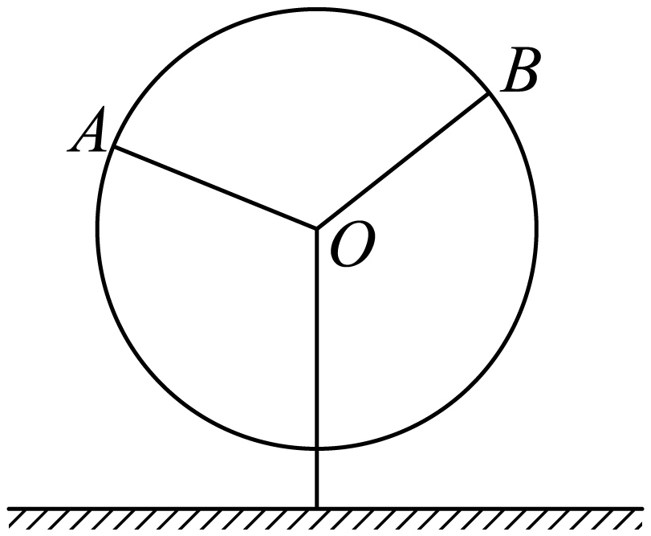

# Mathematics - 题目 3339

**ID**: 927a09e54dcf4a0da3a23ef46b7f0f13
**年级**: Grade 10
**难度**: Medium-Hard
**题型**: Calculation

## 题目
如图所示，摩天轮直径为110m，最高点距离地面120m，相当于40层楼高，摩天轮的圆周上均匀的安装了48个透明座舱，每个座舱最多可坐8人，整个摩天轮可同时供380余人观光，并且运行时按逆时针匀速旋转，转一周需要30min．（1）某游客自最低点处登上摩天轮，请问5min后他距离地面的高度是多少？（2）若甲、乙两游客分别坐在A，B两个座舱里，且他们之间间隔15个座舱，求A，B两个座舱的直线距离；​​​​​​​‌

## 解答

1. （1）设游客高度为 $h$ ，所用时间为 $t$ ，依题意： $h=A\sin \left ({ωt+φ}\right )+B$ （ $A>0$ , $ω>0$ , $-{\rm{π}}<φ<{\rm{π}}$ ）.
2. 由 $\left ({A+B}\right )-\left ({B-A}\right )=110$  $\Rightarrow $  $A=55$ ；由 $A+B=120$  $\Rightarrow $  $B=120-A=65$ .
3. 由 $T=\frac {2{\rm{π}}}{ω}=30$  $\Rightarrow $  $ω=\frac {{\rm{π}}}{15}$ ；由 $h\left ({0}\right )=-55+65=-10$  $\Rightarrow $  $\sin φ=-1$ ，所以 $φ=-\frac {{\rm{π}}}{2}$ .
4. 所以 $h=55\sin \left ({\frac {{\rm{π}}}{15}t-\frac {{\rm{π}}}{2}}\right )+65$ .
5. 当 $t=5$ 时， $h=55\sin \left ({\frac {{\rm{π}}}{15}\times 5-\frac {{\rm{π}}}{2}}\right )+65$  $=-\frac {55}{2}+65$  $=\frac {75}{2}=37.5$ .
6. 所以游客自最低点处登上摩天轮，5min后他距离地面的高度是 $37.5$  ${\rm{m}}$ .
7. （2）因为 $A,B$ 之间间隔15个座舱，所以 $\angle AOB=\frac {2{\rm{π}}}{48}\times 16=\frac {2{\rm{π}}}{3}$ .
8. 在 $\vartriangle AOB$ 中， $AB=55{\cos}30{}\degree \times 2=55\sqrt {3}$ .
9. 所以A，B两个座舱的直线距离为 $55\sqrt {3}$  ${\rm{m}}$ .

## 知识点

**中文**:
  - 在实际问题中建立三角函数模型

**English**:
  - Modeling Real-world Problems

---
