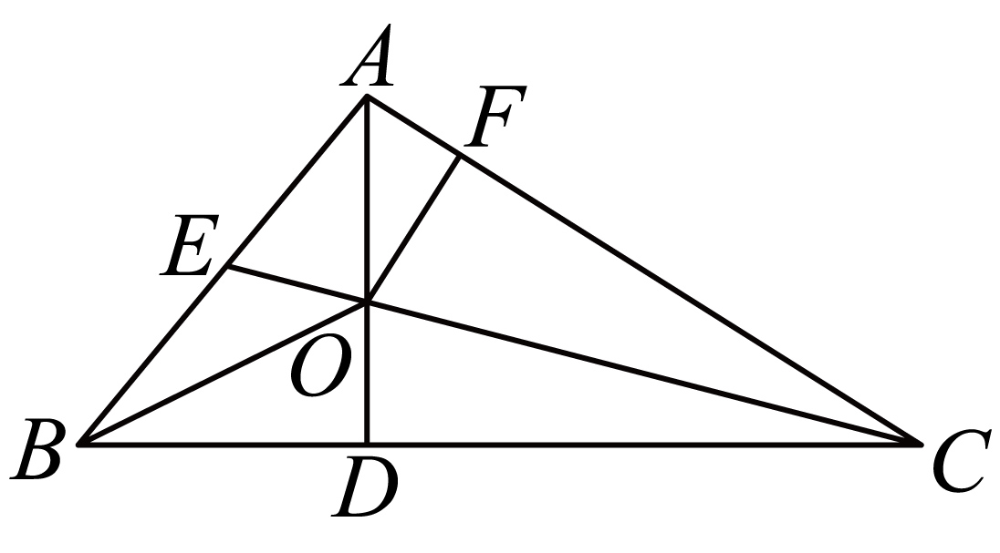

# Mathematics - 题目 3737

**ID**: a364405f5e644d0db9473c7ccaf06860
**年级**: Grade 10
**难度**: Medium-Hard
**题型**: Calculation

## 题目
如图，在 $\mathrm{△}ABC$ 中， $\overrightarrow {{AE}}=\overrightarrow {{EB}},\overrightarrow {{CD}}=2\overrightarrow {{DB}}$ ，点 $O$ 为 $AD$ 和 $CE$ 的交点，设 $\overrightarrow {{BA}}=\overrightarrow {{a}},\overrightarrow {{BC}}=\overrightarrow {{b}}$ ．(1)若 $\overrightarrow {{BO}}=x\overrightarrow {{a}}+y\overrightarrow {{b}}$ ，求 $x,y$ 的值；​​​​​​​‌(2)若 $F$ 在 $AC$ 上， $OF\bot AC$ ，且 $\left |{\overrightarrow {{a}}}\right |=2\left |{\overrightarrow {{b}}}\right |=10$ ，求 $\frac {\left |{\overrightarrow {{CF}}}\right |}{\left |{\overrightarrow {{CA}}}\right |}$ 的取值范围．

## 解答

1. （1）由题意，因为 $\overrightarrow {{AE}}=\overrightarrow {{EB}},\overrightarrow {{CD}}=2\overrightarrow {{DB}}$ ，所以 $\overrightarrow {{BE}}=\frac {1}{2}\overrightarrow {{BA}},\overrightarrow {{BD}}=\frac {1}{3}\overrightarrow {{BC}}$ .
2. 设 $\overrightarrow {{EO}}=λ\overrightarrow {{EC}},\overrightarrow {{AO}}=μ\overrightarrow {{AD}}$ ，
3. 则 $\overrightarrow {{BO}}-\overrightarrow {{BE}}=λ\left ({\overrightarrow {{BC}}-\overrightarrow {{BE}}}\right )$ ，即 $\overrightarrow {{BO}}=λ\overrightarrow {{BC}}+\left ({1-λ}\right )\overrightarrow {{BE}}=λ\overrightarrow {{BC}}+\frac {1-λ}{2}\overrightarrow {{BA}}=λ\overrightarrow {{b}}+\frac {1-λ}{2}\overrightarrow {{a}}$ ,
4. $\overrightarrow {{BO}}-\overrightarrow {{BA}}=μ\left ({\overrightarrow {{BD}}-\overrightarrow {{BA}}}\right )$ ，即 $\overrightarrow {{BO}}=\left ({1-μ}\right )\overrightarrow {{BA}}+μ\overrightarrow {{BD}}=\left ({1-μ}\right )\overrightarrow {{BA}}+\frac {1}{3}μ\overrightarrow {{BC}}=\left ({1-μ}\right )\overrightarrow {{a}}+\frac {1}{3}μ\overrightarrow {{b}}$ ，
5. 所以 $\begin{cases}\frac {1-λ}{2}=1-μ\\λ=\frac {1}{3}μ\end{cases}$ ，解得 $\begin{cases}λ=\frac {1}{5}\\μ=\frac {3}{5}\end{cases}$ ，所以 $\overrightarrow {{BO}}=\frac {2}{5}\overrightarrow {{a}}+\frac {1}{5}\overrightarrow {{b}}$ ，
6. 所以 $x=\frac {2}{5},y=\frac {1}{5}$ .
7. （2）由（1）可知， $\overrightarrow {{EO}}=\frac {1}{5}\overrightarrow {{EC}},$ 所以 $\overrightarrow {{OC}}=\frac {4}{5}\overrightarrow {{EC}}=\frac {4}{5}\left ({\overrightarrow {{BC}}-\overrightarrow {{BE}}}\right )=\frac {4}{5}\left ({\overrightarrow {{BC}}-\frac {1}{2}\overrightarrow {{BA}}}\right )=\frac {4}{5}\overrightarrow {{BC}}-\frac {2}{5}\overrightarrow {{BA}}=\frac {4}{5}\overrightarrow {{b}}-\frac {2}{5}\overrightarrow {{a}}$ .
8. 设 $\overrightarrow {{CF}}=k\overrightarrow {{CA}}$ ， $\overrightarrow {{a}}$ 与 $\overrightarrow {{b}}$ 的夹角为 $θ$ ，其中 $θ\in \left ({0,{\rm{π}}}\right )$ ，
9. 则 $\overrightarrow {{OF}}=\overrightarrow {{OC}}+\overrightarrow {{CF}}=\overrightarrow {{OC}}+k\overrightarrow {{CA}}=\overrightarrow {{OC}}+k\left ({\overrightarrow {{BA}}-\overrightarrow {{BC}}}\right )$
10. $=\frac {4}{5}\overrightarrow {{b}}-\frac {2}{5}\overrightarrow {{a}}+k\left ({\overrightarrow {{a}}-\overrightarrow {{b}}}\right )=\left ({k-\frac {2}{5}}\right )\overrightarrow {{a}}+\left ({\frac {4}{5}-k}\right )\overrightarrow {{b}}$ ，
11. 而 $\overrightarrow {{AC}}=\overrightarrow {{BC}}-\overrightarrow {{BA}}=\overrightarrow {{b}}-\overrightarrow {{a}}$ ，
12. 因为 $OF\bot AC$ ，所以 $\overrightarrow {{OF}}\cdot \overrightarrow {{AC}}=\left [\left ({k-\frac {2}{5}}\right )\overrightarrow {{a}}+\left ({\frac {4}{5}-k}\right )\overrightarrow {{b}}\right ]\cdot \left ({\overrightarrow {{b}}-\overrightarrow {{a}}}\right )=0$ ,
13. 即 $\left ({\frac {2}{5}-k}\right )\overrightarrow {{a}}{^{2}}+\left ({\frac {4}{5}-k}\right )\overrightarrow {{b}}{^{2}}+\left ({2k-\frac {6}{5}}\right )\overrightarrow {{a}}\cdot \overrightarrow {{b}}=0$ ，
14. 因为 $\left |{\overrightarrow {{a}}}\right |=2\left |{\overrightarrow {{b}}}\right |=10$ ，所以 $\left ({\frac {2}{5}-k}\right )\times 10{^{2}}+\left ({\frac {4}{5}-k}\right )\times 5{^{2}}+\left ({2k-\frac {6}{5}}\right )\times 10\times 5{\cos}θ=0$ ，
15. 解得 ${\cos}θ=\frac {25k-12}{20k-12}$ .
16. 因为 $θ\in \left ({0,{\rm{π}}}\right )$ ，所以 ${\cos}θ\in \left ({-1,1}\right )$ ，即 $-1<\frac {25k-12}{20k-12}<1$ ，解得 $0<k<\frac {8}{15}$ .
17. 所以 $\frac {\left |{\overrightarrow {{CF}}}\right |}{\left |{\overrightarrow {{CA}}}\right |}$ 的取值范围是 $\left ({0,\frac {8}{15}}\right )$ .

## 知识点

**中文**:
  - 向量模的计算
  - 向量线性综合运算

**English**:
  - Calculation of Vector Modulus
  - Comprehensive Linear Operations

---
