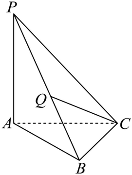

# Mathematics - 题目 1550

**ID**: a661fa038f6e49fd87f19481e7e2c583
**年级**: Grade 10
**难度**: Medium-Hard
**题型**: Calculation

## 题目
离散曲率是刻画空间弯曲性的重要指标．设P为多面体M的一个顶点，定义多面体M在点P处的离散曲率为 $φ{{}_{P}}=1-\frac {1}{2{\rm{π}}}\left ({\angle Q{{}_{1}}PQ{{}_{2}}+\angle Q{{}_{2}}PQ{{}_{3}}+\cdots +\angle Q{{}_{k-1}}PQ{{}_{k}}+\angle Q{{}_{k}}PQ{{}_{1}}}\right )$ ，其中 $Q{{}_{i}}(i=1,2,\cdots ,k,k\geqslant 3)$ 为多面体M的所有与点P相邻的顶点，且平面 $Q{{}_{1}}PQ{{}_{2}}$ ，平面 $Q{{}_{2}}PQ{{}_{3}}$ ，…，平面 $Q{{}_{k-1}}PQ{{}_{k}}$ 和平面 $Q{{}_{k}}PQ{{}_{1}}$ 为多面体M的所有以P为公共点的面．已知三棱锥 $P-ABC$ 如图所示．（1）求三棱锥 $P-ABC$ 在各个顶点处的离散曲率的和；​​​​​​​‌（2）若 $PA\bot $ 平面 ${\rm \mathit{ABC}，}AC\bot BC$ ， $AC=BC=4$ ，三棱锥 $P-ABC$ 在顶点C处的离散曲率为 $\frac {3}{8}$ ，求点A到平面PBC的距离；（3）在（2）的前提下，又知点Q在棱PB上，直线CQ与平面ABC所成角的余弦值为 $\frac {\sqrt {30}}{6}$ ，求BQ的长度．

## 解答

1. （1）根据离散曲率的定义得 $φ{{}_{P}}=1-\frac {1}{2{\rm{π}}}\left ({\angle APB+\angle BPC+\angle APC}\right )$ ，
2. $φ{{}_{A}}=1-\frac {1}{2{\rm{π}}}\left ({\angle PAB+\angle BAC+\angle PAC}\right ),φ{{}_{B}}=1-\frac {1}{2{\rm{π}}}\left ({\angle PBA+\angle ABC+\angle PBC}\right )$ ，
3. $φ{{}_{C}}=1-\frac {1}{2{\rm{π}}}\left ({\angle PCA+\angle BCA+\angle PCB}\right )$ ，
4. 又∵ $\angle APB+\angle BPC+\angle APC+\angle PAB+\angle BAC+\angle PAC+$  $\angle PBA+\angle ABC+\angle PBC$
5. $+\angle PCA+\angle BCA+\angle PCB=4{\rm{π}}$ ，
6. ∴ $φ{{}_{P}}+φ{{}_{A}}+φ{{}_{B}}+φ{{}_{C}}=4-\frac {1}{2{\rm{π}}}\times 4{\rm{π}}=2$ ；
7. （2）∵ $PA\bot $ 平面 $ABC,BC\subset $ 平面 $ABC$ ，∴ $PA\bot BC$ ，
8. 又∵ $AC\bot BC,PA\cap AC=A$ ， $PA,AC\subset $ 平面 $PAC$ ，∴ $BC\bot $ 平面 $PAC$ ，
9. ∵ $PC\subset $ 平面 $PAC$ ，∴ $BC\bot PC$ ，
10. ∵ $φ{{}_{C}}=1-\frac {1}{2{\rm{π}}}\left ({\angle PCA+\angle BCA+\angle PCB}\right )=\frac {3}{8}$ ，即 $1-\frac {1}{2{\rm{π}}}\left ({\angle PCA+\frac {{\rm{π}}}{2}+\frac {{\rm{π}}}{2}}\right )=\frac {3}{8}$ ，
11. ∴ $\angle PCA=\frac {{\rm{π}}}{4}$ ，∴ $PA=AC=BC=4$ ，过点A作 $AM\bot PC$ 于点 $M$ ，
12. 由 $BC\bot $ 平面 $PAC,AM\subset $ 平面 $PAC$ ，得 $BC\bot AM$ ，
13. 又∵ $BC\cap PC=C,BC,PC\subset $ 平面 $PCB$ ，则 $AM\bot $ 平面 $PCB$ ，
14. ∴点A到平面PBC的距离为线段 $AM$ 的长，在 ${\rm{R}}{\rm{t}}△ACM$ 中， $AM=AC{\rm{s}}{\rm{i}}{\rm{n}}\angle PCA=4\times \frac {\sqrt {2}}{2}=2\sqrt {2}$ ，
15. ∴点 $\mathrm{A}$ 到平面 $PBC$ 的距离为 $2\sqrt {2}$ ；
16. （3）过点 $Q$ 作 $QG/\mskip-4mu/PA$ 交 $AB$ 于点 $G$ ，连结 $CG$ ，
17. 
18. ∵ $PA\bot $ 平面 $ABC$ ，∴ $QG\bot $ 平面 $ABC$ ，
19. ∴ $\angle GCQ$ 为直线 $CQ$ 与平面 $ABC$ 所成的角，
20. 依题意可得， $PA=4,AB=\sqrt {AC{^{2}}+BC{^{2}}}=\sqrt {4{^{2}}+4{^{2}}}=4\sqrt {2}$ ，
21. $PB=\sqrt {PA{^{2}}+AB{^{2}}}=\sqrt {4{^{2}}+{\left({4\sqrt {2}}\right)^{2}}}=4\sqrt {3}$ ，
22. ${\rm{s}}{\rm{i}}{\rm{n}}\angle PBA=\frac {PA}{PB}=\frac {\sqrt {3}}{3}$ ， ${\rm{c}}{\rm{o}}{\rm{s}}\angle PBA=\frac {AB}{PB}=\frac {\sqrt {6}}{3}$ ，
23. 设 $BQ=x\left ({0<x\leqslant 4\sqrt {3}}\right )$ ，则 $QG=BQ{\rm{s}}{\rm{i}}{\rm{n}}\angle PBA=\frac {\sqrt {3}}{3}x,BG=BQ\cdot {\rm{c}}{\rm{o}}{\rm{s}}\angle PBA=\frac {\sqrt {6}}{3}x$ ，
24. 在 $△BCG$ 中， $CG=\sqrt {BC{^{2}}+BG{^{2}}-2BC\cdot BG\cdot {\rm{c}}{\rm{o}}{\rm{s}}\angle CBG}$   $=\sqrt {16+\frac {2}{3}x{^{2}}-2\times 4\cdot \frac {\sqrt {6}}{3}x\cdot \frac {\sqrt {2}}{2}}=\sqrt {16+\frac {2}{3}x{^{2}}-\frac {8\sqrt {3}}{3}x}$ ，
25. 又∵ ${\rm{c}}{\rm{o}}{\rm{s}}\angle GCQ=\frac {\sqrt {30}}{6}$ ，∴ ${\rm{s}}{\rm{i}}{\rm{n}}\angle GCQ=\sqrt {1-{\rm{c}}{\rm{o}}{\rm{s}}{^{2}}\angle GCQ}=\frac {\sqrt {6}}{6}$ ，
26. ∴ ${\rm{t}}{\rm{a}}{\rm{n}}\angle GCQ=\frac {{\rm{s}}{\rm{i}}{\rm{n}}\angle GCQ}{{\rm{c}}{\rm{o}}{\rm{s}}\angle GCQ}=\frac {\sqrt {5}}{5}$ ，
27. ∴ ${\rm{t}}{\rm{a}}{\rm{n}}\angle GCQ=\frac {QG}{CG}=\frac {\frac {\sqrt {3}}{3}x}{\sqrt {16+\frac {2}{3}x{^{2}}-\frac {8\sqrt {3}}{3}x}}=\frac {\sqrt {5}}{5}$ ，解得 $x=\frac {4\sqrt {3}}{3}$ 或 $x=-4\sqrt {3}$ （舍），
28. 故 $BQ=\frac {4\sqrt {3}}{3}$ .

## 知识点

**中文**:
  - 新定义问题
  - 直线与平面所成的角
  - 点与面之间的距离

**English**:
  - New Definition Problems
  - Line-Plane Angle
  - Point-Plane Distance

---
