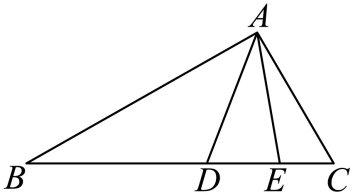

# Mathematics - 题目 2447

**ID**: accf64d1d54e4427a5fa383300f3dd81
**年级**: Grade 10
**难度**: Medium-Hard
**题型**: Calculation

## 题目
井冈山市茨坪镇为落实空间布局的需要，拟建设如图所示的三角形 $\left ({\vartriangle ABC}\right )$ 产业园区，根据规划要求，该产业园区需满足条件： $\sqrt {3}AC\cdot {\rm{s}}{\rm{i}}{\rm{n}}A=BC\cdot {\rm{c}}{\rm{o}}{\rm{s}}B$ ．（1）求B的大小；​​​​​​​‌（2）若在该产业园内再规划一个核心功能区 $\vartriangle ADE$ （D,E是边BC上的点），且 $C=\frac {{\rm{π}}}{3}$ ， $\angle DAE=\frac {{\rm{π}}}{6}$ ， $AB=100\sqrt {3}$ 米， $\angle BAD=α$ ，当核心功能区 $\vartriangle ADE$ 的面积最小时，求 $α$ 的大小．

## 解答

1. （1）由题 $\sqrt {3}AC\cdot {\rm{s}}{\rm{i}}{\rm{n}}A=BC\cdot {\rm{c}}{\rm{o}}{\rm{s}}B$ ，由正弦定理有 $\sqrt {3}\sin B\cdot {\rm{s}}{\rm{i}}{\rm{n}}A=\sin A\cdot {\rm{c}}{\rm{o}}{\rm{s}}B$ ，
2. 因为 $A\in \left ({0,\mathrm{π}}\right )$ ，所以 $\sin A\ne 0$ ，则 $\sqrt {3}\sin B={\rm{c}}{\rm{o}}{\rm{s}}B$ ，得 ${\tan}B=\frac {\sqrt {3}}{3}$ .
3. $B\in \left ({0,\mathrm{π}}\right )$ ，所以 $B=\frac {\mathrm{π}}{6}$ .
4. （2）由（1）知 $B=\frac {\mathrm{π}}{6}$ ， $C=\frac {{\rm{π}}}{3}$ ，所以 $\angle BAC=\frac {\mathrm{π}}{2}$ ， $\vartriangle ABC$ 为直角三角形.
5. 因为 $AB=100\sqrt {3}$ ，所以 $AC=100$ .
6. $\angle DAE=\frac {{\rm{π}}}{6}$ ， $\angle BAD=α$ ，则 $α\in \left ({0,\frac {{\rm{π}}}{3}}\right )$ ， $\angle BDA=\frac {5\mathrm{π}}{6}-α$ .
7. $\mathrm{△}ABD$ 中， $\frac {AD}{\sin \frac {\mathrm{π}}{6}}=\frac {AB}{\sin \left ({\frac {5\mathrm{π}}{6}-α}\right )}$ ，得 $AD=\frac {50\sqrt {3}}{\sin \left ({\frac {5\mathrm{π}}{6}-α}\right )}$ .
8. $\angle CAE=\frac {\mathrm{π}}{3}-α,C=\frac {\mathrm{π}}{3}$ ，得 $\angle CEA=\frac {\mathrm{π}}{3}+α$ .
9. 在 $△ACE$ 中， $\frac {AE}{\sin \frac {\mathrm{π}}{3}}=\frac {AC}{\sin \left ({\frac {\mathrm{π}}{3}+α}\right )}$ ，得 $AE=\frac {{{5}}{{0}}\sqrt {{{3}}}}{\sin \left ({\frac {\mathrm{π}}{3}+α}\right )}$ .
10. 所以 $\vartriangle ADE$ 的面积 $S=\frac {1}{2}AD\cdot AE\cdot \sin \angle DAE$
11. $=\frac {1}{2}\times \frac {50\sqrt {3}}{\sin \left ({\frac {5\mathrm{π}}{6}-α}\right )}\times \frac {{{5}}{{0}}\sqrt {{{3}}}}{\sin \left ({\frac {\mathrm{π}}{3}+α}\right )}\times \sin \frac {\mathrm{π}}{6}$
12. $=\frac {1}{4}\times \frac {7500}{\left ({\frac {1}{2}{\cos}α+\frac {\sqrt {3}}{2}\sin α}\right )\left ({\frac {\sqrt {3}}{2}{\cos}α+\frac {1}{2}\sin α}\right )}=\frac {7500}{\sqrt {3}+4\sin α{\cos}α}=\frac {7500}{2\sin 2α+\sqrt {3}}$
13. 当 $α\in \left ({0,\frac {{\rm{π}}}{3}}\right )$ 时， $2α\in \left ({0,\frac {{{2}}{\rm{π}}}{3}}\right )$ ，当 $α=\frac {{\rm{π}}}{4}$ 时， $\sin 2α=1$ ，此时 $S$ 最小.
14. 故 $α=\frac {{\rm{π}}}{4}$ .

## 知识点

**中文**:
  - 利用正、余弦定理解决其他实际问题
  - 正、余弦定理的实际应用-测量角度问题

**English**:
  - Other Practical Problems
  - Measuring Angles

---
