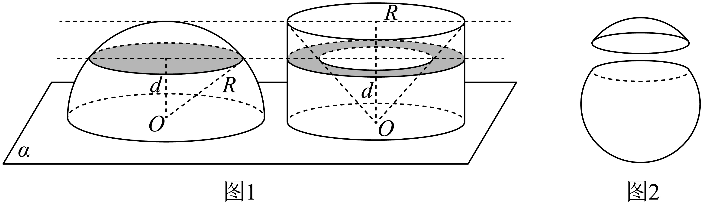

# Mathematics - 题目 1750

**ID**: c3d477bf7517445fa40789b47273ec0f
**年级**: Grade 10
**难度**: Medium-Hard
**题型**: Calculation

## 题目
我国南北朝数学家祖暅于5世纪末提出了体积计算原理：“幂势既同，则积不容异”.​​​​​​​‌这就是“祖暅原理”，意思是夹在两个平行平面之间的两个几何体，被平行于这两个平面的任意平面所截，如果截得的两个截面的面积总相等，那么这两个几何体的体积相等.（1）如图1，左边是半径为R的半球，右边是底面半径和高都等于R的圆柱，它们的底面在同一个平面 $α$ 上，在圆柱内挖去一个以圆柱下底面圆心为顶点，圆柱上底面为底面的圆锥后得到的一个新几何体，现在用平行于平面 $α$ 的平面去截半球和新几何体，得到如图所示两个阴影面，设底面圆心O到截面的距离为d，分别求图中的两个阴影面积及新几何体的体积.（2）如图2，一个球体被平面截下的部分叫做球缺.截面叫做球缺的底面，垂直于截面的直径被截后，剩下的线段长叫做球缺的高.根据祖暅原理，推导半径为R，高为H的球缺的体积公式.（3）若正方体 $ABCD-A{{}_{1}}B{{}_{1}}C{{}_{1}}D{{}_{1}}$ 棱长为 $\sqrt {2}$ ，求该正方体与以A为球心，2为半径的球的公共部分的体积.

## 解答

1. （1）在图1中的半球中，阴影面为一个圆面，
2. 由球的截面圆性质，可知截面圆半径为 $r{{}_{1}}=\sqrt {R{^{2}}-d{^{2}}}$ ，则阴影面积为 $S{{}_{1}}={\rm{π}}r{{}_{1}^{2}}={\rm{π}}(R{^{2}}-d{^{2}})$ ；
3. 在图1中的圆柱中，阴影面为两个同心圆所夹的圆环面，
4. 因圆柱的底面半径和高都等于R，故小圆的半径为 $r=d$ ，大圆半径为 $R$ ，则阴影面积为 $S{{}_{2}}={\rm{π}}(R{^{2}}-d{^{2}})$ ，
5. 因 $S{{}_{1}}=S{{}_{2}}$ ，故新几何体的体积等于半球体的体积，即 $V{{}_{新几何体}}=\frac {2}{3}{\rm{π}}R{^{3}}$ .
6. （2）
7. 
8. 不妨设 $H>R$ ，先用与水平面平行且经过球缺所在球的球心的平面截球缺得到如图所示的球台，
9. 则球台的高为 $H-R$ ，下底面半径为 $R$ ，上底面半径为 $\sqrt {R{^{2}}-(H-R){^{2}}}$ ，
10. 由祖暅原理，球台体积等于与之等高，底面半径相等的圆柱挖去一个与之等高的小圆锥余下的几何体的体积，
11. 其中小圆锥的底面半径为 $H-R$ ，则球台体积为 ${\rm{π}}R{^{2}}(H-R)-\frac {1}{3}{\rm{π}}(H-R){^{3}}$ ，
12. 将其加上半球的体积，即得球缺的体积： $V{{}_{球缺}}{\rm{=}}{\rm{π}}R{^{2}}(H-R)-\frac {1}{3}{\rm{π}}(H-R){^{3}}+\frac {2}{3}{\rm{π}}R{^{3}}=\frac {{\rm{π}}H{^{2}}(3R-H)}{3}$ .
13. 若 $H<R$ ，则可先计算另一半高为 $2R-H$ 的大球缺体积，再用球的体积减去大球缺的体积，
14. 即得小球缺的体积为 $V{{}_{球缺}}{\rm{=}}\frac {4}{3}{\rm{π}}R{^{3}}-\frac {{\rm{π}}(2R-H){^{2}}[3R-(2R-H)]}{3}$  $=\frac {{\rm{π}}}{3}[4R{^{3}}-(2R-H){^{2}}(R+H)]=\frac {{\rm{π}}H{^{2}}(3R-H)}{3}$ .
15. （3）依题意，该正方体与以A为球心，2为半径的球的公共部分是球体的 $\frac {1}{8}$ ，去掉3个包含点 $\mathrm{A}$ 的正方体的面截球所得球缺的 $\frac {1}{4}$ .
16. 因 $V{{}_{球}}=\frac {4{\rm{π}}}{3}\times 2{^{3}}=\frac {32}{3}{\rm{π}}$ ，高为 ${{2}}-\sqrt {2}$ 的球缺体积为： $V{{}_{球缺}}=\frac {{\rm{π}}}{3}\times (2-\sqrt {2}){^{2}}[3\times 2-(2-\sqrt {2})]=\frac {{\rm{π}}}{3}(16-10\sqrt {2})$ ，
17. 故所求的公共部分的体积为： $V=\frac {1}{8}V{{}_{球}}-3\times \frac {1}{4}V{{}_{球缺}}=\frac {1}{8}\times \frac {32}{3}{\rm{π}}-\frac {3}{4}\times \frac {{\rm{π}}}{3}(16-10\sqrt {2})=\frac {15\sqrt {2}-16}{6}{\rm{π}}$ .

## 知识点

**中文**:
  - 新定义问题

**English**:
  - New Definition Problems

---
