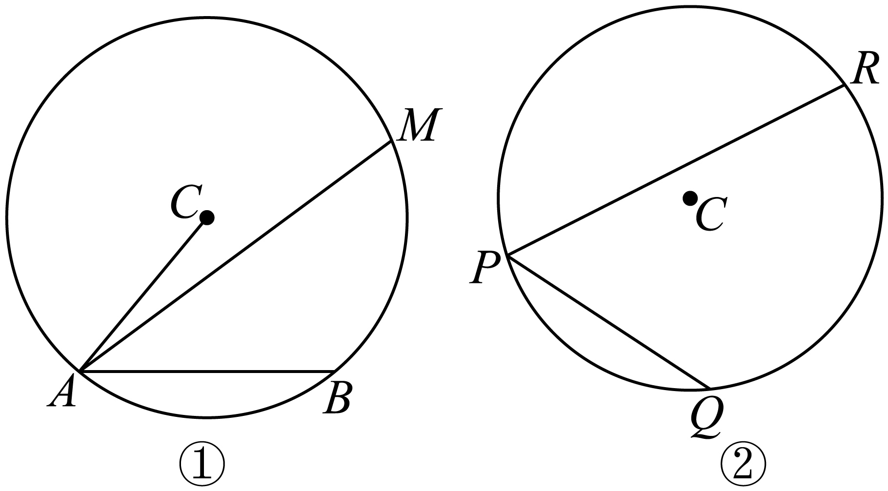

# Mathematics - 题目 3155

**ID**: df9ea3c99e9e4317af7fbccce2ce21fc
**年级**: Grade 10
**难度**: Medium-Hard
**题型**: Calculation

## 题目
如图，圆 $C$ 的半径为2.​​​​​​​‌（1）设 $AB$ 为圆 $C$ 的一条弦，如图①，当 $\angle CAB=60{}\degree $ 时，${\rm （i）}$ 当 $t$ 取何值时， $\left |{\overrightarrow {{AC}}-t\overrightarrow {{AB}}}\right |$ 取得最小值，并求出此最小值；${\rm （ii）}$ 设 $M$ 是圆 $C$ 上的一动点，求 $\overrightarrow {{AM}}\cdot \overrightarrow {{AB}}$ 的最大值；（2）设 $PQ$ 、 $PR$ 为圆 $C$ 的两条弦，如图②，已知 $\angle QPR=60{}\degree $ ，求 $\overrightarrow {{PQ}}\cdot \overrightarrow {{PR}}$ 的最大值.

## 解答

1. （1）（ⅰ）设 $\overrightarrow {{AT}}=t\overrightarrow {{AB}}$ ，即有 $T$ 为直线 $AB$ 上某一点，
2. $\overrightarrow {{AC}}-t\overrightarrow {{AB}}=\overrightarrow {{AC}}-\overrightarrow {{AT}}=\overrightarrow {{TC}}$ ，
3. 要使 $\left |{\overrightarrow {{AC}}-t\overrightarrow {{AB}}}\right |$ 取得最小值，即 $\left |{\overrightarrow {{TC}}}\right |$ 最小，则此时只需 $TC\bot AB$ ，
4. 过点 $C$ 作 $CT^{′}{\bot }AB$ 于点 $T^{′}$ ，有 $AT^{′}=\frac {1}{2}AB$ ，即 $t=\frac {1}{2}$ ，
5. 而因为 $\angle CAB=60{}\degree $ ，因此 $CT^{′}=\frac {\sqrt {3}}{2}\times 2=\sqrt {3}$ ，
6. 故当 $t=\frac {1}{2}$ 时， $\left |{\overrightarrow {{AC}}-t\overrightarrow {{AB}}}\right |$ 取得最小值，其最小值为 $\sqrt {3}$ .
7. 
8. （ⅱ）因为 $\angle CAB=60{}\degree $ ， $\left |{\overrightarrow {{AB}}}\right |=2\left |{\overrightarrow {{AT^{′}}}}\right |=2\times \left ({\frac {1}{2}\times 2}\right )=2$ ，
9. 过点 $M$ 作 $MH\bot AB$ 于点 $H$ ， $\overrightarrow {{AM}}=\overrightarrow {{AH}}+\overrightarrow {{HM}}$
10. $\overrightarrow {{AM}}\cdot \overrightarrow {{AB}}=\left ({\overrightarrow {{AH}}+\overrightarrow {{HM}}}\right )\cdot \overrightarrow {{AB}}=\overrightarrow {{AH}}\cdot \overrightarrow {{AB}}+\overrightarrow {{HM}}\cdot \overrightarrow {{AB}}=\overrightarrow {{AH}}\cdot \overrightarrow {{AB}}$ ，
11. 而 $\overrightarrow {{AH}}\cdot \overrightarrow {{AB}}=\left |{\overrightarrow {{AH}}}\right |\cdot \left |{\overrightarrow {{AB}}}\right |$ 或 $\overrightarrow {{AH}}\cdot \overrightarrow {{AB}}=-\left |{\overrightarrow {{AH}}}\right |\cdot \left |{\overrightarrow {{AB}}}\right |$ ，
12. 要使 $\overrightarrow {{AM}}\cdot \overrightarrow {{AB}}$ 的最大，则需 $\overrightarrow {{AH}}$ ， $\overrightarrow {{AB}}$ 同向，且 $\left |{\overrightarrow {{AH}}}\right |$ 最大，此时 $MH$ 与圆 $C$ 相切，
13. 平移 $AB$ 的垂线 $MH$ 至 $M^{′}H^{′}$ ，使 $M^{′}H^{′}$ 圆 $C$ 相切，
14. 此时有 $CM^{′}{\bot }M^{′}H^{′}$ ， $AB{\rm{/}}{\rm{/}}CM^{′}$ ，所以 $AH{{}_{{\rm{m}}{\rm{a}}{\rm{x}}}}=AT^{′}+CM^{′}=1+2=3$ ，
15. $\left ({\overrightarrow {{AM}}\cdot \overrightarrow {{AB}}}\right ){{}_{{\rm{m}}{\rm{a}}{\rm{x}}}}=\left |{\overrightarrow {{AH}}}\right |{{}_{{\rm{m}}{\rm{a}}{\rm{x}}}}\cdot \left |{\overrightarrow {{AB}}}\right |=\left |{\overrightarrow {{AH^{′}}}}\right |\cdot \left |{\overrightarrow {{AB}}}\right |=3\times 2=6$ .
16. 
17. （2）过点 $C$ 作 $CG\bot QR$ 于点 $G$ ，
18. $\overrightarrow {{PQ}}=\overrightarrow {{PC}}+\overrightarrow {{CG}}+\overrightarrow {{GQ}}$ ， $\overrightarrow {{PR}}=\overrightarrow {{PC}}+\overrightarrow {{CG}}+\overrightarrow {{GR}}$ ，而 $\overrightarrow {{GR}}=-\overrightarrow {{GQ}}$ ，
19. 所以 $\overrightarrow {{PQ}}\cdot \overrightarrow {{PR}}=\left ({\overrightarrow {{PC}}+\overrightarrow {{CG}}+\overrightarrow {{GQ}}}\right )\cdot \left ({\overrightarrow {{PC}}+\overrightarrow {{CG}}+{\overline{GR}}}\right )=\left ({\overrightarrow {{PC}}+\overrightarrow {{CG}}+\overrightarrow {{GQ}}}\right )\cdot \left ({\overrightarrow {{PC}}+\overrightarrow {{CG}}-\overrightarrow {{GQ}}}\right )$
20. $=\overrightarrow {{PC}}{^{2}}+\overrightarrow {{CG}}{^{2}}+2\overrightarrow {{PC}}\cdot \overrightarrow {{CG}}-\overrightarrow {{GQ}}{^{2}}=\left |{\overrightarrow {{PC}}}\right |{^{2}}+\left |{\overrightarrow {{CG}}}\right |{^{2}}+2\overrightarrow {{PC}}\cdot \overrightarrow {{CG}}-\left |{\overrightarrow {{GQ}}}\right |{^{2}}$ ，
21. 因为 $\angle QPR=60{}\degree $ ，所以 $\angle QCR=120{}\degree $ ， $\angle CQR=\angle CRQ=30{}\degree $ ， $CG=\frac {1}{2}CQ=1$ ， $GQ=GR=\frac {\sqrt {3}}{2}CQ=\sqrt {3}$ ，
22. 所以 $\overrightarrow {{PQ}}\cdot \overrightarrow {{PR}}=\left |{\overrightarrow {{PC}}}\right |{^{2}}+\left |{\overrightarrow {{CG}}}\right |{^{2}}+2\overrightarrow {{PC}}\cdot \overrightarrow {{CG}}-\left |{\overrightarrow {{GQ}}}\right |{^{2}}=4+1+2\overrightarrow {{PC}}\cdot \overrightarrow {{CG}}-3$  $=2+2\overrightarrow {{PC}}\cdot \overrightarrow {{CG}}$ ，
23. 因此，当 $\overrightarrow {{PC}}$ ， $\overrightarrow {{CG}}$ 共线时， $\overrightarrow {{PQ}}\cdot \overrightarrow {{PR}}$ 取得最大值， $\left ({\overrightarrow {{PQ}}\cdot \overrightarrow {{PR}}}\right ){{}_{{\rm{m}}{\rm{a}}{\rm{x}}}}=2+2\left |{\overrightarrow {{PC}}}\right |\cdot \left |{\overrightarrow {{CG}}}\right |=2+2\times 2\times 1=6$ .
24. 

## 知识点

**中文**:
  - 向量在平面几何求值问题中的应用

**English**:
  - Applications in Plane Geometry Evaluation

---
