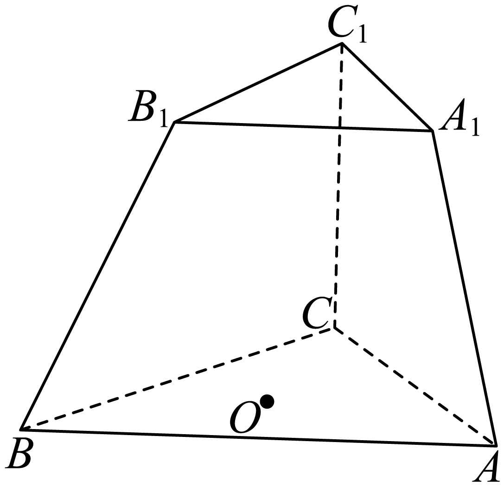

# Mathematics - 题目 3251

**ID**: e7b73668885247c1becb5a094b04fd86
**年级**: Grade 10
**难度**: Medium-Hard
**题型**: Calculation

## 题目
一正三棱台木块 $ABC-A{{}_{1}}B{{}_{1}}C{{}_{1}}$ 如图所示，已知 $2AC=3A{{}_{1}}C{{}_{1}}=6,AA{{}_{1}}=2$ ，点 $O$ 在平面 $ABC$ 内且为 $\vartriangle ABC$ 的重心.​​​​​​​‌（1）过点 $O$ 将木块锯开，使截面经过 $A{{}_{1}}C{{}_{1}}$ 平行于直线 $AC$ ，在木块表面应该怎样划线，并说明理由；（2）求该三棱台木块被问题（1）中的截面分成的两个几何体的体积之比；（3）在棱台的底面 $A{{}_{1}}B{{}_{1}}C{{}_{1}}$ 上（包括边界）是否存在点 $M$ ，使得直线 $OM//$ 平面 $ACC{{}_{1}}A{{}_{1}}$ ？若存在，求 $OM$ 长的取值范围；若不存在，说明理由.

## 解答

1. （1）如图，在平面 $ABC$ 内过点O作直线 $DE//AC$ 交 $BA$ 于点 $D$ ，交 $BC$ 于点 $E$ ，
2. 
3. 连接 $DA{{}_{1}},EC{{}_{1}}$ ，则 $DE、DA{{}_{1}}、EC{{}_{1}}$ 为截面与各木块表面的交线，
4. 理由如下：由于 $DE//AC//A{{}_{1}}C{{}_{1}}$ ，故 $D、E、A{{}_{1}}、C{{}_{1}}$ 四点共面，
5. 且平面 $BCC{{}_{1}}B{{}_{1}}\cap $ 平面 $A{{}_{1}}C{{}_{1}}ED=C{{}_{1}}E$ ，平面 $ABB{{}_{1}}A{{}_{1}}\cap $ 平面 $A{{}_{1}}C{{}_{1}}ED=A{{}_{1}}D$ ，平面 $ABC\cap $ 平面 $A{{}_{1}}C{{}_{1}}ED=DE$ ，
6. 则 $DE、DA{{}_{1}}、EC{{}_{1}}$ 为截面与各木块表面的交线.
7. （2）由于点 $O$ 在平面 $ABC$ 内且为 $\vartriangle ABC$ 的重心， $DE//AC$ ，
8. 所以 $DE=\frac {2}{3}AC$ ，又因为 $2AC=3A{{}_{1}}C{{}_{1}}$ ，故 $DE=A{{}_{1}}C{{}_{1}}$ ，
9. 故几何体 $A{{}_{1}}B{{}_{1}}C{{}_{1}}-DEB$ 为棱柱，
10. 设棱台的高为 $h$ ， $\mathrm{△}A{{}_{1}}B{{}_{1}}C{{}_{1}}$ 的面积为 $\mathrm{S}$ ，故 $V{{}_{A{{}_{1}}B{{}_{1}}C{{}_{1}}-DEB}}=Sh$ ，
11. 又 $2AC=3A{{}_{1}}C{{}_{1}}$ ，则 $S{{}_{\vartriangle ABC}}=\frac {9}{4}S{{}_{\vartriangle A{{}_{1}}B{{}_{1}}C{{}_{1}}}}$ ，
12. 故由台体体积公式得正三棱台 $ABC-A{{}_{1}}B{{}_{1}}C{{}_{1}}$ 体积为 $\frac {1}{3}\left ({S+\frac {9}{4}S+\sqrt {S\cdot \frac {9}{4}S}}\right )h=\frac {19}{12}Sh$ ，
13. 所以被截面 $A{{}_{1}}C{{}_{1}}ED$ 截得的非三棱柱 $A{{}_{1}}B{{}_{1}}C{{}_{1}}-DEB$ 的另一个几何体体积为 $\frac {19}{12}Sh-Sh=\frac {7}{12}Sh$ ，
14. 故该三棱台木块被（1）中的截面分成的两个几何体的体积之比为 $\frac {7}{12}：1{\rm{=}}7：12$ （或 $1：\frac {7}{12}{\rm{=}}12：7$ ）.
15. （3）分别取 $B{{}_{1}}C{{}_{1}}、A{{}_{1}}B{{}_{1}}$ 的中点 $K、L$ ，则当点 $M\in KL$ 时有 $OM//$ 平面 $ACC{{}_{1}}A{{}_{1}}$ ，
16. 
17. 证明如下：由 $K、L$ 分别为 $B{{}_{1}}C{{}_{1}}、A{{}_{1}}B{{}_{1}}$ 的中点得 $KL//A{{}_{1}}C{{}_{1}}$ ，
18. 又由于在正三棱台 $ABC-A{{}_{1}}B{{}_{1}}C{{}_{1}}$ 中 $DE//AC$ ， $A{{}_{1}}C{{}_{1}}//AC$ ，
19. 所以 $KL//DE$ ， $D、E、K、L$ 四点共面，
20. 又因为 $2AC=3A{{}_{1}}C{{}_{1}}$ ，点O为重心，所以 $CE=\frac {1}{3}BC=\frac {1}{3}\times \frac {3}{2}B{{}_{1}}C{{}_{1}}=\frac {1}{2}B{{}_{1}}C{{}_{1}}=C{{}_{1}}K{\rm{=}}1$ ，
21. 又由正三棱台 $ABC-A{{}_{1}}B{{}_{1}}C{{}_{1}}$ 性质 $CE//C{{}_{1}}K$ ，
22. 故四边形 $CEMC{{}_{1}}$ 为平行四边形，故 $EK//CC{{}_{1}}$ ，
23. 因为 $EK\not\subset $ 平面 $ACC{{}_{1}}A{{}_{1}}$ 、 $CC{{}_{1}}\subset $ 平面 $ACC{{}_{1}}A{{}_{1}}$ ，所以 $EK//$ 平面 $ACC{{}_{1}}A{{}_{1}}$ ，
24. 同理 $DE//$ 平面 $ACC{{}_{1}}A{{}_{1}}$ ，
25. 因为 $DE\cap EK=E$ ， $DE、EK\subset $ 平面 $DEKL$ ，所以平面 $DEKL//$ 平面 $ACC{{}_{1}}A{{}_{1}}$ ，
26. 所以当点 $M\in KL$ 时， $OM\subset $ 平面 $DEKL$ ，于是 $OM//$ 平面 $ACC{{}_{1}}A{{}_{1}}$ ，
27. 在梯形 $DEKL$ 中，由已知条件和前面的分析知： $KL=\frac {1}{2}A{{}_{1}}C{{}_{1}}=1,DE=\frac {2}{3}AC=2,DL=EK=CC{{}_{1}}=2$ ，
28. 即四边形 $DEKL$ 是底边长分别为1和2、腰长为2的等腰梯形，
29. 所以该由等腰梯形性质得该等腰梯形 $DEKL$ 的高为 $\sqrt {2{^{2}}-{\left({\frac {2-1}{2}}\right)^{2}}}=\frac {\sqrt {15}}{2}$ ，
30. 所以 $OK=OL=\sqrt {{\left({\frac {\sqrt {15}}{2}}\right)^{2}}+{\left({\frac {1}{2}}\right)^{2}}}=2$ ，
31. 所以 $OM$ 长度的取值范围为 $\left [\frac {\sqrt {15}}{2},2\right ]$ .

## 知识点

**中文**:
  - 直线与平面平行的判定
  - 简单组合体的表面积与体积
  - 直线与平面平行的性质

**English**:
  - Line-Plane Parallelism Determination
  - Area and Volume of Composite Solids
  - Properties of Line-Plane Parallelism

---
