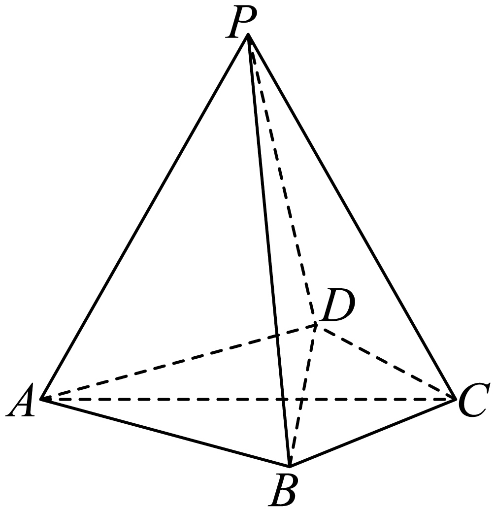

# Mathematics - 题目 925

**ID**: ebc3c0c6b8684ec087607cb0986ede93
**年级**: Grade 10
**难度**: Medium-Hard
**题型**: Calculation

## 题目
如图，四棱锥 $P-ABCD$ 中，平面 $PAC\bot $ 平面 $ABCD$ ， $PA=PB=PC$ ， $AC=2BC=4$ .​​​​​​​‌（1）求 $AB$ ；（2）若直线 $PA$ 与 $BC$ 所成角的余弦值为 $\frac {1}{4}$ .${\rm （i）}$ 求二面角 $P-AB-C$ 的正切值；${\rm （ii）}D$ 是 $\vartriangle ABC$ 的外接圆上的动点，三棱锥 $P-ABD$ 内有一圆柱，圆柱的底面在 $\mathrm{△}ABD$ 内，求该圆柱侧面积的最大值.

## 解答

1. （1）如图1，取 $AC$ 的中点 $O$ ，连接 $PO$ ， $BO$ ，由 $PA=PC$ 知 $PO\bot AC$ .
2. 因为平面 $PAC\bot $ 平面 $ABCD$ ，平面 $PAC\cap $ 平面 $ABCD=AC$ ， $PO\subset $ 平面 $PAC$ ，
3. 所以 $PO\bot $ 平面 $ABC$ .
4. 因为 $OB⊂$ 平面 $ABC$ ，所以 $PO\bot OB$ .
5. 又因为 $PA=PB$ ，所以 ${\rm{R}}{\rm{t}}\vartriangle POA≌{\rm{R}}{\rm{t}}\vartriangle POB$ ，所以 $OA=OB$ ，进而 $OA=OB=OC$ ，
6. 所以点 $B$ 在以 $AC$ 为直径的圆上，所以 $AB\bot BC$ .
7. 所以 $AB=\sqrt {AC{^{2}}-BC{^{2}}}=\sqrt {4{^{2}}-2{^{2}}}=2\sqrt {3}$ .
8. 
9. （2）（i）设 $M$ ， $N$ 分别为棱 $AB$ ， $PC$ 的中点，连接 $OM$ ， $ON$ .
10. 设 $X$ ， $Y$ 分别为 $OC$ ， $MB$ 的中点，则 $XY/\mskip-4mu/OM/\mskip-4mu/BC$ ， $PA/\mskip-4mu/ON$ .
11. 所以 $\angle MON$ 是直线 $PA$ 与 $BC$ 所成角或其补角.
12. 又 $OM\bot AB$ ， $XY\bot AB$ ， $OM=\frac {1}{2}BC=1$ ， $XY=\frac {1}{2}\left ({OM+BC}\right )=\frac {3}{2}$ ， $MY=\frac {1}{4}AB=\frac {\sqrt {3}}{2}$ ，
13. 所以 $MX=\sqrt {MY{^{2}}+XY{^{2}}}=\sqrt {{\left({\frac {\sqrt {3}}{2}}\right)^{2}}+{\left({\frac {3}{2}}\right)^{2}}}=\sqrt {3}$ .
14. 设 $PO=2x$ ，连接 $NX$ ，则 $NX=\frac {1}{2}PO=x$ .
15. 由 $NX/\mskip-4mu/PO$ ， $PO\bot $ 平面 $ABCD$ ，得 $NX\bot $ 平面 $ABCD$ ，又 $AC$ ， $MX\subset $ 平面 $ABCD$ ，
16. 所以 $NX\bot AC$ ， $NX\bot MX$ .
17. 所以 $NO=\sqrt {OX{^{2}}+NX{^{2}}}=\sqrt {1+x{^{2}}}$ ， $MN=\sqrt {MX{^{2}}+NX{^{2}}}=\sqrt {3+x{^{2}}}$ .
18. 在 $\vartriangle OMN$ 中，由 ${\rm{c}}{\rm{o}}{\rm{s}}\angle MON=\frac {ON{^{2}}+OM{^{2}}-MN{^{2}}}{2\cdot ON\cdot OM}=\frac {\left ({1+x{^{2}}}\right )+1-\left ({3+x{^{2}}}\right )}{2\times 1\times \sqrt {x{^{2}}+1}}=\pm \frac {1}{4}$ ，解得 $x=\sqrt {3}$ ，
19. 所以 $PO=2\sqrt {3}$ .
20. 由 $PO\bot $ 平面 $ABCD$ ， $AB\subset $ 平面 $ABCD$ ，得 $AB\bot PO$ .
21. 又 $AB\bot OM$ ， $PO\cap OM=O$ ， $PO$ ， $OM\subset $ 平面 $POM$ ，所以 $AB\bot $ 平面 $POM$ .
22. 因为 $PM\subset $ 平面 $POM$ ，所以 $AB\bot PM$ ，所以 $\angle PMO$ 是二面角 $P-AB-C$ 的平面角，
23. ${\rm{t}}{\rm{a}}{\rm{n}}∠PMO=\frac {PO}{OM}=2\sqrt {3}$ ，即二面角 $P-AB-C$ 的正切值为 $2\sqrt {3}$ .
24. ${\rm （ii）}$ 由 $\mathrm{△}ABD$ 的外接圆直径 $AC=4$ 及正弦定理知 ${\rm{s}}{\rm{i}}{\rm{n}}∠ADB=\frac {AB}{AC}=\frac {\sqrt {3}}{2}$ .
25. ①如图2，当 $O$ 在 $\mathrm{△}ABD$ 内时， $\angle ADB=60{^{\circ }}$ ，
26. 设圆柱上底面所在平面与三棱锥 $P-ABD$ 的截面为 $\vartriangle A{{}_{1}}B{{}_{1}}D{{}_{1}}$ .
27. 当圆柱上底面是 $\vartriangle A{{}_{1}}B{{}_{1}}D{{}_{1}}$ 的内切圆时，其半径 $r$ 取得最大值.
28. 记 $A{{}_{1}}B{{}_{1}}=λ$ ，因为 $△A{{}_{1}}B{{}_{1}}D{{}_{1}}∽△ABD$ ， $\frac {PA{{}_{1}}}{PA}=\frac {λ}{2\sqrt {3}}$ ， $∠A{{}_{1}}D{{}_{1}}B{{}_{1}}=∠ADB=60{^{\circ }}$ .
29. 设 $A{{}_{1}}D{{}_{1}}=m$ ， $B{{}_{1}}D{{}_{1}}=n$ ，则 $S{{}_{\vartriangle A{{}_{1}}B{{}_{1}}D{{}_{1}}}}=\frac {1}{2}mn{\rm{s}}{\rm{i}}{\rm{n}}∠A{{}_{1}}D{{}_{1}}B{{}_{1}}=\frac {\sqrt {3}}{4}mn$ ， $S{{}_{\vartriangle A{{}_{1}}B{{}_{1}}}}=\frac {λ+m+n}{2}\cdot r$ ，
30. 所以 $\frac {\sqrt {3}}{4}mn=\frac {λ+m+n}{2}\cdot r$ ，得 $r=\frac {\sqrt {3}}{2}\cdot \frac {mn}{m+n+λ}$ .
31. $\vartriangle A{{}_{1}}B{{}_{1}}D{{}_{1}}$ 中，由余弦定理得， $λ{^{2}}=m{^{2}}+n{^{2}}-2mn{\rm{c}}{\rm{o}}{\rm{s}}\angle A{{}_{1}}B{{}_{1}}D{{}_{1}}={\left({m+n}\right)^{2}}-3mn$ .
32. 一方面， $mn=\frac {{\left({m+n}\right)^{2}}-λ{^{2}}}{3}$ ；
33. 另一方面， $λ{^{2}}\geqslant {\left({m+n}\right)^{2}}-3\cdot {\left({\frac {m+n}{2}}\right)^{2}}=\frac {1}{4}{\left({m+n}\right)^{2}}$ ，
34. 即 $m+n\leqslant 2λ$ ，当且仅当 $m=n$ 时等号成立.
35. 所以 $r=\frac {\sqrt {3}}{2}\cdot \frac {mn}{m+n+λ}=\frac {\sqrt {3}}{6}\cdot \frac {{\left({m+n}\right)^{2}}-λ{^{2}}}{m+n+λ}=\frac {\sqrt {3}}{6}\cdot \left ({m+n-λ}\right )\leqslant \frac {\sqrt {3}}{6}\cdot \left ({2λ-λ}\right )=\frac {\sqrt {3}λ}{6}$ .
36. 设圆柱的高为 $h$ ，则 $\frac {PO-h}{PO}=\frac {λ}{2\sqrt {3}}$ ，即 $\frac {2\sqrt {3}-h}{2\sqrt {3}}=\frac {λ}{2\sqrt {3}}$ ，得 $h=2\sqrt {3}-λ$ ，
37. 所以圆柱的侧面积
38. $S=2πr\cdot h\leqslant 2{\rm{π}}\cdot \frac {\sqrt {3}λ}{6}\cdot \left ({2\sqrt {3}-λ}\right )=\frac {\sqrt {3}{\rm{π}}}{3}\cdot λ\left ({2\sqrt {3}-λ}\right )\leqslant \frac {\sqrt {3}{\rm{π}}}{3}\cdot \left [\frac {λ+\left ({2\sqrt {3}-λ}\right )}{2}\right ]{^{2}}=\sqrt {3}{\rm{π}}$ ，
39. 当且仅当 $m=n$ 且 $λ=\sqrt {3}$ 时等号成立.
40. ②如图3，当点 $O$ 在 $\mathrm{△}ABD$ 外（包含边界）时， $\mathrm{A}$ 为钝角.
41. 若圆柱的高为 $h$ ，过 $BD$ 作底面的垂面 $α$ ， $α$ 与截面 $A{{}_{1}}B{{}_{1}}D{{}_{1}}$ 的交线为 $B{{}_{2}}D{{}_{2}}$ ，
42. 则圆柱上底面在 $△A{{}_{1}}B{{}_{2}}D{{}_{2}}$ 内部.记 $\vartriangle A{{}_{1}}B{{}_{1}}D{{}_{1}}$ 内切圆半径为 $r^{′}$ ，
43. 此时， $r<r^{′}<\frac {\sqrt {3}λ}{6}$ ， $S<2{\rm{π}}\cdot \frac {\sqrt {3}λ}{6}\cdot h$ .
44. 综上，圆柱侧面积的最大值为 $\sqrt {3}{\rm{π}}$ .

## 知识点

**中文**:
  - 二面角
  - 圆柱、圆锥、圆台的表面积（侧面积）
  - 异面直线所成角

**English**:
  - Dihedral Angle
  - Surface Area of Revolving Solids
  - Angle between Skew Lines

---
