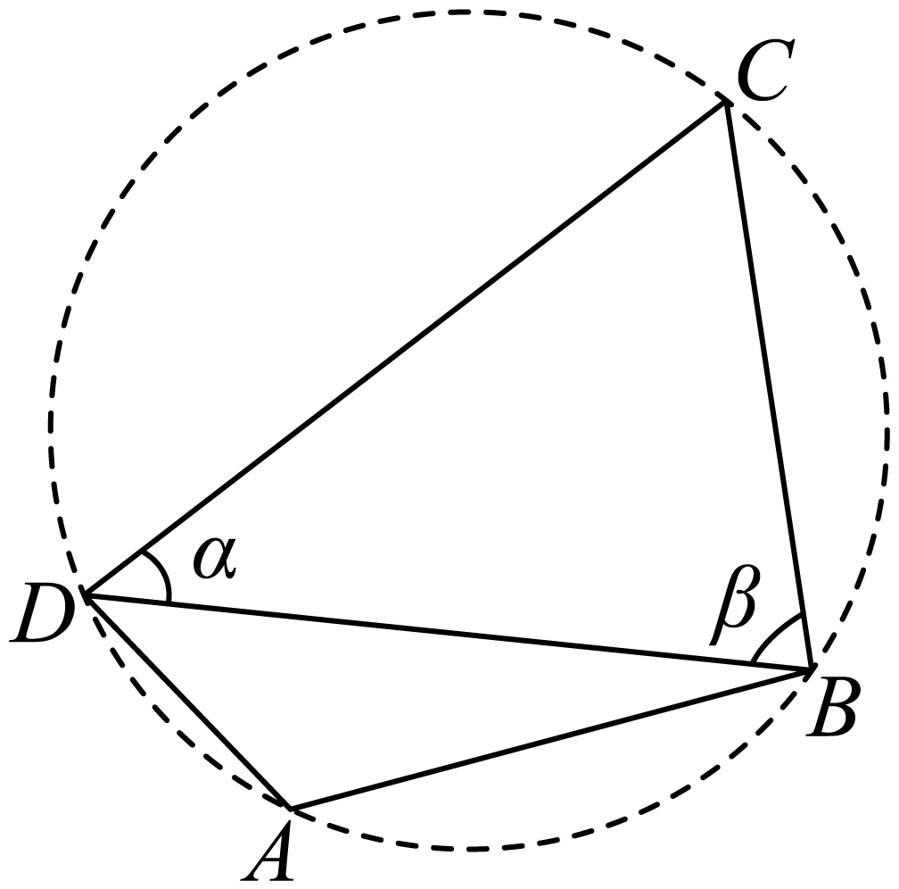

# Mathematics - 题目 222

**ID**: f097fab776034061812cd3c31f3c587f
**年级**: Grade 10
**难度**: Medium-Hard
**题型**: Calculation

## 题目
如图，我国南海某处的一个圆形海域上有四个小岛，小岛 $B$ 与小岛A、小岛 $C$ 相距都为 $5{\rm{n}}{\rm{m}}{\rm{i}}{\rm{l}}{\rm{e}}$ ，与小岛 $D$ 相距为 $3\sqrt {5}{\rm nmile}$ ． $∠BAD$ 为钝角，且 ${\rm{s}}{\rm{i}}{\rm{n}}A=\frac {3}{5}$ ．(1)求小岛A与小岛 $D$ 之间的距离；​​​​​​​‌(2)求四个小岛所形成的四边形的面积；(3)记 $\angle BDC$ 为 $α$ ， $\angle CBD$ 为 $β$ ，求 ${\rm{s}}{\rm{i}}{\rm{n}}\left ({2α+β}\right )$ 的值．

## 解答

1. （1） $\because {\rm{s}}{\rm{i}}{\rm{n}}A=\frac {3}{5}$ ，且A为钝角， $\therefore {\rm{c}}{\rm{o}}{\rm{s}}A=-\sqrt {1-{\left({\frac {3}{5}}\right)^{2}}}=-\frac {4}{5}$ ，
2. 在 $\mathrm{△}ABD$ 中，由余弦定理可得 $BD{^{2}}=AD{^{2}}+AB{^{2}}-2AD\cdot AB\cdot {\rm{c}}{\rm{o}}{\rm{s}}A$ ，
3. $\therefore {\left({3\sqrt {5}}\right)^{2}}=AD{^{2}}+5{^{2}}-2AD\cdot 5\cdot \left ({-\frac {4}{5}}\right )$ ，即 $AD{^{2}}+8AD-20=0$ ，
4. 解得 $AD=2$ 或 $AD=-10$ （舍去）．
5. $\therefore $ 小岛A与小岛 $D$ 之间的距离为2nmile．
6. （2） $\because A，B，C，D$ 四点共圆， $\therefore A$ 与 $C$ 互补，则 ${\rm{s}}{\rm{i}}{\rm{n}}C=\frac {3}{5}$ ，
7. ${\rm{c}}{\rm{o}}{\rm{s}}C={\rm{c}}{\rm{o}}{\rm{s}}\left ({180{}\degree -A}\right )=-{\rm{c}}{\rm{o}}{\rm{s}}A=\frac {4}{5}$ ．
8. 在 $\vartriangle BDC$ 中，由余弦定理得 $CD{^{2}}+CB{^{2}}-2CD\cdot CB\cdot {\rm{c}}{\rm{o}}{\rm{s}}C=BD{^{2}}$ ，
9. $\therefore CD{^{2}}+5{^{2}}-2CD\times 5\times \frac {4}{5}={\left({3\sqrt {5}}\right)^{2}}$ ，得 $CD{^{2}}-8CD-20=0$ ，
10. 解得 $CD=-2$ （舍去）或 $CD=10$ ．
11. $\therefore S{{}_{四边形{{ }}ABCD}}=S{{}_{\mathrm{△}ABD}}+S{{}_{\mathrm{△}BCD}}=\frac {1}{2}AB\cdot AD\cdot {\rm{s}}{\rm{i}}{\rm{n}}A+\frac {1}{2}CB\cdot CD\cdot {\rm{s}}{\rm{i}}{\rm{n}}C$
12. $=\frac {1}{2}\times 5\times 2\times \frac {3}{5}+\frac {1}{2}\times 5\times 10\times \frac {3}{5}=3+15=18$ （平方海里），
13. $\therefore $ 四个小岛所形成的四边形的面积为18平方海里．
14. （3）在 $\vartriangle BDC$ 中，由正弦定理得 $\frac {BC}{{\rm{s}}{\rm{i}}{\rm{n}}α}=\frac {BD}{{\rm{s}}{\rm{i}}{\rm{n}}C}$ ，即 $\frac {5}{{\rm{s}}{\rm{i}}{\rm{n}}α}=\frac {3\sqrt {5}}{\frac {3}{5}}$ ，解 ${\rm{s}}{\rm{i}}{\rm{n}}α=\frac {\sqrt {5}}{5}$ ．
15. $\because DC{^{2}}+DB{^{2}}>BC{^{2}}$ ， $\therefore α$ 为锐角，则 ${\rm{c}}{\rm{o}}{\rm{s}}α=\frac {2\sqrt {5}}{5}$ ，
16. 又 $\because {\rm{s}}{\rm{i}}{\rm{n}}\left ({α+β}\right )={\rm{s}}{\rm{i}}{\rm{n}}\left ({180{}\degree -C}\right )={\rm{s}}{\rm{i}}{\rm{n}}C=\frac {3}{5}$ ，
17. ${\rm{c}}{\rm{o}}{\rm{s}}\left ({α+β}\right )={\rm{c}}{\rm{o}}{\rm{s}}\left ({180{}\degree -C}\right )=-{\rm{c}}{\rm{o}}{\rm{s}}C=-\frac {4}{5}$ ，
18. $\therefore {\rm{s}}{\rm{i}}{\rm{n}}\left ({2α+β}\right )={\rm{s}}{\rm{i}}{\rm{n}}\left [α+\left ({α+β}\right )\right ]={\rm{s}}{\rm{i}}{\rm{n}}α{\rm{c}}{\rm{o}}{\rm{s}}\left ({α+β}\right )+{\rm{c}}{\rm{o}}{\rm{s}}α{\rm{s}}{\rm{i}}{\rm{n}}\left ({α+β}\right )$
19. $=\frac {\sqrt {5}}{5}\times \left ({-\frac {4}{5}}\right )+\frac {2\sqrt {5}}{5}\times \frac {3}{5}=\frac {2\sqrt {5}}{25}$ ．

## 知识点

**中文**:
  - 利用正、余弦定理解决其他实际问题

**English**:
  - Other Practical Problems

---
