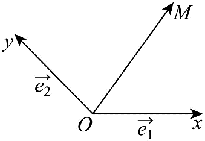

# Mathematics - 题目 3015

**ID**: f4f56441b93b490c84576349976ba128
**年级**: Grade 10
**难度**: Medium-Hard
**题型**: Calculation

## 题目
如图所示，设 $Ox,Oy$ 是平面内相交成 $θ\left ({0<θ<{\rm{π}}}\right )$  角的两条数轴， $\overrightarrow {{e{{}_{1}}}},\overrightarrow {{e{{}_{2}}}}$ 分别是与  $x,y$ 轴正方向同向的单位向量，则称平面坐标系 $xOy$ 为 $θ$ 仿射坐标系，若在 $θ$ 仿射坐标系下  $\overrightarrow {{OM}}=a\overrightarrow {{e{{}_{1}}}}+b\overrightarrow {{e{{}_{2}}}}$ ， 则把有序数对 $\left ({a,b}\right )$ 叫做向量 $\overrightarrow {{OM}}$ 的仿射坐标，记为 $\overrightarrow {{OM}}=\left ({a,b}\right )$ ．（1）若 $θ=60{}\degree ,\overrightarrow {{OM}}=2\overrightarrow {{e{{}_{1}}}}+3\overrightarrow {{e{{}_{2}}}}$ ，求 $\left |{\overrightarrow {{OM}}}\right |$ 的模长；​​​​​​​‌（2）若 $θ=60{}\degree ,\overrightarrow {{OA}}=x{{}_{1}}\overrightarrow {{e{{}_{1}}}}+y{{}_{1}}\overrightarrow {{e{{}_{2}}}},\overrightarrow {{OB}}=x{{}_{2}}\overrightarrow {{e{{}_{1}}}}+y{{}_{2}}\overrightarrow {{e{{}_{2}}}}$ ，有同学认为“ $\overrightarrow {{OA}}\bot \overrightarrow {{OB}}$ ”的充要条件是“ $x{{}_{1}}x{{}_{2}}+y{{}_{1}}y{{}_{2}}=0$ ”，你认为是否正确？若正确，请给出证明，若不正确，请说明理由；（3）若在 $θ$ 仿射坐标系下，设 $\overrightarrow {{OA}}=\left ({3,1}\right ),\overrightarrow {{OB}}=\left ({1,1}\right ),\angle AOB=α$ ，若 $\left |{\overrightarrow {{OA}}-t\overrightarrow {{OB}}}\right |\geqslant \sqrt {3}$ 对 $\forall t\in {\rm{R}}$ 恒成立，求 ${\cos}θ$ 的范围及 ${\rm{c}}{\rm{o}}{\rm{s}}α$ 的最大值．

## 解答

1. （1）因为 $θ=60{}\degree $ ，则 $\left \langle {\overrightarrow {{e{{}_{1}}}},\overrightarrow {{e{{}_{2}}}}}\right \rangle =60{}\degree $ ，又 $\overrightarrow {{OM}}=2\overrightarrow {{e{{}_{1}}}}+3\overrightarrow {{e{{}_{2}}}}$ ，
2. 则 $\left |{\overrightarrow {{OM}}}\right |=\sqrt {{\left({2\overrightarrow {{e{{}_{1}}}}+3\overrightarrow {{e{{}_{2}}}}}\right)^{2}}}=\sqrt {4\overrightarrow {{e{{}_{1}}}}{^{2}}+12\overrightarrow {{e{{}_{1}}}}\cdot \overrightarrow {{e{{}_{2}}}}+9\overrightarrow {{e{{}_{2}}}}{^{2}}}=\sqrt {4+12\times {\rm{c}}{\rm{o}}{\rm{s}}\frac {{\rm{π}}}{3}+9}=\sqrt {19}$ ．
3. （2）不正确，理由如下，
4. 因为 $θ=60{}\degree $ ，则 $\overrightarrow {{e{{}_{1}}}}\cdot \overrightarrow {{e{{}_{2}}}}=1\times 1\times {\rm{c}}{\rm{o}}{\rm{s}}\frac {{\rm{π}}}{3}=\frac {1}{2}$ ，又 $\overrightarrow {{OA}}=x{{}_{1}}\overrightarrow {{e{{}_{1}}}}+y{{}_{1}}\overrightarrow {{e{{}_{2}}}},\overrightarrow {{OB}}=x{{}_{2}}\overrightarrow {{e{{}_{1}}}}+y{{}_{2}}\overrightarrow {{e{{}_{2}}}}$ ，
5. 则 $\overrightarrow {{OA}}\cdot \overrightarrow {{OB}}=\left ({x{{}_{1}}\overrightarrow {{e{{}_{1}}}}+y{{}_{1}}\overrightarrow {{e{{}_{2}}}}}\right )\cdot \left ({x{{}_{2}}\overrightarrow {{e{{}_{1}}}}+y{{}_{2}}\overrightarrow {{e{{}_{2}}}}}\right )=x{{}_{1}}x{{}_{2}}+\frac {1}{2}x{{}_{1}}y{{}_{2}}+\frac {1}{2}x{{}_{2}}y{{}_{1}}+y{{}_{1}}y{{}_{2}}$ ，
6. 若 $\overrightarrow {{OA}}\bot \overrightarrow {{OB}}$ ，则 $\overrightarrow {{OA}}\cdot \overrightarrow {{OB}}=0$ ，则 $x{{}_{1}}x{{}_{2}}+\frac {1}{2}x{{}_{1}}y{{}_{2}}+\frac {1}{2}x{{}_{2}}y{{}_{1}}+y{{}_{1}}y{{}_{2}}=0$ ，
7. 所以“ $\overrightarrow {{OA}}\bot \overrightarrow {{OB}}$ ”的充要条件是“ $x{{}_{1}}x{{}_{2}}+\frac {1}{2}x{{}_{1}}y{{}_{2}}+\frac {1}{2}x{{}_{2}}y{{}_{1}}+y{{}_{1}}y{{}_{2}}=0$ ”，
8. 故“ $\overrightarrow {{OA}}\bot \overrightarrow {{OB}}$ ”的充要条件是“ $x{{}_{1}}x{{}_{2}}+y{{}_{1}}y{{}_{2}}=0$ ”是不正确的．
9. （3）因为 $\overrightarrow {{OA}}=\left ({3,1}\right ),\overrightarrow {{OB}}=\left ({1,1}\right ),\angle AOB=α$ ，则 $\overrightarrow {{OA}}=3\overrightarrow {{e{{}_{1}}}}+\overrightarrow {{e{{}_{2}}}},\overrightarrow {{OB}}=\overrightarrow {{e{{}_{1}}}}+\overrightarrow {{e{{}_{2}}}}$ ，
10. $\left |{\overrightarrow {{OA}}}\right |=\sqrt {{\left({3\overrightarrow {{e{{}_{1}}}}+\overrightarrow {{e{{}_{2}}}}}\right)^{2}}}=\sqrt {9\overrightarrow {{e{{}_{1}}}}{^{2}}+\overrightarrow {{e{{}_{2}}}}{^{2}}+6\overrightarrow {{e{{}_{1}}}}\cdot \overrightarrow {{e{{}_{2}}}}}=\sqrt {10+6{\rm{c}}{\rm{o}}{\rm{s}}θ}$ ，
11. $\left |{\overrightarrow {{OB}}}\right |=\sqrt {{\left({\overrightarrow {{e{{}_{1}}}}+\overrightarrow {{e{{}_{2}}}}}\right)^{2}}}=\sqrt {\overrightarrow {{e{{}_{1}}}}{^{2}}+\overrightarrow {{e{{}_{2}}}}{^{2}}+2\overrightarrow {{e{{}_{1}}}}\cdot \overrightarrow {{e{{}_{2}}}}}=\sqrt {2+2{\rm{c}}{\rm{o}}{\rm{s}}θ}$ ，
12. $\overrightarrow {{OA}}\cdot \overrightarrow {{OB}}=\left ({3\overrightarrow {{e{{}_{1}}}}+\overrightarrow {{e{{}_{2}}}}}\right )\cdot \left ({\overrightarrow {{e{{}_{1}}}}+\overrightarrow {{e{{}_{2}}}}}\right )=3+1+4\overrightarrow {{e{{}_{1}}}}\cdot \overrightarrow {{e{{}_{2}}}}=4+4{\rm{c}}{\rm{o}}{\rm{s}}θ$ ，
13. 由 $\left |{\overrightarrow {{OA}}-t\overrightarrow {{OB}}}\right |\geqslant \sqrt {3}$ ，得 $\overrightarrow {{OA}}{^{2}}-2t\overrightarrow {{OA}}\cdot \overrightarrow {{OB}}+t{^{2}}\overrightarrow {{OB}}{^{2}}\geqslant 3$ ，
14. 所以 $10+6{\rm{c}}{\rm{o}}{\rm{s}}θ-2t\left ({4+4{\rm{c}}{\rm{o}}{\rm{s}}θ}\right )+\left ({2+2{\rm{c}}{\rm{o}}{\rm{s}}θ}\right )t{^{2}}\geqslant 3$ ，
15. 即 $2\left ({1+{\rm{c}}{\rm{o}}{\rm{s}}θ}\right )t{^{2}}-8\left ({1+{\rm{c}}{\rm{o}}{\rm{s}}θ}\right )t+6{\rm{c}}{\rm{o}}{\rm{s}}θ+7\geqslant 0$ 对 $\forall t\in {\rm{R}}$ 恒成立，
16. 又 $1+{\rm{c}}{\rm{o}}{\rm{s}}θ>0$ ，所以 ${\rm{Δ}}=\left [8\left ({1+{\rm{c}}{\rm{o}}{\rm{s}}θ}\right )\right ]{^{2}}-4\times 2\left ({1+{\rm{c}}{\rm{o}}{\rm{s}}θ}\right )\times \left ({6{\rm{c}}{\rm{o}}{\rm{s}}θ+7}\right )\leqslant 0$ ，解得 $-1<{\rm{c}}{\rm{o}}{\rm{s}}θ\leqslant -\frac {1}{2}$ ，
17. 因为 $0<θ<{\rm{π}}$ ，所以 $-1<{\rm{c}}{\rm{o}}{\rm{s}}θ\leqslant -\frac {1}{2}$ 满足题意，
18. 所以 ${\rm{c}}{\rm{o}}{\rm{s}}α=\frac {\overrightarrow {{OA}}\cdot \overrightarrow {{OB}}}{\left |{\overrightarrow {{OA}}}\right |\cdot \left |{\overrightarrow {{OB}}}\right |}=\frac {4+4{\rm{c}}{\rm{o}}{\rm{s}}θ}{\sqrt {10+6{\rm{c}}{\rm{o}}{\rm{s}}θ}\cdot \sqrt {2+2{\rm{c}}{\rm{o}}{\rm{s}}θ}}=2\sqrt {\frac {1+{\rm{c}}{\rm{o}}{\rm{s}}θ}{5+3{\rm{c}}{\rm{o}}{\rm{s}}θ}}$  $=\frac {2}{\sqrt {3}}\sqrt {1-\frac {2}{5+3{\rm{c}}{\rm{o}}{\rm{s}}θ}}$ ，
19. 又 $2<5+3{\rm{c}}{\rm{o}}{\rm{s}}θ\leqslant \frac {7}{2}$ ，所以 $0<\sqrt {1-\frac {2}{5+3{\rm{c}}{\rm{o}}{\rm{s}}θ}}\leqslant \frac {\sqrt {21}}{7}$ ，则 ${\rm{c}}{\rm{o}}{\rm{s}}α$ 的最大值为 $\frac {2\sqrt {7}}{7}$ ．

## 知识点

**中文**:
  - 平面向量的新定义问题

**English**:
  - New Definition Problems

---
