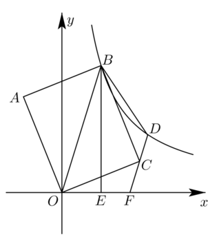

# Mathematics - 题目 1442

**ID**: 17db024af20641839f288a77936fcc73
**年级**: Grade 10
**难度**: Medium-Hard
**题型**: Fill-in-the-blank

## 题目
如图，四边形 $OABC$ 为矩形，点 $\mathrm{A}$ 在第二象限，点 $\mathrm{A}$ 关于 $OB$ 的对称点为点 $D$ ，点 $B,D$ 都在函数 $y=\frac {6\sqrt {2}}{x}(x>0)$ 的图象上， $BE⊥x$ 轴于点 $E$ .​​​​​​​‌若 $DC$ 的延长线交 $x$ 轴于点 $F$ ，当矩形 $OABC$ 的面积为 $9\sqrt {2}$ 时， $\frac {EF}{OE}$ 的值为；点 $F$ 的坐标为.

## 解答

1. 如图，
2. 
3. 作 $DG\bot x$ 轴于 $G$ ，连接 $OD$ ，设 $BC$ 和 $OD$ 交于I,
4. 设点 $B(b,\frac {6\sqrt {2}}{b}),D(a,\frac {6\sqrt {2}}{a})$ ，
5. 由对称性可得:  $\vartriangle BOD≌\vartriangle BOA≌\vartriangle OBC,$
6. $\therefore \angle OBC=\angle {\rm{\;}}BOD，BC=OD,\therefore OI=BI$ ，
7. $\therefore DI=CI$ ， $\therefore \frac {DI}{OI}=\frac {CI}{BI},$  $\because \angle CID=\angle BIO,$
8. $\therefore \vartriangle CDI\sim \vartriangle BOI,\therefore \angle CDI=\angle BOI,$
9. $\therefore CD//OB,$
10. $\therefore S{{}_{\vartriangle BOD}}=S{{}_{\vartriangle AOB}}=\frac {1}{2}S{{}_{矩形EAOCB}}=\frac {9\sqrt {2}}{2},$
11. $S{{}_{\vartriangle BOE}}=S{{}_{\vartriangle DOG}}=\frac {1}{2}|k|=3\sqrt {2},$
12. $S{{}_{四边形}}BOGD=S{{}_{\vartriangle BOD}}+S{{}_{\vartriangle DOG}}=S{{}_{梯形BEGD}}BEGD+S{{}_{\vartriangle BOE}},$
13. $S{{}_{梯形BEGD}}=S{{}_{\vartriangle BOD}}=\frac {9\sqrt {2}}{2},$
14. $\therefore \frac {1}{2}(\frac {6\sqrt {2}}{a}+\frac {6\sqrt {2}}{b})(a-b)=\frac {9\sqrt {2}}{2},$
15. $\therefore 2a{^{2}}-3ab-2b{^{2}}=0,$
16. $\therefore (a-2b)\cdot (2a+b)=0,$
17. $\therefore a=2b,a=-\frac {b}{2}$ （舍去），
18. $\therefore D(2b,\frac {6\sqrt {2}}{2b}),$ 即 $D(2b,\frac {3\sqrt {2}}{b}),$
19. 在 $Rt\vartriangle BOD$ 中，由勾股定理得 $OD{^{2}}+BD{^{2}}=OB{^{2}},$
20. $\therefore \left [(2b){^{2}}+(\frac {3\sqrt {2}}{b}){^{2}}\right ]+\left [(2b-b){^{2}}+(\frac {6\sqrt {2}}{b}-\frac {3\sqrt {2}}{b}){^{2}}\right ]=b{^{2}}+(\frac {6\sqrt {2}}{b}){^{2}},$
21. $\therefore b=\sqrt {3},$
22. $\therefore B(\sqrt {3},2\sqrt {6}),D(2\sqrt {3},\sqrt {6}),$
23. 因为直线 $OB$ 的解析式为： $y=2\sqrt {2}x,$
24. 所以直线 $DF$ 的解析式为： $y=2\sqrt {2}x-3\sqrt {6},$
25. 当 $y=0$ 时， $2\sqrt {2}x-3\sqrt {6}=0,\therefore x=\frac {3\sqrt {3}}{2},$
26. $\therefore F(\frac {3\sqrt {3}}{2},0),\because OE=\sqrt {3},OF=\frac {3\sqrt {3}}{2},$
27. $\therefore EF=OF-OE=\frac {\sqrt {3}}{2},\therefore \frac {EF}{OE}=\frac {1}{2},$

## 知识点

**中文**:
  - 函数

**English**:
  - Functions

---
