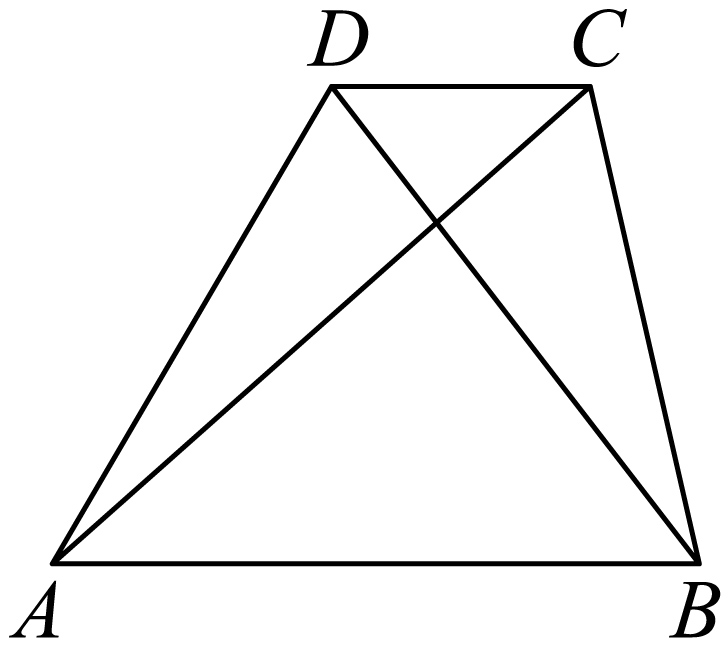

# Mathematics - 题目 3550

**ID**: 5b6f95a5f8d944b5ac4b05faf01212ee
**年级**: Grade 10
**难度**: Medium-Hard
**题型**: Fill-in-the-blank

## 题目
如图，梯形 $ABCD,AB//CD$ 且 $AB=5,AD=2DC=4$ ， $\overrightarrow {{AC}}\cdot \overrightarrow {{BD}}=0$ ，则 $\angle BAD=$， $E$ 在线段BC上，则 $\overrightarrow {{AE}}\cdot \overrightarrow {{DE}}$ 的取值范围为.​​​​​​​‌

## 解答

1. 因为 $\overrightarrow {{AC}}=\overrightarrow {{AD}}+\overrightarrow {{DC}}=\overrightarrow {{AD}}+\frac {2}{5}\overrightarrow {{AB}}$ ， $\overrightarrow {{BD}}=\overrightarrow {{AD}}-\overrightarrow {{AB}}$ ，
2. 所以 $\overrightarrow {{AC}}\cdot \overrightarrow {{BD}}=\left ({\overrightarrow {{AD}}+\frac {2}{5}\overrightarrow {{AB}}}\right )\cdot \left ({\overrightarrow {{AD}}-\overrightarrow {{AB}}}\right )=\left |{\overrightarrow {{AD}}}\right |{^{2}}-\frac {3}{5}\overrightarrow {{AB}}\cdot \overrightarrow {{AD}}-\frac {2}{5}\left |{\overrightarrow {{AB}}}\right |{^{2}}=16-\frac {3}{5}\overrightarrow {{AB}}\cdot \overrightarrow {{AD}}-10=6-\frac {3}{5}\overrightarrow {{AB}}\cdot \overrightarrow {{AD}}=0$ ，
3. 所以 $\overrightarrow {{AB}}\cdot \overrightarrow {{AD}}=10$ ，即 $\left |{\overrightarrow {{AB}}}\right |\cdot \left |{\overrightarrow {{AD}}}\right |{\cos}\angle BAD=5\times 4\times {\cos}\angle BAD=10$ ，
4. 解得 ${\cos}\angle BAD=\frac {1}{2}$ ，因为 $\angle BAD\in \left ({0,{\rm{π}}}\right )$ ，所以 $\angle BAD=\frac {{\rm{π}}}{3}$ ；
5. 
6. 过点 $D$ 作 $DF\bot AB$ ，垂足为 $F$ ，以 $F$ 为原点， $FB$ 为 $x$ 轴， $FD$ 为 $y$ 轴建立平面直角坐标系，
7. 在 ${\rm{R}}{\rm{t}}\vartriangle ADF$ 中， $AD=4$ ， $\angle BAD=\frac {{\rm{π}}}{3}$ ，所以 $AF=2$ ， $DF=2\sqrt {3}$ ，所以 $FB=AB-AF=3$ ，
8. 所以 $A\left ({-2,0}\right ),B\left ({3,0}\right ),C\left ({2,2\sqrt {3}}\right ),D\left ({0,2\sqrt {3}}\right )$ ，则 $\overrightarrow {{AB}}=\left ({5,0}\right ),\overrightarrow {{DB}}=\left ({3,-2\sqrt {3}}\right ),\overrightarrow {{BC}}=\left ({-1,2\sqrt {3}}\right )$ ，
9. 因为 $E$ 在线段BC上，设 $\overrightarrow {{BE}}=λ\overrightarrow {{BC}}=\left ({-λ,2\sqrt {3}λ}\right )$ ， $λ\in \left [0,1\right ]$
10. 从而 $\overrightarrow {{AE}}=\overrightarrow {{AB}}+\overrightarrow {{BE}}=\left ({5,0}\right )+\left ({-λ,2\sqrt {3}λ}\right )=\left ({-λ+5,2\sqrt {3}λ}\right )$ ， $\overrightarrow {{DE}}=\overrightarrow {{DB}}+\overrightarrow {{BE}}=\left ({3,-2\sqrt {3}}\right )+\left ({-λ,2\sqrt {3}λ}\right )=\left ({-λ+3,2\sqrt {3}λ-2\sqrt {3}}\right )$ ，
11. $\overrightarrow {{AE}}\cdot \overrightarrow {{DE}}=\left ({-λ+5,2\sqrt {3}λ}\right )\cdot \left ({-λ+3,2\sqrt {3}λ-2\sqrt {3}}\right )=\left ({-λ+5}\right )\left ({-λ+3}\right )+2\sqrt {3}λ\left ({2\sqrt {3}λ-2\sqrt {3}}\right )$
12. $=13λ{^{2}}-20λ+15=13{\left({λ-\frac {10}{13}}\right)^{2}}+\frac {95}{13}$ ，
13. 因为 $λ\in \left [0,1\right ]$ ，所以当 $λ=\frac {10}{13}$ 时， $\overrightarrow {{AE}}\cdot \overrightarrow {{DE}}$ 取得最小值 $\frac {95}{13}$ ，当 $λ=0$ 时， $\overrightarrow {{AE}}\cdot \overrightarrow {{DE}}$ 取得最大值 $15$ ，
14. 所以 ${\overline{AE}}\cdot {\overline{DE}}$ 的取值范围为 $\left [\frac {95}{13},15\right ]$ .

## 知识点

**中文**:
  - 向量夹角的计算
  - 数量积的坐标表示

**English**:
  - Calculation of Vector Angle
  - Coordinate Representation

---
