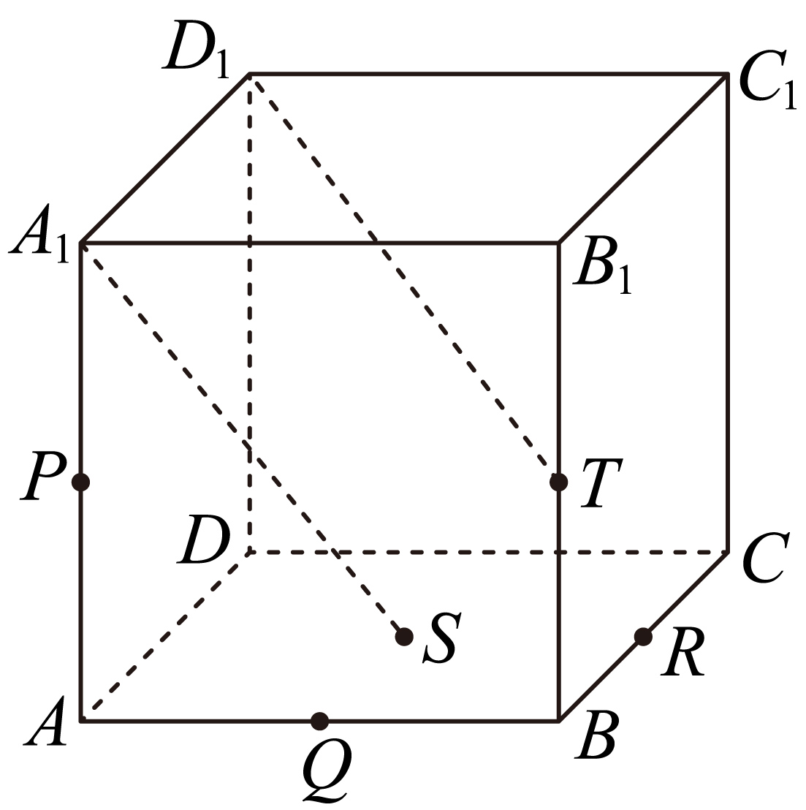

# Mathematics - 题目 2002

**ID**: 656e625ab23949699595d74f986dd00e
**年级**: Grade 10
**难度**: Medium-Hard
**题型**: Fill-in-the-blank

## 题目
如图，正方体 $ABCD-A{{}_{1}}B{{}_{1}}C{{}_{1}}D{{}_{1}}$ 中，P、Q、R、S、T分别为线段 $AA{{}_{1}}$ 、 $AB$ 、 $BC$ 、 $BD$ 、 $BB{{}_{1}}$ 的中点，联结 $A{{}_{1}}S$ 、 $D{{}_{1}}T$ ，对空间任意两点M、N，若线段 $MN$ 与线段 $A{{}_{1}}S$ 不相交或与线段 $D{{}_{1}}T$ 不相交，则称M、N两点可视.​​​​​​​‌则此正方体中的点A、P、Q、R中与点 $C{{}_{1}}$ 可视的点有.（答案从“点A、点P、点Q、点R”中选择）

## 解答

1. 对于点A，连接 $AD{{}_{1}},BC{{}_{1}},AC{{}_{1}}$ ，因为 $D{{}_{1}}、A、C{{}_{1}}\in $ 平面 $D{{}_{1}}C{{}_{1}}BA$ ，
2. $T\notin $ 平面 $D{{}_{1}}C{{}_{1}}BA$ ，且 $D{{}_{1}}\notin $  $AC{{}_{1}}$ ，所以直线 $D{{}_{1}}T$ 与 $AC{{}_{1}}$ 是异面直线，
3. 所以点 $C{{}_{1}}$ 与点 $\mathrm{A}$ 可视；
4. 
5. 对于点 $P$ ，如图，连接 $A{{}_{1}}C{{}_{1}},PC{{}_{1}},BD,AC$ ，得 $A{{}_{1}}S、PC{{}_{1}}\subset $ 平面 $A{{}_{1}}C{{}_{1}}CA$ ，
6. 且 $A{{}_{1}}S$ 与 $PC{{}_{1}}$ 相交，连接 $D{{}_{1}}P,PT,TC{{}_{1}}$ ，因为 $D{{}_{1}}C{{}_{1}}{\rm{/}}{\rm{/}}PT$ ， $D{{}_{1}}C{{}_{1}}{\rm{=}}PT$ ，
7. 所以四边形 $D{{}_{1}}C{{}_{1}}TP$ 是平行四边形，得 $D{{}_{1}}T$ 与 $PC{{}_{1}}$ 相交，所以点 $C{{}_{1}}$ 与点 $P$ 不可视，
8. 
9. 对于点 $Q$ ，如图，连接 $A{{}_{1}}C{{}_{1}},AC$ ， $C{{}_{1}}Q$ ，因为 $A{{}_{1}}、S、C{{}_{1}}\in $ 平面 $A{{}_{1}}C{{}_{1}}CA$ ，
10. $\mathbf{Q}\notin $ 平面 $A{{}_{1}}C{{}_{1}}CA$ ，且 $C{{}_{1}}\notin $  $A{{}_{1}}S$ ，所以直线 $A{{}_{1}}S$ 与 $QC{{}_{1}}$ 是异面直线，
11. 所以点 $C{{}_{1}}$ 与点 $Q$ 可视；
12. 
13. 对于点 $R$ ，如图，连接 $RC{{}_{1}}$ ， $TC{{}_{1}},TD{{}_{1}}$ ，
14. 因为 $C{{}_{1}}、T、D{{}_{1}}\in $ 平面 $D{{}_{1}}C{{}_{1}}T$ ， $\mathbf{R}\notin $ 平面 $D{{}_{1}}C{{}_{1}}T$ ，且 $C{{}_{1}}\notin $  $D{{}_{1}}T$ ，
15. 所以直线 $D{{}_{1}}T$ 与 $RC{{}_{1}}$ 是异面直线，所以点 $C{{}_{1}}$ 与点 $R$ 可视，故D错误.
16. 

## 知识点

**中文**:
  - 空间中直线与平面的位置关系

**English**:
  - Line-Plane Relationships

---
