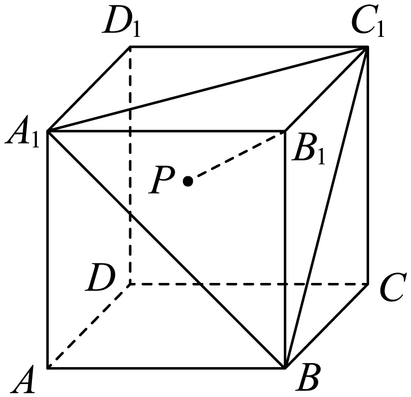

# Mathematics - 题目 2370

**ID**: 9cab45a642614aaca882db573874f1ec
**年级**: Grade 10
**难度**: Medium-Hard
**题型**: Fill-in-the-blank

## 题目
如图所示，在棱长为 $a$ 的正方体 $ABCD-A{{}_{1}}B{{}_{1}}C{{}_{1}}D{{}_{1}}$ 中，点 $P$ 是平面 $BA{{}_{1}}C{{}_{1}}$ 内的动点，满足 $B{{}_{1}}P=\frac {\sqrt {6}}{4}a$ ，则直线 $D{{}_{1}}P$ 与平面 $BA{{}_{1}}C{{}_{1}}$ 所成角正切值的最大值为.​​​​​​​‌

## 解答

1. 如图所示，
2. 在正方体 $ABCD-A{{}_{1}}B{{}_{1}}C{{}_{1}}D{{}_{1}}$ 上“堆叠”一个与之全等的正方体 $A{{}_{1}}B{{}_{1}}C{{}_{1}}D{{}_{1}}-A{{}_{2}}B{{}_{2}}C{{}_{2}}D{{}_{2}}$ ，
3. 连接 $C{{}_{1}}D{{}_{2}}$ 、 $A{{}_{1}}D{{}_{2}}$ ，易知四边形 $D{{}_{2}}A{{}_{1}}BC{{}_{1}}$ 是菱形，
4. 设 $B{{}_{1}}$ 在平面 $BA{{}_{1}}C{{}_{1}}$ 的射影为 $O{{}_{1}}$ ，
5. 由正三棱锥 $B{{}_{1}}-A{{}_{1}}BC{{}_{1}}$ 可知，点 $O{{}_{1}}$ 是 ${\rm △}BA{{}_{1}}C{{}_{1}}$ 的外心，
6. $A{{}_{1}}B=BC{{}_{1}}=A{{}_{1}}C{{}_{1}}=\sqrt {2}a$ ，则 $S{{}_{\vartriangle BA{{}_{1}}C{{}_{1}}}}=\frac {1}{2}\times \sqrt {2}a\times \sqrt {(\sqrt {2}a){^{2}}-(\frac {\sqrt {2}}{2}a){^{2}}}=\frac {\sqrt {3}}{2}a{^{2}}$ ，
7. 由 $V{{}_{B{{}_{1}}-A{{}_{1}}BC{{}_{1}}}}=V{{}_{B-A{{}_{1}}B{{}_{1}}C{{}_{1}}}}$ ，得 $\frac {1}{3}\times \frac {\sqrt {3}}{2}a{^{2}}\cdot B{{}_{1}}O{{}_{1}}=\frac {1}{3}\times \frac {1}{2}\times a{^{3}}$ ，
8. 所以 $B{{}_{1}}O{{}_{1}}=\frac {\sqrt {3}}{3}a$ ，再结合 $B{{}_{1}}P=\frac {\sqrt {6}}{4}a$ ，得 $O{{}_{1}}P=\sqrt {B{{}_{1}}P{^{2}}-B{{}_{1}}O{{}_{1}}{^{2}}}=\frac {\sqrt {6}}{12}a$ ，
9. 从而 $P$ 的轨迹是（平面 $BA{{}_{1}}C{{}_{1}}$ 上）以 $O{{}_{1}}$ 为圆心， $r=\frac {\sqrt {6}}{12}a$ 为半径的圆，记为圆 $O{{}_{1}}$ ，
10. 同理， $D{{}_{1}}$ 在平面 $D{{}_{2}}A{{}_{1}}C{{}_{1}}$ （即平面 $BA{{}_{1}}C{{}_{1}})$ 上的射影 $O{{}_{2}}$ 为 $△D{{}_{2}}A{{}_{1}}C{{}_{1}}$ 的外心，
11. 连接 $O{{}_{2}}P$ ，则 $D{{}_{1}}P$ 在平面 $BA{{}_{1}}C{{}_{1}}$ 上的射影为 $O{{}_{2}}P$ ，
12. 进而 $\angle D{{}_{1}}PO{{}_{2}}$ 即为直线 $D{{}_{1}}P$ 与平面 $BA{{}_{1}}C{{}_{1}}$ 所成角，记 $\angle D{{}_{1}}PO{{}_{2}}=θ$ ，
13. 则 ${\tan}θ=\frac {D{{}_{1}}O{{}_{2}}}{O{{}_{2}}P}$ ，其中 $D{{}_{1}}O{{}_{2}}=B{{}_{1}}O{{}_{1}}=\frac {\sqrt {3}}{3}a$ 为定值，
14. 而对于 $O{{}_{2}}P$ ，由圆的几何知识可知，当 $P$ 运动到线段 $O{{}_{1}}O{{}_{2}}\bot A{{}_{1}}C{{}_{1}}$ 且与圆 $O{{}_{1}}$ 相交时，
15. $O{{}_{2}}P$ 取得最小值，记 $O{{}_{1}}O{{}_{2}},A{{}_{1}}C{{}_{1}}$ 相交于Q,易知 $O{{}_{1}}Q=O{{}_{2}}Q=\sqrt {2}a\times \frac {\sqrt {3}}{2}\times \frac {1}{3}=\frac {\sqrt {6}}{6}a$ ，
16. 则 $O{{}_{2}}P=O{{}_{1}}O{{}_{2}}-r=\frac {\sqrt {6}}{3}a-\frac {\sqrt {6}}{12}a=\frac {\sqrt {6}}{4}a$ ，
17. 此时 ${\tan}θ$ 取得最大值为 $\frac {\frac {\sqrt {3}}{3}a}{\frac {\sqrt {6}}{4}a}=\frac {2\sqrt {2}}{3}$ ．

## 知识点

**中文**:
  - 直线与平面所成的角

**English**:
  - Line-Plane Angle

---
