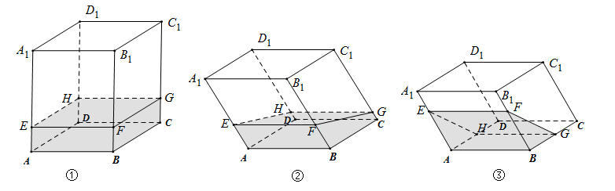

# Mathematics - 题目 947

**ID**: e167034379f94e069ad7827a0db830fb
**年级**: Grade 10
**难度**: Medium-Hard
**题型**: Fill-in-the-blank

## 题目
如图，透明塑料制成的长方体容器 $ABCD-A{{}_{1}}B{{}_{1}}C{{}_{1}}D{{}_{1}}$ 内灌进一些水，固定容器一边 $AB$ 于地面上，再将容器倾斜，随着倾斜度的不同，有下面五个命题：（1）盛水的部分始终呈棱柱形．（2）水面 $EFGH$ 所在四边形的面积为定值．（3）当容器倾斜如图②所示时， $AE+DH$ 为定值．（4）当容器倾斜如图③所示时， $AE\cdot AH$ 为定值．（5）当容器倾斜如图③所示时，当 $AE=AH$ 时， $FG$ 取最小值．其中所有正确命题的序号是．​​​​​​​‌

## 解答

1. 对于（1），由于 $AB$ 固定，所以在倾斜的过程中，始终有 $AB{\rm{/}}{\rm{/}}EF{\rm{/}}{\rm{/}}HG{\rm{/}}{\rm{/}}DC$ ，
2. 且平面 $ADHE{\rm{/}}{\rm{/}}$ 平面 $BCGF$ ，故盛水的部分始终呈棱柱形（四棱柱或三棱柱），故（1）正确；
3. 对于（2），由于 $AB$ 固定，易知 $EF//AB$ ，且 $AB\bot $ 平面 $BCC{{}_{1}}B{{}_{1}}$ ，所以 $EF\bot $ 平面 $BCC{{}_{1}}B{{}_{1}}$ ，
4. 又 $FG\subset $ 平面 $BCC{{}_{1}}B{{}_{1}}$ ，所以 $EF\bot FG$ ,故 $EFGH$ 为矩形，则 $S{{}_{EFGH}}=EF\cdot FG=AB·FG$ ，
5. $FG$ 的长随着倾斜度的变化而变化，故 $EFGH$ 的面积是变化的，故（2）错误；
6. 对于（3），当容器倾斜如图②所示时，四棱柱 $ADHE-BCGF$ 的体积保持不变，
7. 即 $V{{}_{ADHE-BCGF}}=S{{}_{ADHE}}\cdot AB=\frac {\left ({AE+DH}\right )\cdot AD·AB}{2}$ ，又 $AB，AD$ 均为定值，故 $AE+DH$ 为定值，故（3）正确；
8. 对于（4），当容器倾斜如图③所示时，三棱柱 $BFG-AEH$ 的体积保持不变，
9. 即 $V{{}_{BFG-AEH}}=S{{}_{\vartriangle AEH}}\cdot AB=\frac {1}{2}AE\cdot AH·AB$ ，又 $AB$ 是定值，则 $AE\cdot AH$ 为定值，故（4）正确．
10. 对于（5），由（4） $AE\cdot AH$ 为定值， $FG{^{2}}=EH{^{2}}=AE{^{2}}+AH{^{2}}\geqslant 2AE\cdot AH$ ，当 $AE=AH$ 时， $FG$ 取最小值．故（5）正确.

## 知识点

**中文**:
  - 棱柱

**English**:
  - Prism

---
