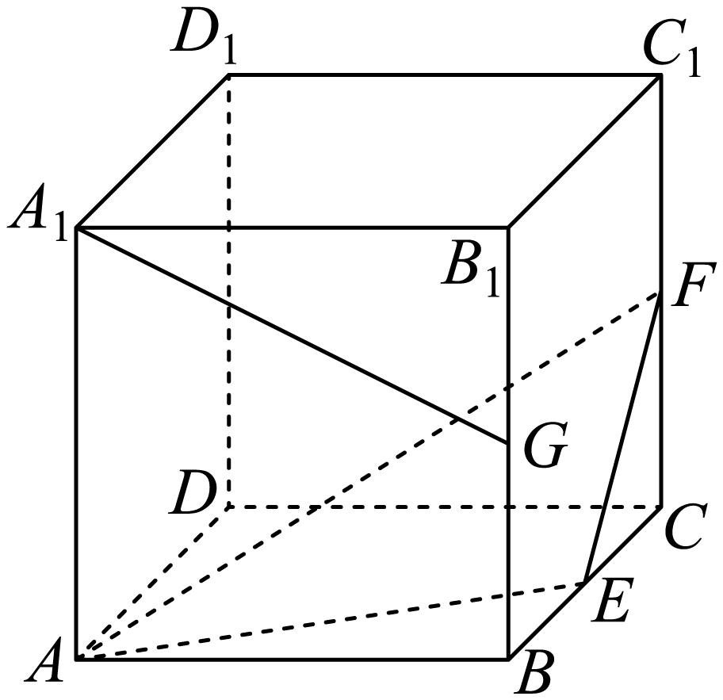

# Mathematics - 题目 3791

**ID**: 179cf4a30a464cabbd97b133c37c564d
**年级**: Grade 10
**难度**: Medium-Hard
**题型**: Multiple-choice

## 题目
如图，正方体 $ABCD-A{{}_{1}}B{{}_{1}}C{{}_{1}}D{{}_{1}}$ 的棱长为 ${\rm 1，}E$ ， $F$ ， $G$ 分别为 $BC,CC{{}_{1}},BB{{}_{1}}$ 的中点，则下列说法正确的是（      ）​​​​​​​‌

## 解答

1. 对A：假设 $DD{{}_{1}}\bot AF$ ，因为 $DD{{}_{1}}$ // $CC{{}_{1}}$ ，则 $CC{{}_{1}}\bot AF$ ， $\angle AFC=90{}\degree $ ；
2. 因为 $ABCD-A{{}_{1}}B{{}_{1}}C{{}_{1}}D{{}_{1}}$ 为正方体，故 $CC{{}_{1}}\bot $ 面 $ABCD$ ，又 $AC\subset $ 面 $ABCD$ ，故 $CC{{}_{1}}\bot AC$ ， $\angle ACF=90{}\degree $ ，
3. 故 $\angle AFC\ne 90{}\degree $ ，假设不成立，即 $DD{{}_{1}}$ 与 $AF$ 不垂直，故A错误；
4. 对B：连接 $AD{{}_{1}},D{{}_{1}}F,GF$ ，如下所示：
5. 
6. 因为 $E,F$ 分别为 $BC,CC{{}_{1}}$ 的中点，故 $EF$ // $BC{{}_{1}}$ ，又 $BC{{}_{1}}$ // $AD{{}_{1}}$ ，故 $AD{{}_{1}}$ // $EF$ ，故 $A,D{{}_{1}},E,F$ 四点共面；
7. 易知四边形 $A{{}_{1}}GFD{{}_{1}}$ 为平行四边形，故 $A{{}_{1}}G$ // $D{{}_{1}}F$ ，又 $D{{}_{1}}F\subset $ 面 $AEF$ ， $A{{}_{1}}G\not\subset $ 面 $AEF$ ，故 $A{{}_{1}}G$ //面 $AEF{\rm ，B}$ 正确；
8. 对C：由B可知，平面 $AEF$ 截正方体所得截面为梯形 $AD{{}_{1}}FE$ ；
9. $EF=\frac {1}{2}AD{{}_{1}}=\frac {\sqrt {2}}{2}$ ， $AE=D{{}_{1}}F=\sqrt {D{{}_{1}}{\rm C}{_{1}^{2}}+C{{}_{1}}F{^{2}}}=\sqrt {1+\frac {1}{4}}=\frac {\sqrt {5}}{2}$ ，
10. 故梯形 $AD{{}_{1}}FE$ 的面积为 $\frac {1}{2}\left ({EF+AD{{}_{1}}}\right )\times \sqrt {AE{^{2}}-{\left({\frac {AD{{}_{1}}-EF}{2}}\right)^{2}}}=\frac {1}{2}\times \left ({\frac {\sqrt {2}}{2}+\sqrt {2}}\right )\times \sqrt {\frac {5}{4}-{\left({\frac {\sqrt {2}-\frac {\sqrt {2}}{2}}{2}}\right)^{2}}}=\frac {3\sqrt {2}}{4}\times \frac {3\sqrt {2}}{4}=\frac {9}{8}$ ，故C错误；
11. 对D：连接 $CG,GF$ ，记 $CG\cap EF=O$ ，若下所示：
12. 
13. 若点 $C$ 与点 $G$ 到平面 $AEF$ 的距离相等，则 $EF$ 过 $CG$ 的中点，也即 $O$ 为 $GC$ 的中点；
14. 显然四边形 $GBCF$ 为平行四边形，显然 $O$ 不为 $GC$ 的中点，故 $O$ 不是 $GC$ 中点，
15. 则点 $C$ 与点 $G$ 到平面 $AEF$ 的距离不相等，故D错误；
16. 故选B.

## 知识点

**中文**:
  - 用向量证明平行问题

**English**:
  - Proving Parallelism

---
