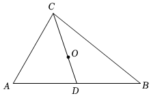

# Mathematics - 题目 2082

**ID**: 35f37a73e5e74bf3a554c7d72abb8828
**年级**: Grade 10
**难度**: Medium-Hard
**题型**: Multiple-choice

## 题目
如图，在 $△ABC$ 中，D是AB的中点，O是CD上一点，且 $\underset{CO}{⃗}=2\underset{OD}{⃗}$ ，其中所有正确结论的序号是（      ）① $\underset{OA}{⃗}+\underset{OB}{⃗}+\underset{OC}{⃗}=\underset{0}{⃗}$ ；​​​​​​​‌② $(\underset{OA}{⃗}+\underset{OB}{⃗})\cdot \underset{OC}{⃗}=|\underset{OC}{⃗}{|}^{2}$ ；③过点O作一条直线与边AC，BC分别相交于点E，F，若 $\underset{CE}{⃗}=\frac{3}{4}\underset{CA}{⃗}$ ， $\underset{CF}{⃗}=\mu \underset{CB}{⃗}(0\leqslant \mu \leqslant 1)$ ，则 $\mu =\frac{3}{4}$ ；④若 $△ABC$ 是边长为1的正三角形，M是边AC上的动点，则 $\underset{BM}{⃗}\cdot \underset{MD}{⃗}$ 的取值范围是 $[-\frac{3}{4},-\frac{23}{64}]．$

## 解答

1. 对于①，由题意， $\underset{OC}{⃗}=-\frac{2}{3}\underset{CD}{⃗}$ ，
2. $\underset{OA}{⃗}=\underset{OD}{⃗}+\underset{DA}{⃗}$ ， $\underset{OB}{⃗}=\underset{OD}{⃗}+\underset{DB}{⃗}=\underset{OD}{⃗}-\underset{DA}{⃗}$ ，
3. 故 $\underset{OA}{⃗}+\underset{OB}{⃗}+\underset{OC}{⃗}=-\frac{2}{3}\underset{CD}{⃗}+2\underset{OD}{⃗}=-\frac{2}{3}\underset{CD}{⃗}+\frac{2}{3}\underset{CD}{⃗}=\underset{0}{⃗}$ ，故①正确；
4. 对于②， $(\underset{OA}{⃗}+\underset{OB}{⃗})\cdot \underset{OC}{⃗}=2\underset{OD}{⃗}\cdot \underset{OC}{⃗}=-|\underset{OC}{⃗}{|}^{2}$ ，故②错误；
5. 对于③， $\underset{CD}{⃗}=\frac{1}{2}\underset{CA}{⃗}+\frac{1}{2}\underset{CB}{⃗}$ ，
6. $\underset{OE}{⃗}=\underset{OC}{⃗}+\underset{CE}{⃗}=-\frac{1}{3}(\underset{CA}{⃗}+\underset{CB}{⃗})+\frac{3}{4}\underset{CA}{⃗}=\frac{5}{12}\underset{CA}{⃗}-\frac{1}{3}\underset{CB}{⃗}$ ，
7. $\underset{OF}{⃗}=\underset{OC}{⃗}+\underset{CF}{⃗}=-\frac{1}{3}(\underset{CA}{⃗}+\underset{CB}{⃗})+\mu \underset{CB}{⃗}=-\frac{1}{3}\underset{CA}{⃗}+(\mu -\frac{1}{3})\underset{CB}{⃗}$ ，
8. 因为E，O，F三点共线，所以 $\underset{OF}{⃗}=\lambda \underset{OE}{⃗}$ ，
9. 即 $\begin{cases}-\frac{1}{3}=\frac{5}{12}\lambda \\\mu -\frac{1}{3}=-\frac{1}{3}\lambda \end{cases}$ ，解得 $\lambda =-\frac{4}{5}$ ， $\mu =\frac{3}{5}$ ，故③错误；
10. 对于④，以D为坐标原点，建立如图所示的平面直角坐标系，
11. 
12. 则 $A(-\frac{1}{2},0)$ ， $B(\frac{1}{2},0)$ ， $C(0,\frac{\sqrt{3}}{2})$ ， $D(0,0)$ ，
13. $\underset{AC}{⃗}=(\frac{1}{2},\frac{\sqrt{3}}{2})$ ， $\underset{AB}{⃗}=(1,0)$ ， $\underset{AD}{⃗}=(\frac{1}{2},0)$ ，
14. 设 $\underset{AM}{⃗}=t\underset{AC}{⃗}$ ， $t\in [0,1]$ ，
15. 因为 $\underset{BM}{⃗}=\underset{AM}{⃗}-\underset{AB}{⃗}=(\frac{1}{2}t,\frac{\sqrt{3}}{2}t)-(1,0)=(\frac{1}{2}t-1,\frac{\sqrt{3}}{2}t)$ ，
16. $\underset{MD}{⃗}=\underset{AD}{⃗}-\underset{AM}{⃗}=(\frac{1}{2},0)-(\frac{1}{2}t,\frac{\sqrt{3}}{2}t)=(\frac{1}{2}-\frac{1}{2}t,-\frac{\sqrt{3}}{2}t)$ ，
17. 所以 $\underset{BM}{⃗}\cdot \underset{MD}{⃗}=(\frac{1}{2}t-1)\cdot (\frac{1}{2}-\frac{1}{2}t)-\frac{3}{4}{t}^{2}$
18. $=-{t}^{2}+\frac{3}{4}t-\frac{1}{2}=-(t-\frac{3}{8})^{2}-\frac{23}{64}$ ， $t\in [0,1]$ ，
19. 所以当 $t=1$ 时， $\underset{BM}{⃗}\cdot \underset{MD}{⃗}$ 有最小值为 $-\frac{3}{4}$ ；
20. 当 $t=\frac{3}{8}$ 时， $\underset{BM}{⃗}\cdot \underset{MD}{⃗}$ 有最大值为 $-\frac{23}{64}$ ，
21. 即 $\underset{BM}{⃗}\cdot \underset{MD}{⃗}$ 的取值范围是 $[-\frac{3}{4},-\frac{23}{64}]$ ，故④正确；
22. 故说法正确的有①④．
23. 故选： ${\rm A}．$

## 知识点

**中文**:
  - 向量在平面几何求值问题中的应用
  - 向量的加法运算与几何表示
  - 数量积的计算
  - 向量线性综合运算

**English**:
  - Applications in Plane Geometry Evaluation
  - Vector Addition and Geometric Representation
  - Calculation of Scalar Product
  - Comprehensive Linear Operations

---
