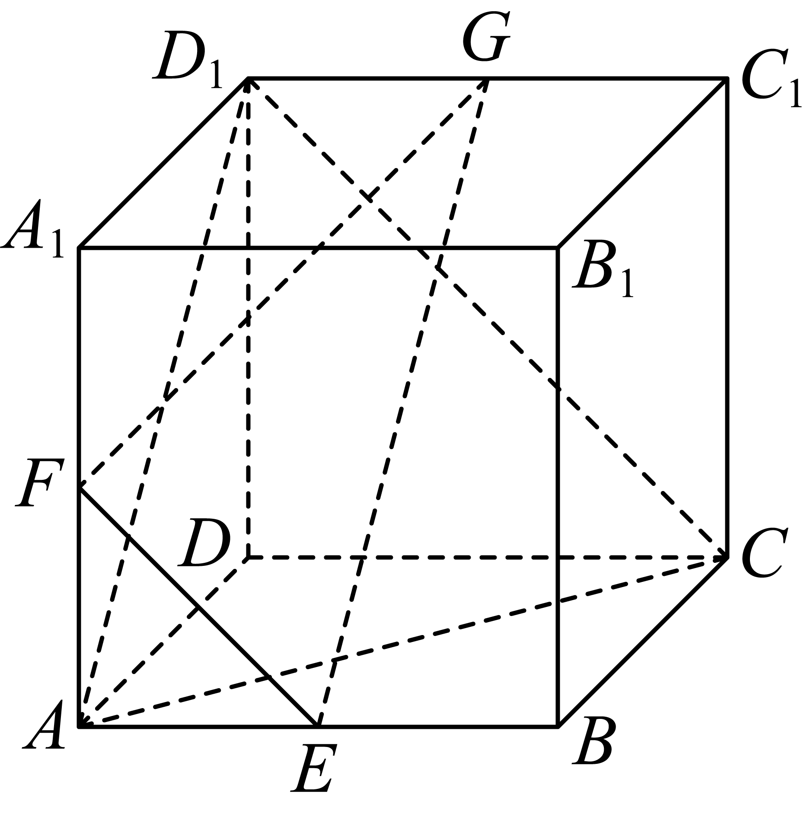

# Mathematics - 题目 275

**ID**: 5810528d4626476e82c644366d6f19a6
**年级**: Grade 10
**难度**: Medium-Hard
**题型**: Multiple-choice

## 题目
已知正方体 $ABCD-A{{}_{1}}B{{}_{1}}C{{}_{1}}D{{}_{1}}$ 中，点 $E$ ， $F$ ， $G$ 分别为棱 $AB$ ， $AA{{}_{1}}$ ， $C{{}_{1}}D{{}_{1}}$ 的中点，给出下列四个结论：其中不正确结论是（      ）​​​​​​​‌

## 解答

1. ①因为点 $E，G$ 分别为棱 $AB，C{{}_{1}}D{{}_{1}}$ 的中点，
2. 所以 $AE//D{{}_{1}}G，AE=D{{}_{1}}G$ ，即四边形 $AEGD{{}_{1}}$ 是平行四边形，
3. 所以 $AD{{}_{1}}//EG$ ，
4. 又因为 $AD{{}_{1}}\subset $ 平面 $ACD{{}_{1}}$ ， $EG\not\subset $ 平面 $ACD{{}_{1}}$ ，所以 $EG//$ 平面 $ACD{{}_{1}}$ .
5. 因为点 $E，F$ 分别为棱 $AB，AA{{}_{1}}$ 的中点，所以 $EF//A{{}_{1}}B//CD{{}_{1}}$ ，
6. 又因为 $CD{{}_{1}}\subset $ 平面 $ACD{{}_{1}}$ ， $EF\not\subset $ 平面 $ACD{{}_{1}}$ ，所以 $EF//$ 平面 $ACD{{}_{1}}$ .
7. 因为 $EG\cap EF=E$ ， $EG、EF\subset $ 平面 $EFG$ ，
8. 所以平面 $EFG//$ 平面 $ACD{{}_{1}}$ .
9. 因为 $FG\subset $ 平面 $EFG$ ，所以直线 $FG//$ 平面 $ACD{{}_{1}}$ ，即A错误；
10. ②由三垂线定理知， $B{{}_{1}}D\bot AC，B{{}_{1}}D\bot CD{{}_{1}}$ ，
11. 因为 $AC\cap CD{{}_{1}}=C,AC,CD{{}_{1}}\subset $ 平面 $ACD{{}_{1}}$ ，所以 $B{{}_{1}}D\bot $ 平面 $ACD{{}_{1}}$ ，
12. 由①知平面 $EFG//$ 平面 $ACD{{}_{1}}$ ，
13. 所以 $B{{}_{1}}D\bot $ 平面 $EFG$ ，即B正确；
14. ③若 $AB=1$ ，则 $△ACD{{}_{1}}$ 是边长为 $\sqrt {2}$ 的等边三角形，
15. 所以 $S{{}_{\vartriangle ACD{{}_{1}}}}=\frac {1}{2}\times \sqrt {2}\times \sqrt {2}\times {\rm{s}}{\rm{i}}{\rm{n}}\frac {{\rm{π}}}{3}=\frac {\sqrt {3}}{2}$ ，
16. 设点 $D$ 到平面 $ACD{{}_{1}}$ 的距离为 $d$ ，
17. 因为 $V{{}_{D-ACD{{}_{1}}}}=V{{}_{D{{}_{1}}-ACD}}$ ，
18. 所以 $\frac {1}{3}d\cdot S{{}_{\vartriangle ACD{{}_{1}}}}=\frac {1}{3}\cdot DD{{}_{1}}\cdot S{{}_{\vartriangle ACD}}$ ，
19. 所以 $d=\frac {1\times \frac {1}{2}\times 1\times 1}{\frac {\sqrt {3}}{2}}=\frac {\sqrt {3}}{3}$ ，
20. 所以点 $D$ 到平面 $ACD{{}_{1}}$ 的距离为 $\frac {\sqrt {3}}{3}$ ，即C正确；
21. ④由题意知，四面体 $D-ACD{{}_{1}}$ 的底面是等边 $△ACD{{}_{1}}$ ，且 $DA=DC=DD{{}_{1}}$ ，
22. 即四面体 $D-ACD{{}_{1}}$ 是正三棱锥，
23. 所以三条侧棱 $DA，DC，DD{{}_{1}}$ 与底面 $ACD{{}_{1}}$ 所成角均相等，
24. 而 $DA/\mskip-4mu/D{{}_{1}}A{{}_{1}}/\mskip-4mu/CB/\mskip-4mu/C{{}_{1}}B{{}_{1}}$ ， $DC/\mskip-4mu/D{{}_{1}}C{{}_{1}}/\mskip-4mu/AB/\mskip-4mu/A{{}_{1}}B{{}_{1}}$ ， $DD{{}_{1}}/\mskip-4mu/AA{{}_{1}}/\mskip-4mu/BB{{}_{1}}/\mskip-4mu/CC{{}_{1}}$ ，
25. 所以该正方体的棱所在直线与平面 $ACD{{}_{1}}$ 所成的角都相等，
26. 由①知平面 $EFG//$ 平面 $ACD{{}_{1}}$ ，
27. 所以该正方体的棱所在直线与平面 $EFG$ 所成的角都相等，即D正确．
28. 故选A

## 知识点

**中文**:
  - 点与面之间的距离
  - 直线与平面垂直的判定
  - 直线与平面所成的角

**English**:
  - Point-Plane Distance
  - Line-Plane Perpendicularity Determination
  - Line-Plane Angle

---
