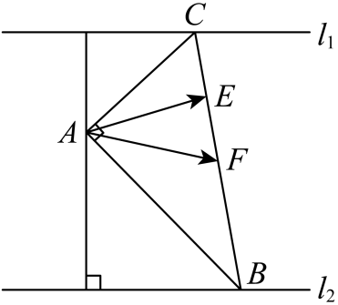

# Mathematics - 题目 2835

**ID**: 586fd6efc2ca4dc7999ec84dd5a6f644
**年级**: Grade 10
**难度**: Medium-Hard
**题型**: Multiple-choice

## 题目
如图，直线 $l{{}_{1}}\mathbf{/}\mathbf{/}l{{}_{2}}$ ，点 $A$ 是 $l{{}_{1}}$ ， $l{{}_{2}}$ 之间的一个定点，点 $A$ 到 $l{{}_{1}}$ ， $l{{}_{2}}$ 的距离分别为 $\sqrt {2}$ 和 $\sqrt {6}$ ．点 $B$ 是直线 $l{{}_{2}}$ 上一个动点，过点 $A$ 作 $AC\bot AB$ ，点 $E,F$ 在线段 $BC$ 上运动（包括端点）且 $EF=1$ ，若 $\vartriangle ABC$ 的面积为 ${{2}}\sqrt {{{3}}}$ ．则 $\overrightarrow {{AE}}\cdot \overrightarrow {{AF}}$ 的最小值为（      ）​​​​​​​‌

## 解答

1. 如图，设 $\angle OAB=θ(0<θ<\frac {{\rm{π}}}{2})$ ，则 $\angle DAC=\frac {{\rm{π}}}{2}-θ$ ，
2. 
3. 所以 $AB=\frac {OA}{{\cos}θ}=\frac {\sqrt {6}}{{\cos}θ},AC=\frac {AD}{{\cos}(\frac {{\rm{π}}}{2}-θ)}=\frac {\sqrt {2}}{\sin θ}$ ，
4. 得 $S{{}_{\vartriangle ABC}}=\frac {1}{2}AB\cdot AC=\frac {1}{2}\cdot \frac {\sqrt {6}}{{\cos}θ}\cdot \frac {\sqrt {2}}{\sin θ}=\frac {2\sqrt {3}}{\sin 2θ}$ ，又 $S{{}_{\vartriangle ABC}}=2\sqrt {3}$ ，
5. 所以 $\frac {2\sqrt {3}}{\sin 2θ}=2\sqrt {3}$ ，得 $\sin 2θ=1$ ，解得 $θ=\frac {{\rm{π}}}{4}$ ，
6. 所以 $AB=2\sqrt {3},AC=2$ ，故 $BC=\sqrt {AB{^{2}}+AC{^{2}}}=4$ ， $\overrightarrow {{AB}}\cdot \overrightarrow {{AC}}=0$ ，
7. 设 $\frac {BE}{BC}=x$  $(0\leqslant x\leqslant 1)$ ，则 $\frac {CE}{BC}=1-x,\frac {BF}{BC}=\frac {BE-EF}{BC}=x-\frac {1}{4},\frac {CF}{BC}=\frac {CE+EF}{BC}=\frac {5}{4}-x$ ，
8. 所以 $\overrightarrow {{AE}}=x\overrightarrow {{AC}}+(1-x)\overrightarrow {{AB}},\overrightarrow {{AF}}=\frac {BF}{BC}\cdot \overrightarrow {{AC}}+\frac {CF}{BC}\cdot \overrightarrow {{AB}}=(x-\frac {1}{4})\overrightarrow {{AC}}+(\frac {5}{4}-x)\overrightarrow {{AB}}$ ，
9. 则 $\overrightarrow {{AE}}\cdot \overrightarrow {{AF}}=[x\overrightarrow {{AC}}+(1-x)\overrightarrow {{AB}}]\cdot [(x-\frac {1}{4})\overrightarrow {{AC}}+(\frac {5}{4}-x)\overrightarrow {{AB}}]$
10. $=(x{^{2}}-\frac {1}{4}x)\overrightarrow {{AC}}{^{2}}+(\frac {5}{4}x-x{^{2}})\overrightarrow {{AC}}\cdot \overrightarrow {{AB}}+(1-x)(x-\frac {1}{4})\overrightarrow {{AC}}\cdot \overrightarrow {{AB}}+(1-x)(\frac {5}{4}-x)\overrightarrow {{AB}}{^{2}}$
11. $=16x{^{2}}-28x+15=16{\left({x-\frac {7}{8}}\right)^{2}}+\frac {11}{4}$ ，
12. 当 $x=\frac {7}{8}$ 时， $\overrightarrow {{AE}}\cdot \overrightarrow {{AF}}$ 取得最小值，且为 $\frac {11}{4}$ .
13. 故选B.

## 知识点

**中文**:
  - 数量积的计算

**English**:
  - Calculation of Scalar Product

---
