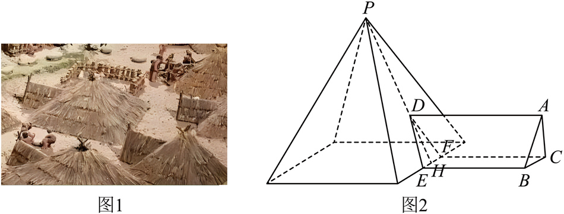

# Mathematics - 题目 706

**ID**: b5d64fe6443c4d5891a19d6ee17bf78a
**年级**: Grade 10
**难度**: Medium-Hard
**题型**: Multiple-choice

## 题目
距今5000年以上的仰韶遗址表明，我们的先人们居住的是一种茅屋，如图1所示，该茅屋主体是一个正四棱锥，侧面是正三角形，且在茅屋的一侧建有一个入户甬道，甬道形似从一个直三棱柱上由茅屋一个侧面截取而得的几何体，一端与茅屋的这个侧面连在一起，另一端是一个等腰直角三角形.​​​​​​​‌图2是该茅屋主体的直观图，其中正四棱锥的侧棱长为 $6{\rm{m}},BC//EF,AB=AC=2\sqrt {2}{\rm{m}},AB\bot AC$ ，点 $D$ 在正四棱锥的斜高PH上， $AD\bot $ 平面ABC且 $AD=3\sqrt {2}{\rm{m}}$ .不考虑建筑材料的厚度，则这个茅屋（含甬道)的室内容积为（      ）

## 解答

1. 设 $O$ 为正四棱锥底面中心，连接 $PO,OH$ ，则 $PH=6\times \frac {\sqrt {3}}{2}=3\sqrt {3},OH=3$ ，
2. 
3. $\therefore PO=\sqrt {PH{^{2}}-OH{^{2}}}=3\sqrt {2}$ ，
4. $\therefore {\tan}\angle PHO=\frac {OP}{OH}=\sqrt {2}$ ，
5. $AB=AC=2\sqrt {2}{\rm{m}},AB\bot AC$ ，则 $BC=4$ ；
6. 取 $BC$ 的中点 $M$ ，连接 $AM$ ，过点 $D$ 作 $DG\bot OH$ 于点 $G$ ，
7. 则 $DG=AM=2$ ，
8. 在 ${\rm{R}}{\rm{t}}\mathrm{△}DGH$ 中 $GH=\frac {DG}{{\tan}\angle PHO}=\sqrt {2}$ ，过 $E$ 作 $EN{\rm{/}}{\rm{/}}AB$ 交 $AD$ 于 $N$ ，连接 $NF$ ，
9. 则 $DN=GH$ ,则 $AN=AD-DN=2\sqrt {2}$ ，
10. 所求体积 $V=V{{}_{四棱锥}}{{+}}V{{}_{ABC-NEF}}{{+}}V{{}_{D-NEF}}$  ${\rm{=}}\frac {1}{3}\times 6\times 6\times 3\sqrt {2}{{+}}\frac {1}{2}\times {\left({2\sqrt {2}}\right)^{2}}\times 2\sqrt {2}{{+}}\frac {1}{3}\times \frac {1}{2}\times {\left({2\sqrt {2}}\right)^{2}}\times \sqrt {2}{\rm{=}}\frac {136}{3}\sqrt {2}({\rm{m}}{^{3}})$ .
11. 故选 ${\rm{B}}$ .

## 知识点

**中文**:
  - 简单组合体的表面积与体积

**English**:
  - Area and Volume of Composite Solids

---
