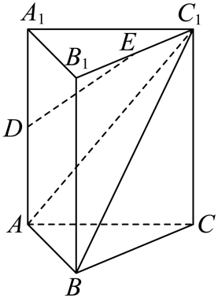

# Mathematics - 题目 2605

**ID**: b60b0aea6a144258ace6648c5a98db4c
**年级**: Grade 10
**难度**: Medium-Hard
**题型**: Multiple-choice

## 题目
《九章算术》是我国古代数学名著，它在几何学中的研究比西方早1000多年，在《九章算术》中，将底面为直角三角形且侧棱垂直于底面的三棱柱称为堑堵，将底面为矩形且一侧棱垂直于底面的四棱锥称为阳马，将四个面均为直角三角形的四面体称为鳖臑.​​​​​​​‌如图在堑堵 $ABC-A{{}_{1}}B{{}_{1}}C{{}_{1}}$ 中， $AB\mathrm{⊥}AC$ ， $CC{{}_{1}}=BC=2$ ， $D$ ， $E$ 分别为棱 $AA{{}_{1}}$ ， $B{{}_{1}}C{{}_{1}}$ 的中点，给出下列四个结论：①四面体 $C{{}_{1}}-ABC$ 为鳖臑② $DE//$ 平面 $ABC{{}_{1}}$③若 $AB=\sqrt {3}$ ，则 $AB$ 与 $DE$ 所成角的正弦值为 $\frac {\sqrt {6}}{4}$④三棱锥 $C{{}_{1}}-ABC$ 的外接球的体积为定值 $\frac {8\sqrt {2}}{3}{\rm{π}}$则其中正确结论的个数为（      ）

## 解答

1. 对于①，在堑堵 $ABC-A{{}_{1}}B{{}_{1}}C{{}_{1}}$ 中， $AB\mathrm{⊥}AC$ ，且 $CC{{}_{1}}\bot $ 平面 $ABC$ ；
2. 又 $AB,AC,BC\subset $ 平面 $ABC$ ，所以 $AB\mathrm{⊥}CC{{}_{1}}$ ， $AC\bot CC{{}_{1}},BC\bot CC{{}_{1}}$ ，
3. 因此 $\vartriangle ACC{{}_{1}},\vartriangle BCC{{}_{1}}$ 均为直角三角形，
4. 又 $AC\cap CC{{}_{1}}=C$ ， $AC,CC{{}_{1}}\subset $ 平面 $ACC{{}_{1}}A{{}_{1}}$ ，所以 $AB\bot $ 平面 $ACC{{}_{1}}A{{}_{1}}$ ；
5. 因为 $AC{{}_{1}}\subset $ 平面 $ACC{{}_{1}}A{{}_{1}}$ ，所以 $AB\bot AC{{}_{1}}$ ，即 $\vartriangle ABC{{}_{1}}$ 为直角三角形，
6. 所以可知四面体 $C{{}_{1}}-ABC$ 的四个面 $\vartriangle ACC{{}_{1}},\vartriangle BCC{{}_{1}}$ ， $\vartriangle ABC{{}_{1}}$ ， $\vartriangle ABC$ 均为直角三角形，
7. 因此四面体 $C{{}_{1}}-ABC$ 为鳖臑，即①正确；
8. 对于②，如下图所示：
9. 
10. 取 $BC{{}_{1}}$ 的中点为 $O$ ，连接 $EO,AO$ ，
11. 所以可得 $EO//BB{{}_{1}}$ ， $EO=\frac {1}{2}BB{{}_{1}}$ ，所以 $EO\mathrm{/}\mathrm{/}AD,EO=AD$ ，
12. 即可得四边形 $ADEO$ 为平行四边形，所以 $DE//AO$ ，
13. 因为 $DE\not\subset $ 平面 $ABC{{}_{1}}$ ， $AO\subset $ 平面 $ABC{{}_{1}}$ ，
14. 所以 $DE//$ 平面 $ABC{{}_{1}}$ ，即②正确；
15. 对于③，由②中的分析可知 $DE//AO$ ，
16. 所以 $AB$ 与 $DE$ 所成的角即为 $AB$ 与 $AO$ 所成的角 $\angle BAO$ 或其补角，
17. 因为 $CC{{}_{1}}=BC=2$ ， $AB=\sqrt {3}$ ，可得 $BC{{}_{1}}=2\sqrt {2}$ ，
18. 所以 $AO$ 为直角 $\vartriangle ABC{{}_{1}}$ 斜边中线，因此可得 $AO=BO=\sqrt {2}$ ，
19. 在 $\vartriangle ABO$ 中，由余弦定理可知 ${\cos}\angle BAO=\frac {AB{^{2}}+AO{^{2}}-BO{^{2}}}{2AB\cdot AO}=\frac {3+2-2}{2\times \sqrt {3}\times \sqrt {2}}=\frac {\sqrt {6}}{4}$ ，
20. 因此 $\angle BAO$ 为锐角，则 $\sin \angle BAO=\sqrt {1-{\left({\frac {\sqrt {6}}{4}}\right)^{2}}}=\frac {\sqrt {10}}{4}$ ，即③错误；
21. 对于④，由①中的分析可知， $\vartriangle ACC{{}_{1}},\vartriangle BCC{{}_{1}}$ ， $\vartriangle ABC{{}_{1}}$ ， $\vartriangle ABC$ 均为直角三角形，
22. 所以可得 $AO=BO=CO=C{{}_{1}}O=\sqrt {2}$ ，
23. 因此 $O$ 即为三棱锥 $C{{}_{1}}-ABC$ 的外接球的球心，且半径为 $\sqrt {2}$ ，
24. 所以三棱锥 $C{{}_{1}}-ABC$ 的外接球的体积为定值 $V=\frac {4}{3}{\rm{π}}{\left({\sqrt {2}}\right)^{3}}=\frac {8\sqrt {2}}{3}{\rm{π}}$ ，
25. 与 $AB,AC$ 的长度无关，即④正确.
26. 综上可知，正确的结论是①②④，共3个.
27. 故选C.

## 知识点

**中文**:
  - 异面直线所成角
  - 球的体积
  - 球的切接问题
  - 直线与平面平行的判定

**English**:
  - Angle between Skew Lines
  - Volume of a Sphere
  - Tangency and Inscribed/Circumscribed Spheres
  - Line-Plane Parallelism Determination

---
