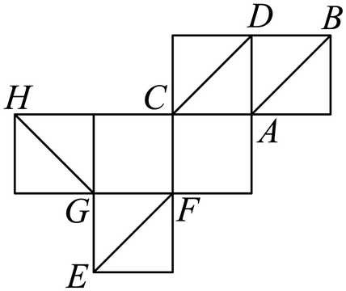

# Mathematics - 题目 2

**ID**: 13916acec7b347b88ce1428b7216809c
**年级**: Grade 10
**难度**: Medium-Hard
**题型**: Multiple-select

## 题目
如图是一个正方体的表面展开图，则在原正方体中，（      ）​​​​​​​‌

## 解答

1. 作出正方体，如下图所示，连接 $AF$ .
2. 
3. 对于A选项，因为 $BD{\rm{/}}{\rm{/}}CF$ 且 $BD=CF$ ，则四边形 $BDCF$ 为平行四边形，
4. 故 $AB$ 与 $CD$ 所成的角为 $\angle ABF$ 或其补角，
5. 易知 $\mathrm{△}ABF$ 为等边三角形，则 $\angle ABF=60{^{\circ }}$ ，
6. 所以直线 $AB$ 与 $CD$ 的夹角为 $60\degree {\rm ，A}$ 错；
7. 对于B选项，由A可知，四边形 $CDEF$ 为平行四边形，则 $CD{\rm{/}}{\rm{/}}EF{\rm ，B}$ 对；
8. 对于C选项，由图可知， $GH\cap $ 平面 $EGF=G$ ， $G\notin EF$ ， $EF\subset $ 平面 $EGF$ ，
9. 所以直线 $EF$ 与 $GH$ 为异面直线，C对；
10. 对于D选项，因为 $AH{\rm{/}}{\rm{/}}GF$ 且 $AH=GF$ ，故四边形 $AFGH$ 为平行四边形，
11. 所以 $GH//AF$ ，所以 $GH$ 与 $AB$ 所成的角为 $\angle BAF$ 或其补角，
12. 因为 $\mathrm{△}ABF$ 为等边三角形，则 $\angle BAF=60{^{\circ }}$ ，即直线 $GH$ 与直线 $AB$ 所成角为 $60{^{\circ }}{\rm ，D}$ 对.
13. 故选BCD.

## 知识点

**中文**:
  - 直线与直线的位置关系的判断
  - 空间几何体的平面展开图

**English**:
  - Determining Line-Line Relationships
  - Planar Nets

---
