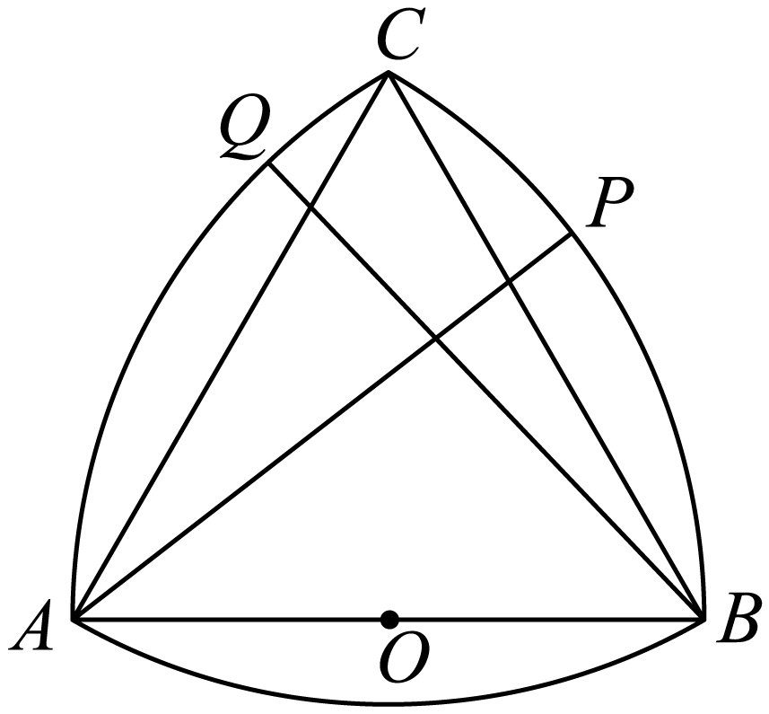

# Mathematics - 题目 249

**ID**: 4ea3f0f192f84b119a208c4874f2cffb
**年级**: Grade 10
**难度**: Medium-Hard
**题型**: Multiple-select

## 题目
如图所示，分别以等边三角形ABC的顶点A，B，C为圆心，线段AB的长为半径画圆弧 $\overset{\frown}{{BC}}$ ， $\overset{\frown}{{AC}}$ ， $\overset{\frown}{{AB}}$ ，三段圆弧围成一个曲边三角形.​​​​​​​‌已知 $AB=2{\rm ，\mathit{O}}$ 为AB的中点，点P，Q分别在 $\overset{\frown}{{BC}}$ ， $\overset{\frown}{{AC}}$ 上，若 $\angle PAB=\angle CBQ+\frac {π}{6}$ ，则（      ）

## 解答

1. 如图，设 $A\left ({0,0}\right )$ ， $B\left ({2,0}\right )$ ，
2. 
3. 根据等边三角形性质，则 $C\left ({1,\sqrt {3}}\right ){\rm ，\mathit{O}}$ 为AB的中点，故 $O\left ({1,0}\right )$ ；
4. 圆弧 $\overset{\frown}{{BC}}$ 以A为圆心，半径为2； $\overset{\frown}{{AC}}$ 以B为圆心，半径为2.
5. 设 $\angle PAB=α$ ，则P在 $\overset{\frown}{{BC}}$ 上，坐标 $P\left ({2{\rm{c}}{\rm{o}}{\rm{s}}α,2{\rm{s}}{\rm{i}}{\rm{n}}α}\right )$ ， $α\in \left [\frac {{\rm{π}}}{6},\frac {{\rm{π}}}{3}\right ]$ .
6. $\angle CBQ=β$ ，且 $α=β+\frac {{\rm{π}}}{6}$ ，故 $β\in \left [0,\frac {{\rm{π}}}{6}\right ]$ .
7. Q在 $\overset{\frown}{{AC}}$ 上，以 $B\left ({2,0}\right )$ 为圆心， $\overrightarrow {{BQ}}=\left ({2{\cos}\left ({\frac {2{\rm{π}}}{3}+β}\right ),2\sin \left ({\frac {2{\rm{π}}}{3}+β}\right )}\right )$ ，所以 $Q\left ({2-2\sin α,2{\cos}α}\right )$ .
8. 由 $\overrightarrow {{PQ}}=(x{{}_{Q}}-x{{}_{p}},y{{}_{Q}}-y{{}_{P}})$ 得： $\left |{\overrightarrow {{PQ}}}\right |=2\sqrt {3-2\left ({\sin α+{\cos}α}\right )}=2\sqrt {3-2\sqrt {2}\sin \left ({α+\frac {π}{4}}\right )}$ ，
9. 在 $α\in \left [\frac {{\rm{π}}}{6},\frac {{\rm{π}}}{3}\right ]$ 时，当 $α=\frac {{\rm{π}}}{4}$ 时， $\left |{\overrightarrow {{PQ}}}\right |{{}_{{\rm \min }}}=2\sqrt {3-2\sqrt {2}}=2\sqrt {2}-2$ ，故A对.
10. $\left |{\overrightarrow {{PQ}}}\right |$ 的最大值在 $α=\frac {{\rm{π}}}{6}$ 或 $\frac {{\rm{π}}}{3}$ 处取得， $\left |{\overrightarrow {{PQ}}}\right |{{}_{{\rm \max }}}=2\sqrt {2-\sqrt {3}}<2\sqrt {2}$ ，故B错.
11. $\overrightarrow {{OP}}\cdot \overrightarrow {{OQ}}=\left ({2{\cos}α-1}\right )\left ({1-2\sin α}\right )+4\sin α{\cos}α=2\left ({\sin α+{\cos}α}\right )-1$
12. $=2\sqrt {2}\sin \left ({α+\frac {{\rm{π}}}{4}}\right )-1$ ，
13. 当 $α=\frac {{\rm{π}}}{4}$ 时， $\left ({\overrightarrow {{OP}}\cdot \overrightarrow {{OQ}}}\right ){{}_{{\rm \max }}}=2\sqrt {2}-1$ ， 故C正确，
14. 当 $α=\frac {{\rm{π}}}{6}$ 或 $\frac {{\rm{π}}}{3}$ 时， $\left ({\overrightarrow {{OP}}\cdot \overrightarrow {{OQ}}}\right ){{}_{{\rm \min }}}=\sqrt {3}>1$ ，故D错.
15. 故选AC.

## 知识点

**中文**:
  - 向量的模的坐标计算
  - 数量积的坐标表示

**English**:
  - Coordinate Calculation of Modulus
  - Coordinate Representation

---
