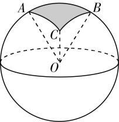

# Mathematics - 题目 2223

**ID**: 6b7bcbb65e0b46e8a8f0046a79abaa6f
**年级**: Grade 10
**难度**: Medium-Hard
**题型**: Multiple-select

## 题目
球面三角是研究球面三角形的边、角关系的一门科学.​​​​​​​‌从十六世纪起，由于天文学、航海学、测量学等方面的发展，球面三角逐渐形成了独立学科.球面上的三个点，每两点之间用球的大圆劣弧相连接，三段弧所围成的球面部分称为球面三角形.如图，球 $O$ 的半径为 ${\rm 1，}A$ ， $B$ ， $C$ 为球面上三点.平面 $△ABC$ 中，三内角 $A$ ， $B$ ， $C$ 所对的边分别为 $a$ ， $b$ ， $c$ .球面 $△ABC$ 中， $\stackrel{⌢}{BC}$ ， $\stackrel{⌢}{AC}$ ， $\stackrel{⌢}{AB}$ 的弧长分别记为 $\stackrel{⌢}{a}$ ， $\stackrel{⌢}{b}$ ， $\stackrel{⌢}{c}$ ，线段 $OA$ ， $OB$ ， $OC$ 与球面 $△ABC$ 围成的封闭几何体叫作球面三棱锥，记为球面 $O-ABC$ .设 $\mathrm{\angle }BOC=\alpha $  ， $\mathrm{\angle }AOC=\beta $  ， $\mathrm{\angle }AOB=\gamma $  ，则下列结论正确的是（      ）

## 解答

1. 对于 $\mathrm{A}$ ， $\because a=2\sin \frac{\alpha }{2}$ ， $b=2\sin \frac{\beta }{2}$ ，
2. $c=2\sin \frac{\gamma }{2}$ ， $\therefore $  由 $a+b>c$ ，得 $2\sin \frac{\alpha }{2}+2\sin \frac{\beta }{2}>2\sin \frac{\gamma }{2}$ ，即 $\sin \frac{\alpha }{2}+\sin \frac{\beta }{2}>\sin \frac{\gamma }{2}$ ，故 $\mathrm{A}$ 正确；
3. 对于 $\mathrm{B}$ ， $\because \stackrel{⌢}{a}=\alpha $  ， $\stackrel{⌢}{b}=\beta $  ， $\stackrel{⌢}{c}=\gamma $  ， $\therefore $  由 ${\stackrel{⌢}{a}}^{2}+{\stackrel{⌢}{b}}^{2}={\stackrel{⌢}{c}}^{2}$ ，得 ${\alpha }^{2}+{\beta }^{2}={\gamma }^{2}$ ，故 $\mathrm{B}$ 正确；
4. 对于 $\mathrm{C}$ ， $\because {a}^{2}+{b}^{2}={c}^{2}$ ， $\therefore 4{\sin }^{2}\frac{\alpha }{2}+4{\sin }^{2}\frac{\beta }{2}=4{\sin }^{2}\frac{\gamma }{2}$ ，即 ${\sin }^{2}\frac{\alpha }{2}+{\sin }^{2}\frac{\beta }{2}={\sin }^{2}\frac{\gamma }{2}$ ，又 ${\sin }^{2}\frac{\alpha }{2}=\frac{1-\cos \alpha }{2}$ ， ${\sin }^{2}\frac{\beta }{2}=\frac{1-\cos \beta }{2}$ ， ${\sin }^{2}\frac{\gamma }{2}=\frac{1-\cos \gamma }{2}$ ，
5. $\therefore \frac{1-\cos \alpha }{2}+\frac{1-\cos \beta }{2}=\frac{1-\cos \gamma }{2}$ ，则 $\cos \alpha +\cos \beta -\cos \gamma =1$ ，取 $\alpha =\beta =\frac{\mathrm{\pi }}{3}$ ， $\gamma =\frac{\mathrm{\pi }}{2}$ ，满足 $\cos \alpha +\cos \beta -\cos \gamma =1$ ，此时 ${\stackrel{⌢}{a}}^{2}+{\stackrel{⌢}{b}}^{2}=\frac{2{\mathrm{\pi }}^{2}}{9}$ ， ${\stackrel{⌢}{c}}^{2}=\frac{{\mathrm{\pi }}^{2}}{4}$ ， $\therefore {\stackrel{⌢}{a}}^{2}+{\stackrel{⌢}{b}}^{2}<{\stackrel{⌢}{c}}^{2}$ ，故 $\mathrm{C}$ 错误；
6. 对于 $\mathrm{D}$ ， $\because \stackrel{⌢}{a}=\stackrel{⌢}{b}=\stackrel{⌢}{c}=\frac{\mathrm{\pi }}{3}$ ， $\therefore \alpha =\beta =\gamma =\frac{\mathrm{\pi }}{3}$ ， $\therefore a=b=c=1$ ，
7. 
8. 则平面 $△ABC$ 的面积为 $\frac{\sqrt{3}}{4}{a}^{2}=\frac{\sqrt{3}}{4}$ ，
9. 此时三棱锥 $O-ABC$ 的棱长都为1，取 $BC$ 的中点 $D$ ，连接 $AD$ ，过点 $O$ 作 $OP\perp $  平面 $ABC$ ，交 $AD$ 于点 $P$ ，
10. 其中 $AD=\frac{\sqrt{3}}{2}$ ， $AP=\frac{2}{3}AD=\frac{\sqrt{3}}{3}$ ，故 $OP=\sqrt{A{O}^{2}-A{P}^{2}}=\sqrt{1-\frac{1}{3}}=\frac{\sqrt{6}}{3}$ ，
11. 故点 $O$ 到平面 $ABC$ 的距离 $ℎ=\frac{\sqrt{6}}{3}$ ，所以三棱锥 $O-ABC$ 的体积 ${V}_{O-ABC}=\frac{1}{3}{S}_{△ABC}\cdot ℎ=\frac{\sqrt{2}}{12}$ ，则球面 $O-ABC$ 的体积 $V>{V}_{O-ABC}=\frac{\sqrt{2}}{12}$ ，故 $\mathrm{D}$ 正确.故选 $\mathrm{A}\mathrm{B}\mathrm{D}$ .

## 知识点

**中文**:
  - 新定义问题

**English**:
  - New Definition Problems

---
