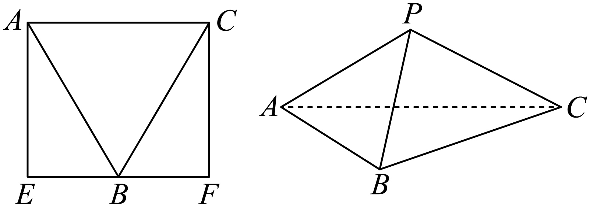

# Mathematics - 题目 955

**ID**: 841e5edb19d249eca8874ce1f7d34c9b
**年级**: Grade 10
**难度**: Medium-Hard
**题型**: Multiple-select

## 题目
如图，在矩形AEFC中， $AE=2\sqrt {3}$ ， $EF=4$ ， $B$ 为 $EF$ 中点，现分别沿 $AB,BC$ 将 $\vartriangle ABE$ ， $\vartriangle BCF$ 翻折，使点 $E,F$ 重合，记为点 $P$ ，翻折后得到三棱锥 $P-ABC$ ，则（      ）​​​​​​​‌

## 解答

1. 由题意可得 $BP\bot AP$ ， $BP\bot CP$ ，
2. 又 $AP\cap CP=P$ ， $AP,CP\subset $ 平面PAC，
3. ∴ $BP\bot $ 平面PAC，
4. 在 $\vartriangle PAC$ 中， $PA=PC=2\sqrt {3}{\rm ，\mathit{AC}}$ 边上的高为 $\sqrt {{\left({2\sqrt {3}}\right)^{2}}-2{^{2}}}=2\sqrt {2}$ ，
5. ∴ $V{{}_{P-ABC}}=V{{}_{B-PAC}}=\frac {1}{3}\times \frac {1}{2}\times 4\times 2\sqrt {2}\times 2=\frac {8\sqrt {2}}{3}$ ，故A正确；
6. 对于B，在 $\vartriangle PAC$ 中， ${\cos}\angle APC=\frac {12+12-16}{2\times 2\sqrt {3}\times 2\sqrt {3}}=\frac {1}{3}$ ， $BC=\sqrt {12+4}=4$ ，
7. ${\cos}\langle \overrightarrow {{PA}},\overrightarrow {{BC}}\rangle =\frac {\overrightarrow {{PA}}\cdot \overrightarrow {{BC}}}{\left |{\overrightarrow {{PA}}}\right |\left |{\overrightarrow {{BC}}}\right |}=\frac {\overrightarrow {{PA}}\cdot \left ({\overrightarrow {{PC}}-\overrightarrow {{PB}}}\right )}{2\sqrt {3}\times 4}=\frac {\overrightarrow {{PA}}\cdot \overrightarrow {{PC}}-\overrightarrow {{PA}}\cdot \overrightarrow {{PB}}}{8\sqrt {3}}=\frac {2\sqrt {3}\times 2\sqrt {3}\times \frac {1}{3}}{8\sqrt {3}}=\frac {\sqrt {3}}{6}$ ，
8. ∴直线PA与直线BC所成角的余弦值为 $\frac {\sqrt {3}}{6}$ ，故B正确；
9. 对于 ${\rm C，}S{{}_{\vartriangle PBC}}=\frac {1}{2}PB\cdot PC=2\sqrt {3}$ ，
10. 设点A到平面PBC的距离为d，
11. 由 $V{{}_{B-PAC}}=V{{}_{A-PBC}}$ ，得 $\frac {1}{3}\times 2\sqrt {3}d=\frac {8\sqrt {2}}{3}$ ，解得 $d=\frac {4\sqrt {6}}{3}$ ，
12. ∴直线PA与平面PBC所成角的正弦值为 $\frac {d}{PA}=\frac {\frac {4\sqrt {6}}{3}}{2\sqrt {3}}=\frac {2\sqrt {2}}{3}$ ，故C错误；
13. 由B选项知， ${\cos}\angle APC=\frac {1}{3}$ ，则 $\sin \angle APC=\frac {2\sqrt {2}}{3}$ ，
14. ∴ $\vartriangle PAC$ 的外接圆的半径 $r=\frac {1}{2}\cdot \frac {AC}{\sin \angle APC}=\frac {3}{\sqrt {2}}$ ，
15. 设三棱锥 $P-ABC$ 外接球的半径为 $R$ ，
16. 设外接球球心为 $O$ ， $\vartriangle PAC$ 外接圆圆心为 $O{{}_{1}}$ ，
17. 
18. 连接 $OO{{}_{1}}$ ，可知 $OO{{}_{1}}$  $\bot $ 平面 $PAC$ ，
19. 又 $BP\bot $ 平面 $PAC$ ，
20. ∴ $OO{{}_{1}}=\frac {1}{2}PB$ ，
21. 在 ${\rm{R}}{\rm{t}}△OO{{}_{1}}C$ 中，
22. $R{^{2}}=r{^{2}}+{\left({\frac {1}{2}PB}\right)^{2}}=\frac {9}{2}+1=\frac {11}{2}$ ，∴ $R=\frac {\sqrt {22}}{2}$ ，
23. 即三棱锥 $P-ABC$ 外接球的半径为 $\frac {\sqrt {22}}{2}$ ，故D正确.
24. 故选ABD．

## 知识点

**中文**:
  - 翻折问题

**English**:
  - Folding Problems

---
