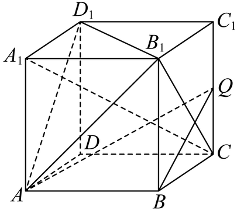

# Mathematics - 题目 98

**ID**: b888fcc5f01042e0ade09d4aae8746cc
**年级**: Grade 10
**难度**: Medium-Hard
**题型**: Multiple-select

## 题目
已知P是棱长为6的正方体表面上一个动点，Q为棱 $CC{{}_{1}}$ 的中点，则下列说法中正确的是（      ）​​​​​​​‌

## 解答

1. 
2. 对于A，取 $DD{{}_{1}}$ 中点 $M$ ，连接 $AM,QM$ ，
3. 因为Q为棱 $CC{{}_{1}}$ 的中点，由正方体的性质可得 $AB//QM$ 且 $AB=QM$ ，
4. 所以四边形 $ABQM$ 为平行四边形，即过点A，B，Q的截面是一个平行四边形，故A错误；
5. 
6. 对于B，连接 $A{{}_{1}}D$ ，由正方形对角线的性质可得 $A{{}_{1}}D\bot AD{{}_{1}}$ ，
7. 又 $CD\bot $ 侧面 $ADD{{}_{1}}A{{}_{1}}$ ， $A{{}_{1}}D\subset $ 面 $ADD{{}_{1}}A{{}_{1}}$ ，所以 $CD\bot AD{{}_{1}}$ ，
8. 即 $A{{}_{1}}D\cap CD=D,A{{}_{1}}D,CD\subset $ 平面 $A{{}_{1}}CD$ ，所以 $AD{{}_{1}}\bot $ 平面 $A{{}_{1}}CD$ ，
9. 因为 $A{{}_{1}}C\subset $ 平面 $A{{}_{1}}CD$ ，所以  $AC\bot AD{{}_{1}}$ ，
10. 连接 $A{{}_{1}}C{{}_{1}}$ ，同理可证明 $A{{}_{1}}C\bot B{{}_{1}}D{{}_{1}}$ ，
11. 所以 $AD{{}_{1}}\cap B{{}_{1}}D{{}_{1}}=D{{}_{1}},AD{{}_{1}},B{{}_{1}}D{{}_{1}}\subset $ 平面 $AB{{}_{1}}D{{}_{1}}$ ，所以 $A{{}_{1}}C\bot $ 平面 $AB{{}_{1}}D{{}_{1}}$ ，
12. 即P在 $AB{{}_{1}}$ 上，则 $PD{{}_{1}}\bot A{{}_{1}}C$ ，故B正确；
13. 对于C，当点 $P$ 与 $D{{}_{1}}$ 点重合时，由正方体的性质可得 $C{{}_{1}}D{{}_{1}}\bot $ 侧面 $BCC{{}_{1}}B{{}_{1}}$ ，
14. 又 $B{{}_{1}}C\subset $ 面 $BCC{{}_{1}}B{{}_{1}}$ ，所以 $PC{{}_{1}}\bot B{{}_{1}}C$ ，故C正确；
15. 对于D，三棱锥 $A-B{{}_{1}}D{{}_{1}}P$ 的体积等于三棱锥 $P-AB{{}_{1}}D{{}_{1}}$ 的体积， $S{{}_{\vartriangle AB{{}_{1}}D{{}_{1}}}}=\frac {\sqrt {3}}{4}\times {\left({6\sqrt {2}}\right)^{2}}=18\sqrt {3}$ ，
16. 设 $P$ 到面 $AB{{}_{1}}D{{}_{1}}$ 的距离为 $h$ ，由棱锥的体积公式可得 $\frac {1}{3}\times 18\sqrt {3}\times h=18\Rightarrow h=\sqrt {3}$ ，
17. 即 $P$ 到面 $AB{{}_{1}}D{{}_{1}}$ 的距离为 $\sqrt {3}$ ，
18. 设 $A{{}_{1}}$ 到平面 $AB{{}_{1}}D{{}_{1}}$ 的距离为 $d$ ，
19. 则由等体积法可得 $V{{}_{A{{}_{1}}-AB{{}_{1}}D{{}_{1}}}}=V{{}_{D{{}_{1}}-AB{{}_{1}}A{{}_{1}}}}$ ，即 $\frac {1}{3}\times \frac {1}{2}\times 6\times 6\times 6=\frac {1}{3}\times \frac {\sqrt {3}}{4}\times {\left({6\sqrt {2}}\right)^{2}}d\Rightarrow d=2\sqrt {3}$ ，
20. 所以P点轨迹为与平面 $AB{{}_{1}}D{{}_{1}}$ 平行的两个正三角形，其中一个为过 $AA{{}_{1}},A{{}_{1}}B{{}_{1}},AD{{}_{1}}$ 中点的正三角形，
21. 又正方体的体对角线长为 $6\sqrt {3}$ ，由空间对称性可知另一个为 $BDC{{}_{1}}$ ，
22. 所以轨迹长度为 $3\sqrt {2}\times 3+6\sqrt {2}\times 3=27\sqrt {2}$ ，故D正确.
23. 故选BCD.

## 知识点

**中文**:
  - 动点问题
  - 截面问题

**English**:
  - Moving Point Problems
  - Cross-section Problems

---
