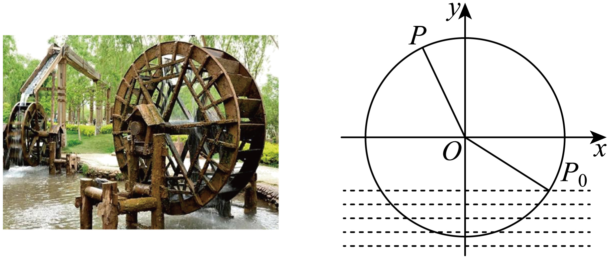

# Mathematics - 题目 2221

**ID**: c282a680d5c14b74b454eace5dd24c96
**年级**: Grade 10
**难度**: Medium-Hard
**题型**: Multiple-select

## 题目
筒车是我国古代发明的一种水利灌溉工具，因其经济又环保，至今还在农业生产中得到应用．假定在水流稳定的情况下，筒车上的每一个盛水筒都做匀速圆周运动如图，将筒车抽象为一个几何图形（圆），筒车半径为 ${{2}}{{.​​​​​​​‌}}{{4}}{\rm{m}}$ ，筒车转轮的中心O到水面的距离为 ${{1}}{{.}}{{2}}{\rm{m}}$ ，筒车每分钟沿逆时针方向转动3圈．规定：盛水筒M对应的点P从水中浮现（即 $P{{}_{0}}$ 时的位置）时开始计算时间，且以水轮的圆心O为坐标原点，过点O的水平直线为x轴建立平面直角坐标系 $xOy$ ．设盛水筒M从点 $P{{}_{0}}$ 运动到点P时所经过的时间为t（单位：s），且此时点P距离水面的高度为h（单位：m）（在水面下则h为负数，则h与时间t之间的关系为 $h(t)=A\sin (ωt+φ)+K\left ({A>0,ω>0,-\frac {{\rm{π}}}{2}<φ<\frac {{\rm{π}}}{2}}\right )$ ．下列结论正确的是（      ）

## 解答

1. 对于A，因为筒车半径为 ${{2}}{{.}}{{4}}{\rm{m}}$ ，筒车转轮的中心 $O$ 到水面的距离为 ${{1}}{{.}}{{2}}{\rm{m}}$ ，
2. 所以点P距离水面的高度h的最值为 $\begin{cases}h{{}_{{\rm{m}}{\rm{a}}{\rm{x}}}}=1.2+2.4=3.6=A+K\\h{{}_{{\rm{m}}{\rm{i}}{\rm{n}}}}=1.2-2.4=-1.2=-A+K\end{cases}$ ，所以 $\begin{cases}A=2.4\\K=1.2\end{cases}$ ，
3. 因为筒车每分钟（ ${{6}}{{0}}{\rm{s}}$ ）沿逆时针方向转动3圈，所以 $T=\frac {60}{3}=20,ω=\frac {2{\rm{π}}}{T}=\frac {{\rm{π}}}{10}$ ，
4. 因为 $h(t)=2.4\sin φ+1.2=0$ ，所以 $\sin φ=-\frac {1}{2}$ ，
5. 又因为 $-\frac {{\rm{π}}}{2}<φ<\frac {{\rm{π}}}{2}$ ，所以 $φ=-\frac {{\rm{π}}}{6}$ ，故A正确；
6. 对于B，由已知， $OP{{}_{0}}$ 与x轴正方向的夹角为 $\frac {{\rm{π}}}{6}$ ，
7. 所以点P第一次到达最高点需要转动 $\frac {{\rm{π}}}{6}+\frac {{\rm{π}}}{2}=\frac {2{\rm{π}}}{3}$ ，则所需时间为 $\frac {T}{3}=\frac {20}{3}{\rm{s}}$ ，故B错误；
8. 对于C，在转动的一个周期内，点P在水中转动 $2\times \left ({\frac {{\rm{π}}}{2}-\frac {{\rm{π}}}{6}}\right )=\frac {2{\rm{π}}}{3}$ ，则需要的时间是 $\frac {T}{3}=\frac {20}{3}{\rm{s}}$ ，故C正确；
9. 对于D，若 $h(t)=2.4\sin \left ({\frac {{\rm{π}}}{10}t-\frac {{\rm{π}}}{6}}\right )+1.2$ 在 $[0,a]$ 上的值域为 $[0,3.6]$ ，
10. 则 $y=\sin \left ({\frac {{\rm{π}}}{10}t-\frac {{\rm{π}}}{6}}\right )$ 在 $[0,a]$ 上的值域为 $\left [-\frac {1}{2},1\right ]$ ，因为 $t\in [0,a]$ ，所以 $\frac {{\rm{π}}}{10}t-\frac {{\rm{π}}}{6}\in \left [-\frac {{\rm{π}}}{6},\frac {{\rm{π}}}{10}a-\frac {{\rm{π}}}{6}\right ]$ ，
11. 所以 $\frac {{\rm{π}}}{2}\leqslant \frac {{\rm{π}}}{10}a-\frac {{\rm{π}}}{6}\leqslant \frac {7{\rm{π}}}{6}$ ，则 $\frac {20}{3}\leqslant a\leqslant \frac {40}{3}$ ，故D正确．
12. 故选ACD.

## 知识点

**中文**:
  - 在实际问题中建立三角函数模型

**English**:
  - Modeling Real-world Problems

---
