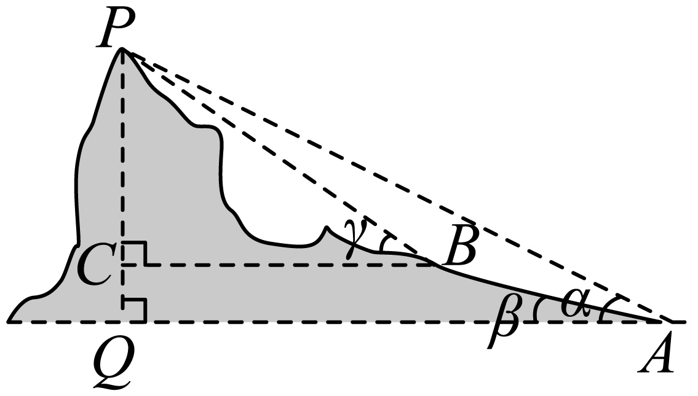

# Mathematics - 题目 3173

**ID**: ff83073103044dcd91a795a20ef27c9a
**年级**: Grade 10
**难度**: Medium-Hard
**题型**: Multiple-select

## 题目
如图，在山脚 $\mathrm{A}$ 测得山顶 $P$ 的仰角为 $α$ ，沿倾斜角为 $β$ 的斜坡向上走 $a{\rm{m}}$ 到达 $B$ 处，在 $B$ 处测得山顶 $P$ 的仰角为 $γ$ ，则山高 $h=$ （      ）​​​​​​​‌

## 解答

1. 由题意可知， $\angle PAQ=α$ ， $\angle PBC=γ$ ， $\angle PAB=α-β$ ， $\angle BAQ=β$ ，
2. 分别在 ${\rm{R}}{\rm{t}}\vartriangle APQ$ ， ${\rm{R}}{\rm{t}}\vartriangle ΒPC$ 中， $\angle APQ=\frac {\mathrm{π}}{2}-α$ ， $\angle BPQ=\frac {π}{2}-γ$ ，
3. 所以 $\angle APB=\angle APQ-\angle BPQ=γ-α$ ，
4. 又 $\sin \angle ABP=\sin [\mathrm{π}\mathrm{-}\mathrm{(}\angle APB+\angle BAP)]$ ，
5. $=\sin \mathrm{(}\angle APB+\angle BAP)=\sin \left ({γ-α+α-β}\right )=\sin (γ-β)$ ，
6. 在 $\vartriangle ABP$ 中，由正弦定理可得， $\frac {AB}{{\rm{s}}{\rm{i}}{\rm{n}}\angle APB}=\frac {AP}{{\rm{s}}{\rm{i}}{\rm{n}}\angle ABP}$ ，
7. 即 $\frac {a}{\sin (γ-α)}=\frac {AP}{\sin (γ-β)}$ ， 所以 $AP=\frac {a\sin (γ-β)}{\sin (γ-α)}$ ，
8. 在 ${\rm{R}}{\rm{t}}\vartriangle APQ$ 中， $PQ=AP\sin α=\frac {a\sin α\sin (γ-β)}{\sin (γ-α)}$ ，故A正确，B错误；
9. 在 $\vartriangle ABP$ 中，由正弦定理可得， $\frac {AB}{\sin \angle APB}=\frac {PB}{\sin \angle BAP}$ ，
10. 即 $\frac {a}{\sin (γ-α)}=\frac {PB}{\sin (α-β)}$ ， 所以 $PB=\frac {a\sin (α-β)}{\sin (γ-α)}$ ，
11. 在 ${\rm{R}}{\rm{t}}\vartriangle PBC$ 中， $PC=PB\sin γ=\frac {a\sin γ\sin (α-β)}{\sin (γ-α)}$ ，
12. 又 $CQ=AB\sin β=a\sin β$ ，
13. 所以 $PQ=PC+CQ=\frac {a\sin γ\sin \left ({α-β}\right )}{\sin \left ({γ-α}\right )}+a\sin β$ ，故C正确、D错误.
14. 故选AC

## 知识点

**中文**:
  - 正、余弦定理的实际应用-测量高度问题

**English**:
  - Measuring Height

---
