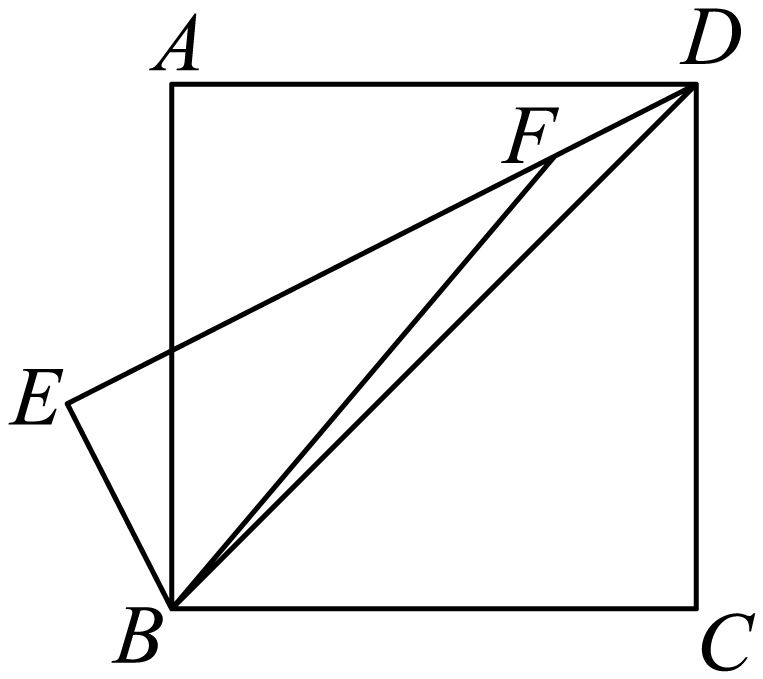

# Mathematics - 题目 361

**ID**: 192f87d4e7544b7cac10f93efb3afe4f
**年级**: Grade 10
**难度**: Medium
**题型**: Multiple-choice

## 题目
如图，正方形 $ABCD$ 边长为6，以对角线 $BD$ 为斜边作 ${\rm{R}}{\rm{t}}\vartriangle BED$ ， $∠E=90{^{\circ }}$ ，点 $F$ 在 $DE$ 上，连接 $BF$ ．若 $2BE=3DF$ ，则 $BF$ 的最小值为（      ）​​​​​​​‌

## 解答

1. 以 $B$ 为坐标原点， $BC,BA$ 所在直线分别为 $x,y$ 轴，建立直角坐标系，
2. 设BD的中点为G，过点D作 $DH\bot BD$ ，使 $DH=2\sqrt {2}$ ，过点H作 $HK\bot AD$ 于点K，
3. 连接BH,FH，AG，EG，则 $\angle BDH=\angle DKH=90\degree $ ，
4. 因为正方形ABCD边长为6，所以 $C(6,0),D(6,6),A(0,6)$ ， $G\left ({3,3}\right )$ ；
5. 所以 $BG=\sqrt {3{^{2}}+3{^{2}}}=3\sqrt {2}$ ，即有 $\frac {BG}{DH}=\frac {3}{2}$ .
6. 因为 $\angle E=\angle BAD=90\degree $ ，所以 $EG=AG=BG=DG=3\sqrt {2}$ ，即 $B,E,A,D$ 四点共圆，
7. 所以 $\angle ABE=\angle ADE$ ；
8. 因为 $\angle ABD=\angle ADB=45\degree $ ，所以 $\angle HDK=\angle BDH-\angle ADB=45\degree $ ，所以 $\angle HDK=\angle ABD=45\degree $ ，
9. 所以 $\angle ABE+\angle ABD=\angle ADE+\angle HDK$ ，即 $\angle EBG=\angle FDH$ ，
10. 因为 $2BE=3DF$ ，所以 $\frac {BE}{DF}=\frac {3}{2},\frac {BE}{DF}=\frac {BG}{DH}$ ，所以 $\vartriangle BEG$ 与 $\vartriangle DFH$ 相似，
11. 所以 $FH=DH=2\sqrt {2}$ ，即点 $F$ 是在以点 $H$ 为圆心， $2\sqrt {2}$ 为半径的圆上；
12. 因为 $\angle DHK=90\degree -\angle HDK=45\degree $ ，所以 $DK{^{2}}+HK{^{2}}=DH{^{2}}$ ，所以 $DK=HK=2$ ，
13. 所以 $H\left ({4,8}\right )$ ，从而可得 $BH=\sqrt {4{^{2}}+8{^{2}}}=4\sqrt {5}$ ，
14. 因为 $BF+FH\geqslant BH$ ，所以当点 $F$ 在 $BH$ 上时， $BF$ 取得最小值，
15. 最小值为 $BF=BH-FH=4\sqrt {5}-2\sqrt {2}$ .
16. 故选D
17. 

## 知识点

**中文**:
  - 图形的性质

**English**:
  - Properties of Geometric Figures

---
