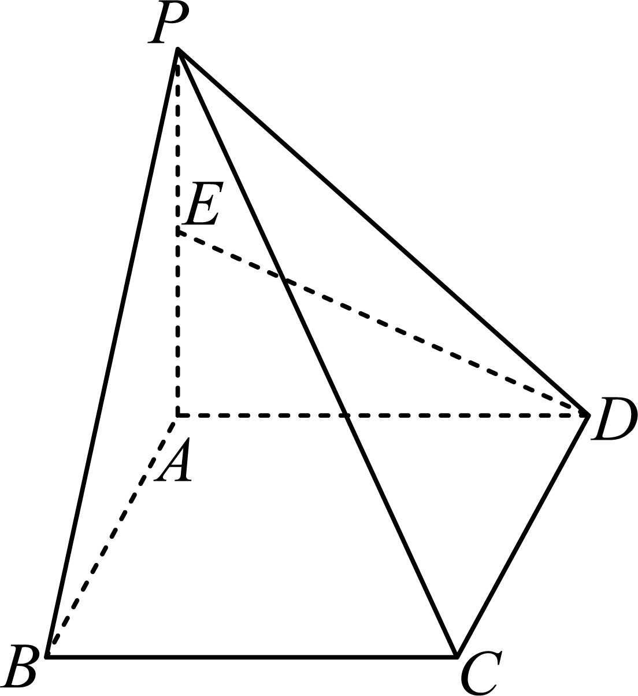

# Mathematics - 题目 2174

**ID**: 65fff6a59a034b0aacebcf7cf828a1f4
**年级**: Grade 10
**难度**: Medium
**题型**: Multiple-choice

## 题目
如图，在四棱锥 $P-ABCD$ 中， $PA\bot $ 平面 $ABCD$ ，四边形 $ABCD$ 为正方形， $PA=AB，E$ 为 $AP$ 的中点，则异面直线 $PC$ 与 $DE$ 所成的角的正弦值为（      ）​​​​​​​‌

## 解答

1. 连 $AC$ ， $BD$ 相交于点 $O$ ，连 $OE$ 、 $BE$ ，
2. 
3. 因为 $E$ 为 $AP$ 的中点， $O$ 为 $AC$ 的中点，有 $PC//{\rm{O}}{\rm{E}}$ ，可得 $\angle OED$ 或其补角为异面直线 $PC$ 与 $DE$ 所成的角，
4. 不妨设正方形中， $AB=2$ ，则 $PA=2$ ，由 $PA\bot $ 平面 $ABCD$ ，可得 $PA\mathrm{⊥}AB,PA\mathrm{⊥}AD$ ，
5. 则 $BE=DE=\sqrt {1+4}=\sqrt {5}$ ， $OD=\frac {1}{2}BD=\frac {1}{2}\times 2\sqrt {2}=\sqrt {2}$ ，
6. 因为 $BE=DE$ ， $O$ 为 $BD$ 的中点，所以 $\angle EOD=90{}\degree $ ， $\sin \angle OED=\frac {OD}{DE}=\frac {\sqrt {2}}{\sqrt {5}}=\frac {\sqrt {10}}{5}$ ．
7. 故选C.

## 知识点

**中文**:
  - 异面直线所成角

**English**:
  - Angle between Skew Lines

---
