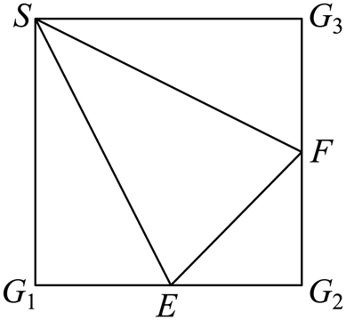

# Mathematics - 题目 124

**ID**: 73dba746dae8496c816c1c0cc411888b
**年级**: Grade 10
**难度**: Medium
**题型**: Multiple-choice

## 题目
如图，在边长为2的正方形 $SG{{}_{1}}G{{}_{2}}G{{}_{3}}$ 中， $E$ ， $F$ 分别是 $G{{}_{1}}G{{}_{2}}$ ， $G{{}_{2}}G{{}_{3}}$ 的中点，若沿 $SE$ ， $SF$ 及 $EF$ 把这个正方形折成一个四面体，使 $G{{}_{1}}$ ， $G{{}_{2}}$ ， $G{{}_{3}}$ 三点重合，重合后的点记为 $G$ ，则四面体 $S-EFG$ 的外接球体积为（      ）​​​​​​​‌

## 解答

1. 解：因为折前 $SG{{}_{1}}\bot EG{{}_{1}}$ ， $SG{{}_{3}}\bot FG{{}_{3}}$ ， $EG{{}_{2}}\bot FG{{}_{2}}$ ，
2. 所以折后 $SG\bot EG$ ， $SG\bot FG$ ， $EG\bot FG$ ，
3. 如图所示：
4. 
5. 则四面体 $S-EFG$ 的外接球半径 $R=\frac {\sqrt {GS{^{2}}+GE{^{2}}+GF{^{2}}}}{2}=\frac {\sqrt {4+1+1}}{2}=\frac {\sqrt {6}}{2}$ ，
6. 从而四面体 $S-EFG$ 的外接球体积 $V=\frac {4}{3}{\rm{π}}R{^{3}}=\sqrt {6}{\rm{π}}$ .
7. 故选D．

## 知识点

**中文**:
  - 球的体积
  - 球的切接问题
  - 翻折问题

**English**:
  - Volume of a Sphere
  - Tangency and Inscribed/Circumscribed Spheres
  - Folding Problems

---
