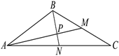

# Mathematics - 题目 178

**ID**: 7c982f1f00d34895bae7f77045212162
**年级**: Grade 10
**难度**: Medium
**题型**: Multiple-choice

## 题目
如图，在三角形 $ABC$ 中，已知 $AB=2,AC=2\sqrt {3},∠BAC=\frac {{\rm{π}}}{6},BC、AC$ 边上的两条中线分别为 $AM、BN$ ，且相交于点 $P$ ，则 ${\rm{c}}{\rm{o}}{\rm{s}}\angle MPN=$ （      ）​​​​​​​‌

## 解答

1. 由题意可知 $\overrightarrow {{AM}}=\frac {1}{2}\overrightarrow {{AB}}+\frac {1}{2}\overrightarrow {{AC}}$ ，
2. $\overrightarrow {{BN}}=\overrightarrow {{BA}}+\overrightarrow {{AN}}=-\overrightarrow {{AB}}+\frac {1}{2}\overrightarrow {{AC}}$ ，
3. ∴ $\left |{\overrightarrow {{AM}}}\right |=\sqrt {{\left({\frac {1}{2}\overrightarrow {{AB}}+\frac {1}{2}\overrightarrow {{AC}}}\right)^{2}}}=\sqrt {\frac {1}{4}\left |{\overrightarrow {{AB}}}\right |{^{2}}+\frac {1}{4}\left |{\overrightarrow {{AC}}}\right |{^{2}}+\frac {1}{2}\overrightarrow {{AB}}\cdot \overrightarrow {{AC}}}=\sqrt {7}$ ，
4. $\left |{\overrightarrow {{BN}}}\right |=\sqrt {{\left({-\overrightarrow {{AB}}+\frac {1}{2}\overrightarrow {{AC}}}\right)^{2}}}=\sqrt {\left |{\overrightarrow {{AB}}}\right |{^{2}}+\frac {1}{4}\left |{\overrightarrow {{AC}}}\right |{^{2}}-\overrightarrow {{AB}}\cdot \overrightarrow {{AC}}}=1$ ，
5. $\overrightarrow {{AM}}\cdot \overrightarrow {{BN}}=\left ({\frac {1}{2}\overrightarrow {{AB}}+\frac {1}{2}\overrightarrow {{AC}}}\right )\left ({-\overrightarrow {{AB}}+\frac {1}{2}\overrightarrow {{AC}}}\right )=-\frac {1}{2}\left |{\overrightarrow {{AB}}}\right |{^{2}}+\frac {1}{4}\left |{\overrightarrow {{AC}}}\right |{^{2}}-\frac {1}{4}\overrightarrow {{AB}}\cdot \overrightarrow {{AC}}=-\frac {1}{2}$ ，
6. ∴ ${\rm{c}}{\rm{o}}{\rm{s}}\angle MPN=\frac {\overrightarrow {{AM}}\cdot \overrightarrow {{BN}}}{\left |{\overrightarrow {{AM}}}\right |\left |{\overrightarrow {{BN}}}\right |}=\frac {-\frac {1}{2}}{\sqrt {7}\times 1}=-\frac {\sqrt {7}}{14}$ .
7. 故选A.

## 知识点

**中文**:
  - 向量夹角的计算
  - 向量模的计算
  - 向量线性综合运算

**English**:
  - Calculation of Vector Angle
  - Calculation of Vector Modulus
  - Comprehensive Linear Operations

---
