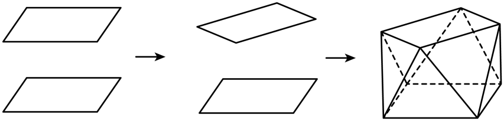

# Mathematics - 题目 120

**ID**: b82377f9fe11499b8ffe6cc28d377a32
**年级**: Grade 10
**难度**: Medium
**题型**: Multiple-choice

## 题目
取两个相互平行且全等的正n边形，将其中一个旋转一定角度，连接这两个多边形的顶点，使得侧面均为等边三角形，我们把这种多面体称作“n角反棱柱”.​​​​​​​‌当 $n=4$ 时，得到如图所示棱长均相等的“四角反棱柱”，则该“四角反棱柱”外接球的半径与棱长的比值的平方为（      ）

## 解答

1. 如图，由题意可知旋转角度为 $\frac {{\rm{π}}}{2}$ ，设上下正四边形的中心分别为 $O{{}_{1}},O{{}_{2}}$ ，
2. 连接 $O{{}_{1}}O{{}_{2}}$ ，则 $O{{}_{1}}O{{}_{2}}$ 的中点 $O$ 即为外接球的球心，其中点 $B$ 为所在棱的中点，
3. 设棱长为 $4a$ ，可知 $O{{}_{1}}A=2\sqrt {2}a$ ， $O{{}_{2}}B=2a,AB=2\sqrt {3}a$ ，
4. 过点 $B$ 作 $BC\bot O{{}_{1}}A$ 于点 $C$ ，则 $AC=O{{}_{1}}A-O{{}_{2}}B=(2\sqrt {2}-2)a$ ，
5. $BC=\sqrt {AB{^{2}}-AC{^{2}}}=\sqrt {8\sqrt {2}}a$ ，易得四边形 $CBO{{}_{2}}O{{}_{1}}$ 为矩形，即 $O{{}_{1}}O{{}_{2}}=BC=\sqrt {8\sqrt {2}}a$ ， $OO{{}_{1}}=\frac {1}{2}O{{}_{1}}O{{}_{2}}=\sqrt {2\sqrt {2}}a$ ，
6. 则 $OA=\sqrt {OO{{}_{1}^{2}}+O{{}_{1}}A{^{2}}}=\sqrt {2\sqrt {2}+8}a$ ，即该“四角反棱柱”外接球的半径 $R=\sqrt {2\sqrt {2}+8}a$ ，
7. 故该“四角反棱柱”外接球的半径与其棱长的比值的平方为 $\left ({\frac {\sqrt {2\sqrt {2}+8}a}{4a}}\right ){^{2}}=\frac {\sqrt {2}+4}{8}$ ，
8. 故选：A.
9. 
10. 【点睛】本题的关键是读懂题意，求出旋转角度为 $\frac {{\rm{π}}}{2}$ ，再设出棱长，利用图形作出合理辅助线，利用勾股定理求出外接球的半径，最后得到比值.

## 知识点

**中文**:
  - 新定义问题
  - 球的切接问题

**English**:
  - New Definition Problems
  - Tangency and Inscribed/Circumscribed Spheres

---
