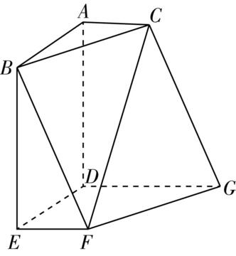

# Mathematics - 题目 3444

**ID**: e3e6fd39e11f4930b3deab0fa9469430
**年级**: Grade 10
**难度**: Medium
**题型**: Multiple-choice

## 题目
如图，在多面体 $ABC-DEFG$ 中，平面 $ABC//$ 平面 $DEFG$ ， $EF//DG$ ，且 $AB=DE$ ， $DG=2EF$ ，则（      ）​​​​​​​‌

## 解答

1. 取 $DG$ 的中点 $M$ ，连接 $AM$ ， $FM$ ，如图所示.
2. 因为 $EF//DG$ ，且 $DG=2EF$ ，所以 $DM//EF$ 且 $DM=EF$ ，
3. 所以四边形 $DEFM$ 是平行四边形，
4. 所以 $DE//FM$ ，且 $DE=FM$ .
5. 因为平面 $ABC//$ 平面 $DEFG$ ，平面 $ABC\cap $  平面 $ADEB=AB$ ，平面 $ADEB\cap $  平面 $DEFG=DE$ ，
6. 所以 $AB//DE$ ，所以 $AB//FM$ ，
7. 又 $AB=DE$ ，所以 $AB=FM$ ，
8. 所以四边形 $ABFM$ 是平行四边形，
9. 即 $BF//AM$ .
10. 又 $BF\not\subset $  平面 $ACGD$ ， $AM\subset $  平面 $ACGD$ ，
11. 所以 $BF//$ 平面 $ACGD$ ,选项 $\mathrm{A}$ 正确;
12. 而根据已知条件只能推出上面的关系，无法判断 $CF$ 与平面 $ABED$ 是否平行，故选项 $\mathrm{B}$ 错误；
13. 没有条件可以判断 $BC//FG$ ，故选项 $\mathrm{C}$ 错误；
14. 没有条件可以判断平面 $ABED$ 与平面 $CGF$ 是否平行，故选项 $\mathrm{D}$ 错误．故选 $\mathrm{A}$ ．
15. 

## 知识点

**中文**:
  - 平面与平面平行的判定
  - 平面与平面平行的性质

**English**:
  - Plane-Plane Parallelism Determination
  - Properties of Plane-Plane Parallelism

---
