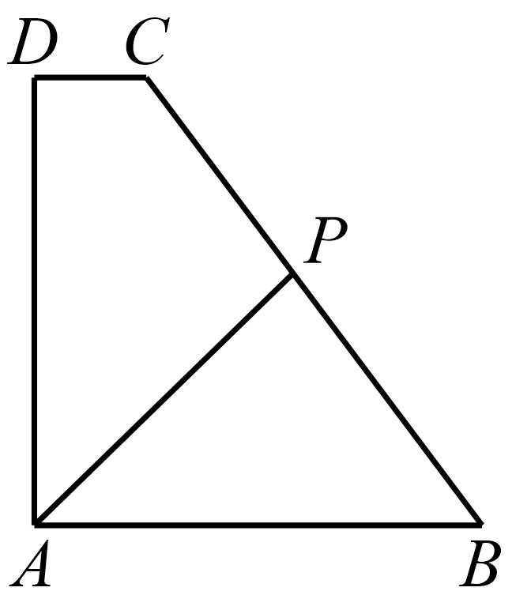

# Mathematics - 题目 846

**ID**: ec6afb9bcfc3446693f634a0b4b4cd7f
**年级**: Grade 10
**难度**: Medium
**题型**: Multiple-choice

## 题目
如图所示，在直角梯形ABCD中， $AB//CD$ ， $\angle DAB=90\degree $ ， $AD=AB=4$ ， $CD=1$ ，动点P在边BC上，且满足 $\overrightarrow {{AP}}=m\overrightarrow {{AB}}+n\overrightarrow {{AD}}$ （m，n均为正实数），则 $\frac {1}{m}+\frac {1}{n}$ 的最小值为（      ）​​​​​​​‌

## 解答

1. 依题意得 $CD//AB$ ，∴ $\overrightarrow {{AD}}=\overrightarrow {{AC}}+\overrightarrow {{CD}}=\overrightarrow {{AC}}-\overrightarrow {{DC}}=\overrightarrow {{AC}}-\frac {1}{4}\overrightarrow {{AB}}$ ，
2. ∴ $\overrightarrow {{AP}}=m\overrightarrow {{AB}}+n\overrightarrow {{AD}}=m\overrightarrow {{AB}}+n\left ({\overrightarrow {{AC}}-\frac {1}{4}\overrightarrow {{AB}}}\right )=\left ({m-\frac {n}{4}}\right )\overrightarrow {{AB}}+n\overrightarrow {{AC}}$ ．
3. ∵C，P，B三点共线，
4. ∴ $\left ({m-\frac {n}{4}}\right )+n=1$ ，即 $m+\frac {3}{4}n=1$ ，
5. 又∵m，n均是正实数，
6. ∴ $\frac {1}{m}+\frac {1}{n}=\left ({\frac {1}{m}+\frac {1}{n}}\right )\left ({m+\frac {3}{4}n}\right )=\frac {7}{4}+\frac {m}{n}+\frac {3n}{4m}\geqslant \frac {7}{4}+2\sqrt {\frac {m}{n}\cdot \frac {3n}{4m}}=\frac {7}{4}+\sqrt {3}$ ,
7. 当且仅当 $\frac {m}{n}=\frac {3n}{4m}$ ，即 $\begin{cases}m=4-2\sqrt {3}\\n=-4+\frac {8\sqrt {3}}{3}\end{cases}$ 时，等号成立．
8. 故选:B．

## 知识点

**中文**:
  - 向量线性综合运算
  - 基本不等式在最值问题中的应用
  - 平面向量运算中的参数求解

**English**:
  - Comprehensive Linear Operations
  - Application in Extremum Problems
  - Solving Parameters in Vector Operations

---
