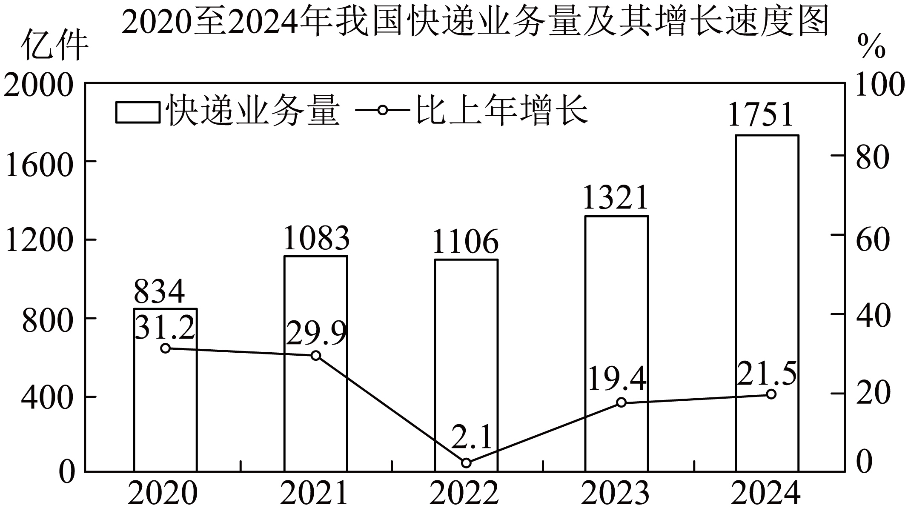

# Mathematics - 题目 572

**ID**: 08ae757248fb471e82521e2e6b83936a
**年级**: Grade 10
**难度**: Medium
**题型**: Multiple-select

## 题目
2020至2024年我国快递业务量及其增长速度如图所示，则（      ）​​​​​​​‌

## 解答

1. 根据统计图表可知2020至2024年我国快递业务量逐年增长，A正确．
2. 由图可知2020年-2022年的快递业务量增长速度是减少的，所以B错误．
3. 2022年我国快递业务量增长 $1106-1083=23$ 亿件，C错误．
4. 设我国2019年的快递业务量为 $x$ 亿件，则 $\left ({1+31.2{\rm{\%}}}\right )x=834$ ，可得 $x=\frac {834}{1.312}\approx 635.67<650$ ，所以D正确．
5. 故选AD.

## 知识点

**中文**:
  - 柱形图

**English**:
  - Bar Chart

---
