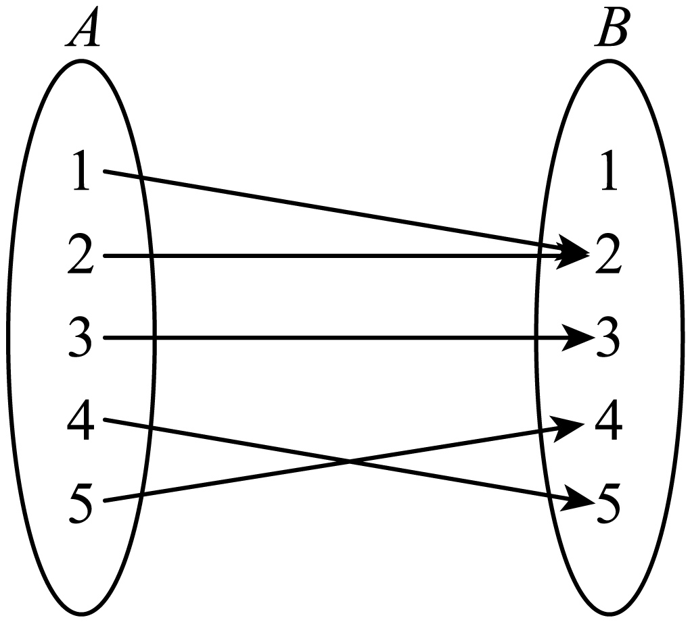

# Mathematics - 题目 2371

**ID**: d034909fb2704440b4804ca30d1f102b
**年级**: Grade 11
**难度**: Easy
**题型**: Calculation

## 题目
集合 $A,B$ 与对应关系 $f$ 如图所示： $f:A\to B$ 是否为从集合A到集合B的函数？如果是，那么定义域、值域与对应关系各是什么？​​​​​​​‌

## 解答

1. 根据题目所示图可以看出A中的任意一个数，B中都有唯一确定的数与之对应，所以是函数，定义域是 $A=\{1,2,3,4,5\}$ ，值域 $C=\{2,3,4,5\}$ .
2. 由图知，A中的任意一个数，B中都有唯一确定的数与之对应，
3. 所以 $f:A\to B$ 是从A到B的函数.
4. 定义域是 $A=\{1,2,3,4,5\}$ ，值域 $C=\{2,3,4,5\}$ .

## 知识点

**中文**:
  - 函数的值域
  - 函数的定义域
  - 函数的概念

**English**:
  - Range of Functions
  - Domain of Functions
  - Concept of Functions

---
