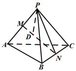

# Mathematics - 题目 2436

**ID**: 07494383396149e09f8ec61cc7057ea3
**年级**: Grade 11
**难度**: Easy
**题型**: Fill-in-the-blank

## 题目
如图，在正四面体 $P-ABC$ 中， $M,N$ 分别为 $PA,BC$ 的中点， $D$ 是线段 $MN$ 上一点，且 $ND=2DM$ ，若 $\overrightarrow {{PD}}=x\overrightarrow {{PA}}+y\overrightarrow {{PB}}+z\overrightarrow {{PC}}$ ，则 $x+y+z$ 的值为．​​​​​​​‌

## 解答

1. $\overrightarrow {{PD}}=\overrightarrow {{PM}}+\overrightarrow {{MD}}=\frac {1}{2}\overrightarrow {{PA}}+\frac {1}{3}\overrightarrow {{MN}}=\frac {1}{2}\overrightarrow {{PA}}+\frac {1}{3}(\overrightarrow {{PN}}-\overrightarrow {{PM}})=\frac {1}{3}\overrightarrow {{PA}}+\frac {1}{6}\overrightarrow {{PB}}+\frac {1}{6}\overrightarrow {{PC}}$
2. 所以 $x=\frac {1}{3},y=z=\frac {1}{6}$ ，所以 $x+y+z=\frac {2}{3}$ .

## 知识点

**中文**:
  - 空间向量基本定理内容辨析

**English**:
  - Analysis of Fundamental Theorem

---
