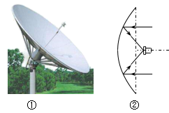

# Mathematics - 题目 927

**ID**: 30ff6e15c8f64f56b417ac0f66cff90b
**年级**: Grade 11
**难度**: Easy
**题型**: Fill-in-the-blank

## 题目
某学习小组研究一种卫星接收天线（如图①所示），发现其曲面与轴截面的交线为抛物线，在轴截面内的卫星波束呈近似平行状态射入形为抛物线的接收天线，经反射聚焦到焦点处（如图②所示），已知接收天线的口径（直径）为 $4.​​​​​​​‌8m$ ，深度为 $1m$ ，则该抛物线的焦点到顶点的距离为$m$ ．

## 解答

1. 如图所示，在接收天线的轴截面所在平面建立直角坐标系，使接收天线的顶点（即抛物线的顶点）与原点重合，焦点在 $x$ 轴上，
2. 
3. 设抛物线的标准方程为 $y{^{2}}=2px\left ({p>0}\right )$ ，由已知条件可得，点 $A\left ({1,2.4}\right )$ 在抛物线上，
4. 所以， $2p=2.4{^{2}}$ ，解得 $p=2.88$ ，
5. 所以，所求抛物线的标准方程为 $y{^{2}}=5.76x$ ，焦点坐标为 $\left ({1.44,0}\right )$ ，
6. 因此，该抛物线的焦点到顶点的距离为 $1.44$ .
7. 故答案为： $1.44$ .

## 知识点

**中文**:
  - 抛物线的实际应用

**English**:
  - Real-world Applications

---
