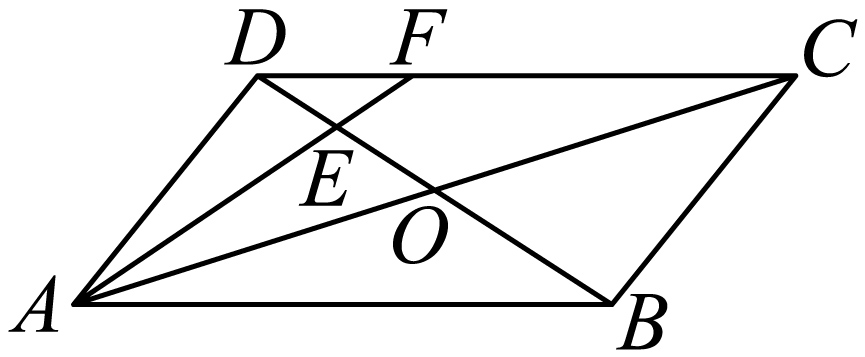

# Mathematics - 题目 2514

**ID**: d2393a6daf2f44e4baf477307d7a26bd
**年级**: Grade 11
**难度**: Easy
**题型**: Fill-in-the-blank

## 题目
已知平行四边形ABCD中，AC与BD交于点O，E为线段OD的中点，AE的延长线与CD交于点F．若 $\overrightarrow {{AC}}=\overrightarrow a$ ， $\overrightarrow {{BD}}=\overrightarrow b$ ，则 $\overrightarrow {{AD}}=$， $\overrightarrow {{AF}}=$（答案用含 $\overrightarrow a$ ， $\overrightarrow b$ 的式子表示）．​​​​​​​‌

## 解答

1. 由题 $\overrightarrow {{AD}}=\overrightarrow {{AO}}+\overrightarrow {{OD}}=\frac {1}{2}\overrightarrow {{AC}}+\frac {1}{2}\overrightarrow {{BD}}=\frac {1}{2}\overrightarrow {{a}}+\frac {1}{2}\overrightarrow {{b}}$ ；
2. 设 $\overrightarrow {{AF}}=λ\overrightarrow {{AE}}\left ({λ>1}\right )$ ，
3. 因为 $\overrightarrow {{AF}}=λ\overrightarrow {{AE}}=\frac {λ}{2}\left ({\overrightarrow {{AD}}+\overrightarrow {{AO}}}\right )=\frac {λ}{2}\overrightarrow {{AD}}+\frac {λ}{4}\overrightarrow {{AC}}$ ,
4. 因为 $D,F,C$ 三点共线，
5. 所以 $\frac {λ}{2}+\frac {λ}{4}=1\Rightarrow λ=\frac {4}{3}$ ，
6. 所以 $\overrightarrow {{AF}}=\frac {2}{3}\overrightarrow {{AD}}+\frac {1}{3}\overrightarrow {{AC}}=\frac {2}{3}\left ({\frac {1}{2}\overrightarrow a+\frac {1}{2}\overrightarrow b}\right )+\frac {1}{3}\overrightarrow a=\frac {2}{3}\overrightarrow a+\frac {1}{3}\overrightarrow b$ .

## 知识点

**中文**:
  - 向量的共线定理
  - 向量线性综合运算

**English**:
  - Collinearity Theorem
  - Comprehensive Linear Operations

---
