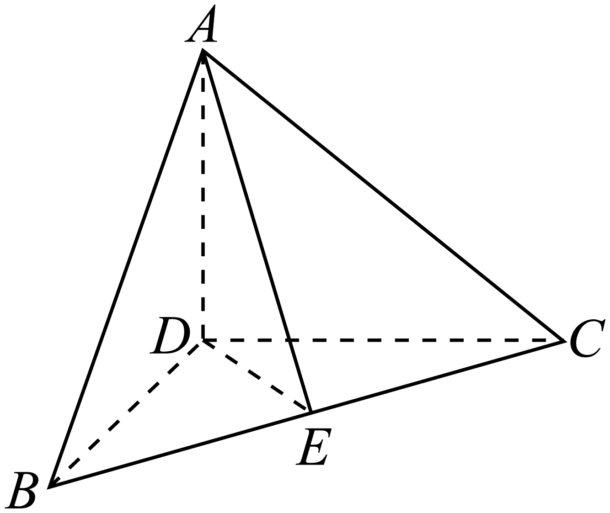

# Mathematics - 题目 3100

**ID**: 1c80f6119f3549c4bd67684a0ecda390
**年级**: Grade 11
**难度**: Easy
**题型**: Multiple-choice

## 题目
如图，在三棱锥 $A-BCD$ 中， $DA$ ， $DB$ ， $DC$ 两两垂直，且 $DB=DC=3$ ， $AD=4$ ， $E$ 为 $BC$ 的中点，则 $\overrightarrow {{AE}}\cdot \overrightarrow {{BC}}$ 等于（      ）​​​​​​​‌

## 解答

1. 以 $\left \{\overrightarrow {{DA}},\overrightarrow {{DB}},\overrightarrow {{DC}}\right \}$ 为基底向量，则 $\overrightarrow {{DA}}\cdot \overrightarrow {{DB}}=\overrightarrow {{DA}}\cdot \overrightarrow {{DC}}=\overrightarrow {{DB}}\cdot \overrightarrow {{DC}}=0$ ，
2. ∵ $\overrightarrow {{AE}}=\frac {1}{2}\left ({\overrightarrow {{AB}}+\overrightarrow {{AC}}}\right )=\frac {1}{2}\left ({\overrightarrow {{DB}}-\overrightarrow {{DA}}+\overrightarrow {{DC}}-\overrightarrow {{DA}}}\right )=\frac {1}{2}\left ({\overrightarrow {{DB}}-2\overrightarrow {{DA}}+\overrightarrow {{DC}}}\right ),\overrightarrow {{BC}}=\overrightarrow {{DC}}-\overrightarrow {{DB}}$ ，
3. 则 $\overrightarrow {{AE}}\cdot \overrightarrow {{BC}}=\frac {1}{2}\left ({\overrightarrow {{DB}}-2\overrightarrow {{DA}}+\overrightarrow {{DC}}}\right )\cdot \left ({\overrightarrow {{DC}}-\overrightarrow {{DB}}}\right )$  $=\frac {1}{2}\overrightarrow {{DB}}\cdot \overrightarrow {{DC}}-\frac {1}{2}\overrightarrow {{DB}}{^{2}}-\overrightarrow {{DA}}\cdot \overrightarrow {{DC}}+\overrightarrow {{DA}}\cdot \overrightarrow {{DB}}+\frac {1}{2}\overrightarrow {{DC}}{^{2}}-\frac {1}{2}\overrightarrow {{DC}}\cdot \overrightarrow {{DB}}=\frac {1}{2}\overrightarrow {{DC}}{^{2}}-\frac {1}{2}\overrightarrow {{DB}}{^{2}}$ ，
4. 又∵ $DB=DC$ ，即 $\overrightarrow {{DC}}{^{2}}=\overrightarrow {{DB}}{^{2}}$ ，
5. ∴ $\overrightarrow {{AE}}\cdot \overrightarrow {{BC}}=0$ ．
6. 故选D．

## 知识点

**中文**:
  - 空间向量的数乘运算
  - 空间向量的数量积

**English**:
  - Scalar Multiplication
  - Scalar Product of Spatial Vectors

---
