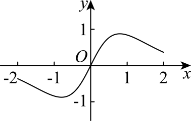

# Mathematics - 题目 3590

**ID**: ae57ac444bf24979875691f56efa41b4
**年级**: Grade 11
**难度**: Easy
**题型**: Multiple-choice

## 题目
如图是下列四个函数中的某个函数在区间 $[-2,2]$ 的大致图象，则该函数是（      ）​​​​​​​‌

## 解答

1. 当 $x=1$ 时，由图象可得 $f\left ({1}\right )>0$ ，而C，D中 $f\left ({1}\right )=0$ ，故排除C，D；
2. 当 $x=-1$ 时，由图象可得 $f\left ({-1}\right )<0$ ，而B中 $f\left ({-1}\right )=\frac {-2\sin \left ({-1}\right )}{2}=\sin 1>0$ ，故排除B；
3. 故选A.

## 知识点

**中文**:
  - 函数图象的识别

**English**:
  - Recognition of Function Graphs

---
