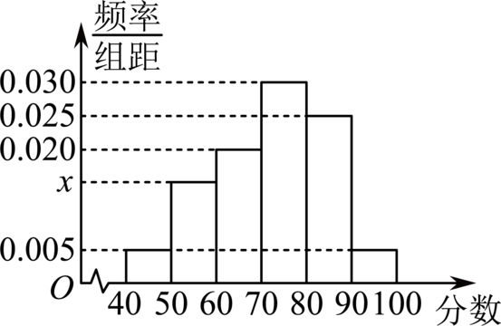

# Mathematics - 题目 116

**ID**: 26f96be2287a44b087680a9b2f27afc4
**年级**: Grade 11
**难度**: Easy
**题型**: Multiple-select

## 题目
某校对参加高校综合评价测试的学生进行模拟训练，从中抽出 $\mathbf{N}$ 名学生，其数学成绩的频率分布直方图如图所示．已知成绩在区间 $[90,100]$ 内的学生人数为2人．则（      ）​​​​​​​‌

## 解答

1. ①由图可知， $f{{}_{\left [{40,50}\right )}}=0.05$ ， $f{{}_{\left [{50,60}\right )}}=10x$ ， $f{{}_{\left [{60,70}\right )}}=0.2$ ，
2. $f{{}_{\left [{70,80}\right )}}=0.3$ ， $f{{}_{\left [{80,90}\right )}}=0.25$ ， $f{{}_{\left [90,100\right ]}}=0.05$ ，
3. 由频率之和为1可得 $10x=0.15$ ，故 $x=0.015$ ；
4. ②因为 $f{{}_{\left [90,100\right ]}}=\frac {2}{N}=0.05$ ，所以 $N=40$ ；
5. ③由图可知，众数为75；
6. ④平均数为 $45\times 0.05+55\times 0.15+65\times 0.2+75\times 0.3+85\times 0.25+95\times 0.05=72$ ；
7. ⑤ $f{{}_{\left [{40,50}\right )}}+f{{}_{\left [{50,60}\right )}}+f{{}_{\left [{60,70}\right )}}=0.4$ ，所以中位数位于区间 $\left [{70,80}\right )$ ，
8. 设中位数为 $a$ ，则 $(a-70)\times 0.03=0.1$ ，解得 $a=73.33$ ；
9. 综上所述，AB正确，而C错误；
10. 样本可以估计总体，但是不能通过样本直接确定总体，样本与总体之间总是存在一定的偏差，故选项D错误.
11. 故选AB

## 知识点

**中文**:
  - 中位数
  - 频率分布直方图
  - 众数
  - 平均数

**English**:
  - Median
  - Frequency Distribution Histogram
  - Mode
  - Mean

---
