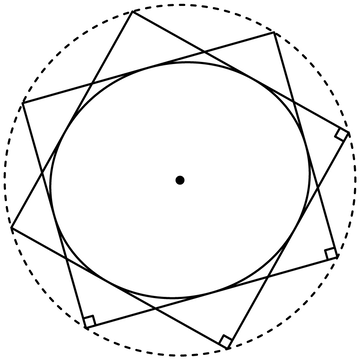

# Mathematics - 题目 1030

**ID**: cedbc75815e548c29e3b9623aca38332
**年级**: Grade 11
**难度**: Hard
**题型**: Multiple-select

## 题目
法国著名数学家加斯帕尔•蒙日在研究圆锥曲线时发现：椭圆的任意两条互相垂直的切线的交点 $Q$ 的轨迹是以坐标原点为圆心， $\sqrt {a{^{2}}+b{^{2}}}$ 为半径的圆，这个圆称为蒙日圆.​​​​​​​‌若矩形 $G$ 的四边均与椭圆 $C:\frac {x{^{2}}}{5}+\frac {y{^{2}}}{4}=1$ 相切，则下列说法正确的是（      ）

## 解答

1. 解：对于A，椭圆 $\frac {x{^{2}}}{a{^{2}}}+\frac {y{^{2}}}{b{^{2}}}=1(a>b>0)$ 的四个顶点处的切线，
2. 恰好围成长、宽分别为 $2a$ 和 $2b$ 的矩形，蒙日圆为此矩形的外接圆，半径 $r=\sqrt {a{^{2}}+b{^{2}}}$ ，
3. 故椭圆 $C:\frac {x{^{2}}}{5}+\frac {y{^{2}}}{4}=1$ 的蒙日圆方程为 $x{^{2}}+y{^{2}}=9$ ，故A正确；
4. 对于B，由题意可知正方形 $G$ 是圆 $x{^{2}}+y{^{2}}=9$ 的内接正方形，
5. 设正方形 $G$ 的边长为 $m$ ，可得 $m{^{2}}+m{^{2}}=(2\times 3){^{2}}$ ，解得 $m=3\sqrt {2}$ ，
6. 即正方形 $G$ 的边长为 $3\sqrt {2}$ ，故B正确；
7. 对于 C，由题意可得 $HP\bot HQ$ ，则 $PQ$ 为圆 $x{^{2}}+y{^{2}}=9$ 的一条直径，
8. 则 $|PQ|=2r=6$ ，由勾股定理可得 $|HP|{^{2}}+|HQ|{^{2}}=|PQ|{^{2}}=36$ ，
9. 所以 $S{{}_{\vartriangle MPQ}}=\frac {1}{2}\left |{HP}\right |\cdot \left |{HQ}\right |\leqslant \frac {\left |{HP|{^{2}}+}\right |HQ|{^{2}}}{4}=9$
10. 当且仅当 $|HP|=|HQ|=3\sqrt {2}$ 时，等号成立，
11. 因此， $\vartriangle MPQ$ 面积的最大值为9，故 C错误；
12. 对于 D，过直线 $l:x+2y-3=0$ 上一点 $P$ 作椭圆 $C$ 的两条切线，切点分别为 $M$ ， $N$ ，
13. 当 $∠MPN$ 为直角时，点 $P$ 在椭圆 $C$ 的蒙日圆上，
14. 即为直线 $l:x+2y-3=0$ 与圆 $x{^{2}}+y{^{2}}=9$ 的交点，
15. 由 $\begin{cases}x+2y-3=0\\x{^{2}}+y{^{2}}=9\end{cases}$ ，解得 $\begin{cases}x=3\\y=0\end{cases}$ 或 $\begin{cases}x=-\frac {9}{5}\\y=\frac {12}{5}\end{cases}$ ，
16. 即点 $P$ 的坐标为 $(3,0)$ 或 $\left ({-\frac {9}{5},\frac {12}{5}}\right )$ ，
17. 则直线 $OP$ （ $O$ 为坐标原点）的斜率为0或 $-\frac {4}{3}$ ，故 D正确.
18. 故选：ABD.

## 知识点

**中文**:
  - 与圆有关的轨迹问题
  - 圆的标准方程
  - 直线与圆的位置关系的判断

**English**:
  - Locus Problems involving Circles
  - Standard Equation of a Circle
  - Determining Line-Circle Relationship

---
