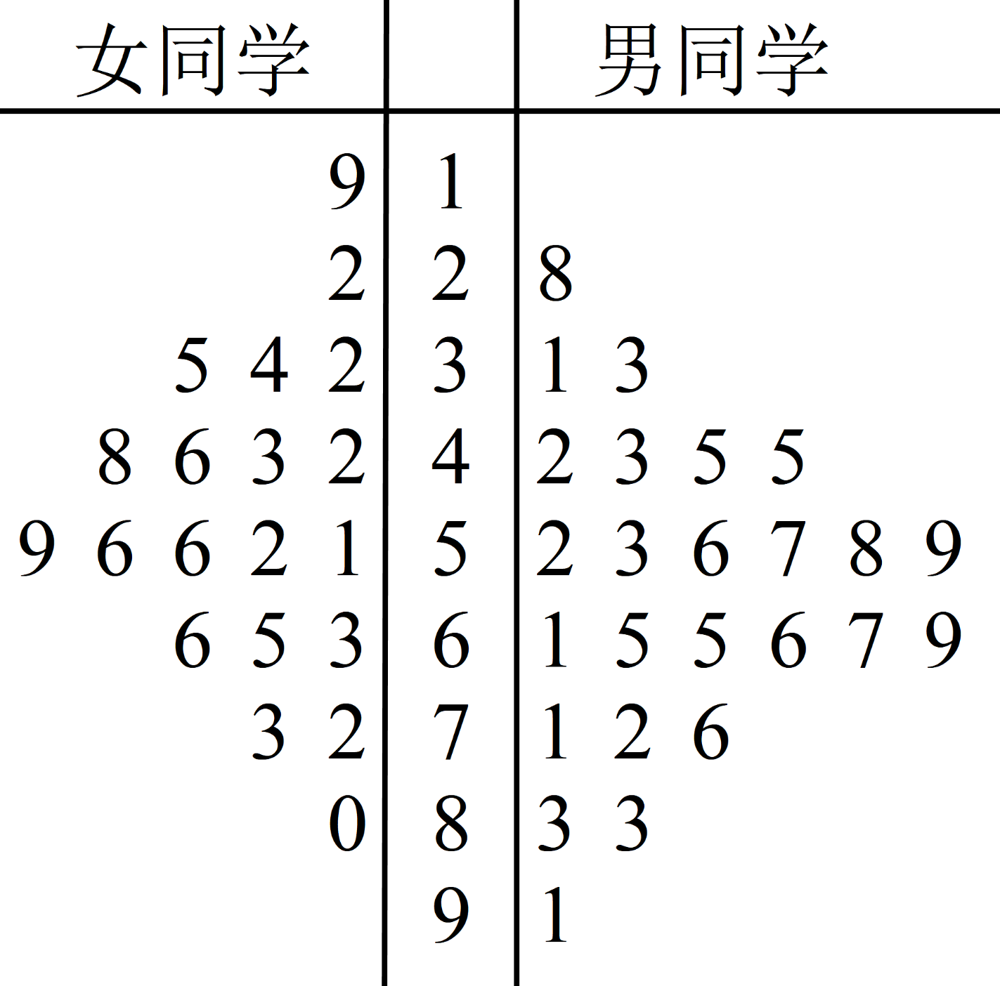
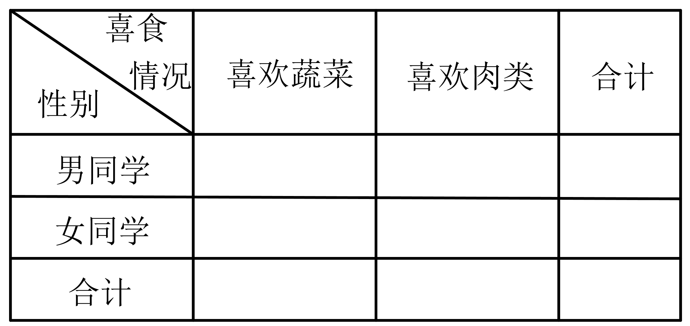

# Mathematics - 题目 3459

**ID**: 06cb124e30d64ef9a7c94db503abc1a0
**年级**: Grade 11
**难度**: Medium
**题型**: Calculation

## 题目
某课题组对全班45名同学的饮食习惯进行了一次调查，并用茎叶图表示45名同学的饮食指数，说明：下图中饮食指数低于70的人被认为喜食蔬菜，饮食指数不低于70的人被认为喜食肉类.​​​​​​​‌（1）根据茎叶图，完成下面 $2\times 2$ 列联表，并判断是否有90%的把握认为喜食蔬菜还是喜食肉类与性别有关，说明理由；（2）根据饮食指数在 $[10,39]$ ， $[40,69]$ ， $[70,99]$ 进行分层抽样，从全班同学中抽取15名同学进一步调查，记抽取的喜食肉类的女同学为 $ξ$ ，求 $ξ$ 的分布列和数学期望 $Eξ$ .下面公式及临界值表仅供参考： $χ{^{2}}=\frac {n(ad-bc){^{2}}}{(a+b)(c+d)(a+c)(b+d)}$$P\left ({χ{^{2}}\geqslant k}\right )$0.1000.0500.010$k$2.7063.8416.635

## 解答

1. （1） $2\times 2$ 列联表：
2. 
3. 由公式： $χ{^{2}}=\frac {n(ad-bc){^{2}}}{(a+b)(c+d)(a+c)(b+d)}=\frac {45\times {\left({19\times 3-6\times 17}\right)^{2}}}{\left ({19+6}\right )\times \left ({17+3}\right )\times \left ({19+17}\right )\times \left ({6+3}\right )}=0.5625\leqslant 2.706$ ，因此没有90%的把握认为喜食蔬菜还是喜食肉类与性别有关；
4. （2）因为从喜食肉类同学中抽取： $9\times \frac {15}{45}=3$ 人，所以 $ξ$ 可能取值有 $0,1,2,3$ ，
5. $P(ξ=0)=\frac {{\rm C}{_{6}^{3}}}{{\rm C}{_{9}^{3}}}=\frac {5}{21}$ ， $P(ξ=1)=\frac {{\rm C}{_{6}^{2}}{\rm C}{_{3}^{1}}}{{\rm C}{_{9}^{3}}}=\frac {15}{28}$ ，
6. $P(ξ=2)=\frac {{\rm C}{_{6}^{1}}{\rm C}{_{3}^{2}}}{{\rm C}{_{9}^{3}}}=\frac {3}{14}$ ， $P(ξ=3)=\frac {{\rm C}{_{3}^{3}}}{{\rm C}{_{9}^{3}}}=\frac {1}{84}$ ，
7. $\therefore ξ$ 的分布列是：
8. $ξ$
9. 0
10. 1
11. 2
12. 3
13. $P$
14. $\frac {5}{21}$
15. $\frac {15}{28}$
16. $\frac {3}{14}$
17. $\frac {1}{84}$
18. $\therefore $ 数学期望 $E\left ({ξ}\right )=0\times \frac {5}{21}+1\times \frac {15}{28}+2\times \frac {3}{14}+3\times \frac {1}{84}=1$ ．

## 知识点

**中文**:
  - 独立性检验的应用
  - 离散型随机变量的分布列
  - 茎叶图

**English**:
  - Applications of Independence Test
  - Probability Distribution Table
  - Stem-and-Leaf Plot

---
