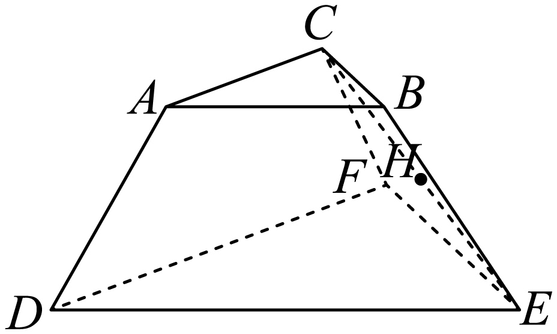

# Mathematics - 题目 1994

**ID**: 397120fba03c41c698f76cd8ca530960
**年级**: Grade 11
**难度**: Medium
**题型**: Calculation

## 题目
如图，几何体 $ABC-DEF$ 为正三棱台，且 $\overrightarrow {{DE}}=2\overrightarrow {{AB}}$ ，点 $G$ 满足 $\overrightarrow {{FG}}=\frac {1}{2}\overrightarrow {{FD}}+\frac {1}{2}\overrightarrow {{FE}}$ ．（1）证明： $AG{\rm{/}}{\rm{/}}$ 平面 $CFEB$ ．（2）若 $H$ 为 $CE$ 的中点，证明：平面 $BGH{\rm{/}}{\rm{/}}$ 平面 $ADFC$ ．​​​​​​​‌

## 解答

1. （1）因为 $\overrightarrow {{FG}}=\frac {1}{2}\overrightarrow {{FD}}+\frac {1}{2}\overrightarrow {{FE}}$ ，所以 $G$ 为 $DE$ 的中点．
2. 连接 $AG$ ．因为 $\overrightarrow {{DE}}=2\overrightarrow {{AB}}$ ，所以 $\overrightarrow {{GE}}=\overrightarrow {{AB}}$ ，
3. 则 $AGEB$ 为平行四边形，所以 $AG{\rm{/}}{\rm{/}}BE$ ．
4. 又 $AG\not\subset $ 平面 $CFEB,BE\subset $ 平面 $CFEB$ ，所以 $AG{\rm{/}}{\rm{/}}$ 平面 $CFEB$ ．
5. （2）连接 $CD$ ．因为 $G,H$ 分别为 $DE,CE$ 的中点，所以 $CD{\rm{/}}{\rm{/}}GH$ ，
6. 又 $GH\not\subset $ 平面 $ADFC,CD\subset $ 平面 $ADFC$ ，所以 $GH{\rm{/}}{\rm{/}}$ 平面 $ADFC$ ．
7. 因为 $G$ 为 $DE$ 的中点， $\overrightarrow {{DE}}=2\overrightarrow {{AB}}$ ，所以 $\overrightarrow {{DG}}=\overrightarrow {{AB}}$ ，
8. 所以 $ADGB$ 为平行四边形，所以 $AD{\rm{/}}{\rm{/}}BG$ ．
9. 又 $BG\not\subset $ 平面 $ADFC,AD\subset $ 平面 $ADFC$ ，所以 $BG{\rm{/}}{\rm{/}}$ 平面 $ADFC$ ．
10. 因为 $BG\cap GH=G$ ，所以平面 $BGH{\rm{/}}{\rm{/}}$ 平面 $ADFC$ ．
11. 

## 知识点

**中文**:
  - 平面与平面平行的判定
  - 直线与平面平行的判定

**English**:
  - Plane-Plane Parallelism Determination
  - Line-Plane Parallelism Determination

---
