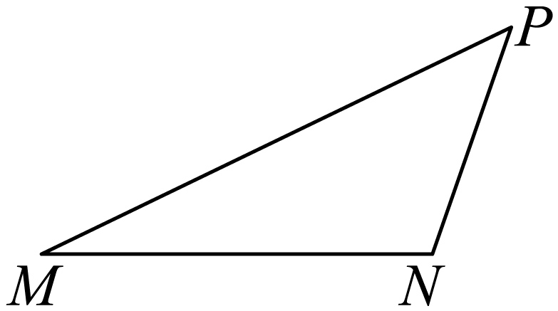

# Mathematics - 题目 2442

**ID**: 787717e32a5c43338eb5a23fba2f4235
**年级**: Grade 11
**难度**: Medium
**题型**: Calculation

## 题目
如图，在面积为 $1$ 的 $\vartriangle PMN$ 中， ${\tan}M=\frac {1}{2}$ ， ${\tan}N=-2．$ 建立适当的坐标系，求出以 $M$ ， $N$ 为焦点且过点 $P$ 的椭圆的方程和离心率 $．$​​​​​​​‌

## 解答

1. 
2. 如图所示：以 $MN$ 所在直线为 $x$ 轴，以 $MN$ 的垂直平分线为 $y$ 轴建立直角坐标系，
3. 设以 $M，N$ 为焦点且过点 $P$ 的椭圆方程为  $\frac {x{^{2}}}{a{^{2}}}+\frac {y{^{2}}}{b{^{2}}}=1$ （ $a>b>0$ ）， $M\left ({-c,0}\right ),N\left ({c,0}\right )$ ，
4. 由 ${\rm{t}}{\rm{a}}{\rm{n}}M=\frac {1}{2}，{\rm{t}}{\rm{a}}{\rm{n}}\angle PNx=2$ ，
5. 可得直线 $PM$ 和直线 $PN$ 的方程分别为 $y=\frac {1}{2}\left ({x+c}\right )$ 和 $y=2\left ({x-c}\right )$ ，
6. 将两方程联立可得 $x=\frac {5}{3}c$ ， $y=\frac {4}{3}c$ ，即 $P\left ({\frac {5}{3}c,\frac {4}{3}c}\right )$ ，
7. 则 $S{{}_{\vartriangle PMN}}=\frac {1}{2}\left |{MN}\right |\cdot y{{}_{P}}=\frac {1}{2}\cdot 2c\cdot \frac {4}{3}c=\frac {4}{3}c{^{2}}=1$ ，
8. 解得 $c=\frac {\sqrt {3}}{2}$ ，
9. 则 $M\left ({-\frac {\sqrt {3}}{2},0}\right ),N\left ({\frac {\sqrt {3}}{2},0}\right )$ ， $P\left ({\frac {5\sqrt {3}}{6},\frac {2\sqrt {3}}{3}}\right )$ ，
10. 则 $\left |{PM}\right |=\sqrt {{\left({\frac {5\sqrt {3}}{6}+\frac {\sqrt {3}}{2}}\right)^{2}}+{\left({\frac {2\sqrt {3}}{3}}\right)^{2}}}=\frac {2\sqrt {15}}{3}$ ， $\left |{PN}\right |=\sqrt {{\left({\frac {5\sqrt {3}}{6}-\frac {\sqrt {3}}{2}}\right)^{2}}+{\left({\frac {2\sqrt {3}}{3}}\right)^{2}}}=\frac {\sqrt {15}}{3}$ ，
11. $a=\frac {\left |{PM}\right |+\left |{PN}\right |}{2}=\frac {\sqrt {15}}{2}$ ， $b{^{2}}=a{^{2}}-c{^{2}}=\frac {15}{4}-\frac {3}{4}=3$ ．
12. 所求椭圆方程为 $\frac {4x{^{2}}}{15}+\frac {y{^{2}}}{3}=1$ ，离心率 ${\rm{e}}=\frac {c}{a}=\frac {\sqrt {5}}{5}．$

## 知识点

**中文**:
  - 椭圆的离心率

**English**:
  - Eccentricity

---
