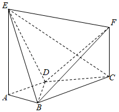

# Mathematics - 题目 1064

**ID**: c5c91e4998a24e7cb1582c4345912346
**年级**: Grade 11
**难度**: Medium
**题型**: Calculation

## 题目
如图， $AE\bot $ 平面 $ABCD$ ， $CF//AE$ ， $AD//BC$ ， $AD⊥AB$ ， $AB=AD=2$ ， $AE=BC=2CF{\rm{=}}4$ ．（1）求证： $BF//$ 平面 $ADE$ ；​​​​​​​‌（2）求平面 $ADE$ 与平面 $BDF$ 夹角的余弦值；（3）求四面体 $B-DEF$ 的体积．

## 解答

1. （1）因为 $AE\bot $ 平面 $ABCD$ ，且 $AB、AD\subset $ 平面 $ABCD$ ，
2. 所以 $AE\bot AB$ ， $AE\bot AD$ ，又 $AD⊥AB$ ，
3. 则以A为原点，分别以 $\overrightarrow {{AB}},\overrightarrow {{AD}},\overrightarrow {{AE}}$ 的方向为x轴，y轴，z轴正方向建立空间直角坐标系 $A-xyz$  (如图)，
4. 
5. 则 $A\left ({0,0,0}\right ),B\left ({2,0,0}\right ),C\left ({2,4,0}\right ),D\left ({0,2,0}\right ),E\left ({0,0,4}\right )$ ， $F\left ({2,4,2}\right )$ ．
6. 因为 $AE\bot AB$ ， $AD⊥AB$ ，
7. 又 $AD\cap AE=A,AD,AE\subset $ 平面 $ADE$ ，
8. 所以 $AB\bot $ 平面 $ADE$ ，
9. 故 $\overrightarrow {{AB}}=\left ({2,0,0}\right )$ 是平面 $ADE$ 的一个法向量，
10. 又 $\overrightarrow {{BF}}=\left ({0,4,2}\right )$ ，所以 $\overrightarrow {{BF}}\cdot \overrightarrow {{AB}}=0$ ，
11. 又因为 $BF\not\subset $ 平面 $ADE$
12. 所以 $BF//$ 平面 $ADE$ ．
13. （2）设 $\overrightarrow m=\left ({x,y,z}\right )$ 为平面 $BDF$ 的一个法向量，
14. 则 $\begin{cases}\overrightarrow m\cdot \overrightarrow {{BD}}=0\\\overrightarrow m\cdot \overrightarrow {{BF}}=0\end{cases}$ ，
15. 又 $\overrightarrow {{BD}}=\left ({-2,2,0}\right )$ ，  $\overrightarrow {{BF}}=\left ({0,4,2}\right )$ ，
16. 所以 $\begin{cases}-2x+2y=0\\4y+2z=0\end{cases}$ ，
17. 令 $y=1$ ，可得 $\overrightarrow m=\left ({1,1,-2}\right )$ ．
18. 又因为 $\overrightarrow {{AB}}=\left ({2,0,0}\right )$ 是平面 $ADE$ 的一个法向量，
19. 设平面 $ADE$ 与平面 $BDF$ 夹角为 $θ$ ，
20. 则 ${\cos}θ=\left |{{\cos}\left \langle {\overrightarrow {{AB}},\overrightarrow m}\right \rangle }\right |=\left |{\frac {\overrightarrow {{AB}}\cdot \overrightarrow m}{\left |{\overrightarrow {{AB}}}\right |\times \left |{\overrightarrow m}\right |}}\right |=\frac {1\times 2}{2\times \sqrt {1{^{2}}+1{^{2}}+{\left({-2}\right)^{2}}}}=\frac {\sqrt {6}}{6}$ ，
21. 所以平面 $ADE$ 与平面 $BDF$ 夹角的余弦值为 $\frac {\sqrt {6}}{6}$ ．
22. （3）因为 $\overrightarrow {{EB}}=\left ({2,0,-4}\right )$ ，平面 $BDF$ 的一个法向量 $\overrightarrow m=\left ({1,1,-2}\right )$ ，
23. 所以点E到平面 $BDF$ 的距离 $d=\left |{\frac {\overrightarrow {{EB}}\cdot \overrightarrow m}{\left |{\overrightarrow m}\right |}}\right |=\left |{\frac {1\times 2+4\times 2}{\sqrt {6}}}\right |=\frac {5\sqrt {6}}{3}$  ，
24. 因为 $AD⊥AB$ ， $AB=AD=2$ ，
25. 又 $AE\bot $ 平面 $ABCD$ ， $CF//AE$ ，则 $CF\bot $ 平面 $ABCD$ ，
26. 又 $BC、CD\subset $ 平面 $ABCD$ ，
27. 所以 $CF\bot BC$ ， $CF\bot CD$ ，
28. 又 $AD//BC$ ， $AE=BC=2CF{\rm{=}}4$ ，
29. 则 $DC{^{2}}=2{^{2}}+{\left({4-2}\right)^{2}}=8$ ，
30. 在 $\vartriangle BDF$ 中： $BD=\sqrt {AD{^{2}}+AB{^{2}}}=2\sqrt {2}$ ，
31. $BF=\sqrt {BC{^{2}}+CF{^{2}}}=2\sqrt {5}$ ，  $DF=\sqrt {DC{^{2}}+CF{^{2}}}=2\sqrt {3}$ ，
32. 所以 $BD{^{2}}+DF{^{2}}=BF{^{2}}$ ，所以 $\angle BDF=90{^{\circ }}$ ，
33. 所以 $S{{}_{ΔBDF}}=\frac {1}{2}BD\cdot DF=2\sqrt {6}$ ，
34. 所以四面体 $B-DEF$ 体积 $V{{}_{B-DEF}}=V{{}_{E-BDF}}=\frac {1}{3}S{{}_{{\rm{Δ}}BDF}}\cdot d=\frac {20}{3}$ .

## 知识点

**中文**:
  - 向量法求二面角
  - 棱柱、棱锥、棱台的体积
  - 用向量证明平行问题

**English**:
  - Dihedral Angle
  - Volume of Polyhedra
  - Proving Parallelism

---
