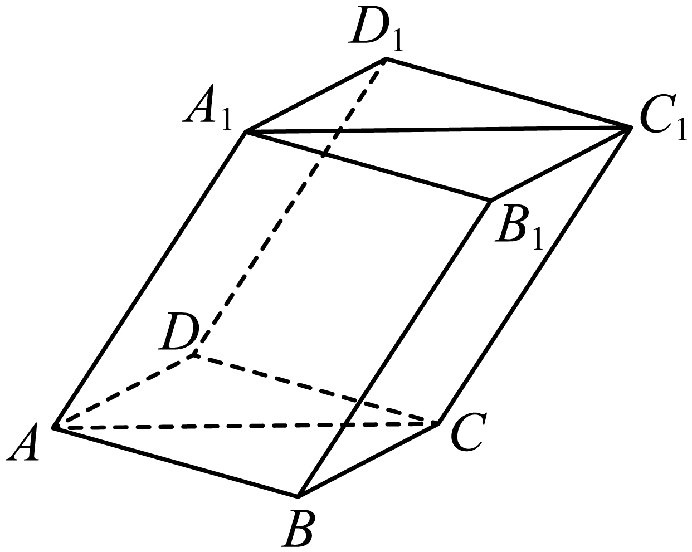

# Mathematics - 题目 2105

**ID**: e8f29d0ffe214101ac548d4df7f2b27c
**年级**: Grade 11
**难度**: Medium
**题型**: Calculation

## 题目
如图，平行六面体 $ABCD-A{{}_{1}}B{{}_{1}}C{{}_{1}}D{{}_{1}}$ 的体积为6，截面 $ACC{{}_{1}}A{{}_{1}}$ 的面积为6．(1)求点 $B$ 到平面 $ACC{{}_{1}}A{{}_{1}}$ 的距离；​​​​​​​‌(2)若 $AB=AD=2,\angle BAD=60{}^\circ $ ， $AA{{}_{1}}=\sqrt {6}$ ，求直线 $BD{{}_{1}}$ 与平面 $CC{{}_{1}}D{{}_{1}}D$ 所成角的正弦值．

## 解答

1. （1）在平行六面体 $ABCD-A{{}_{1}}B{{}_{1}}C{{}_{1}}D{{}_{1}}$ 中， $ABC-A{{}_{1}}B{{}_{1}}C{{}_{1}}$ 是三棱柱，
2. $V{{}_{B-ACC{{}_{1}}A{{}_{1}}}}=\frac {2}{3}V{{}_{ABC-A{{}_{1}}B{{}_{1}}C{{}_{1}}}}=\frac {1}{3}V{{}_{ABCD-A{{}_{1}}B{{}_{1}}C{{}_{1}}D{{}_{1}}}}=2$ ，
3. 设点 $B$ 到平面 $ACC{{}_{1}}A{{}_{1}}$ 的距离为 $d$ ，则 $V{{}_{B-ACC{{}_{1}}A{{}_{1}}}}=\frac {1}{3}S{{}_{ACC{{}_{1}}A{{}_{1}}}}\cdot d=\frac {1}{3}\times 6d=2$ ，所以 $d=1$ ，
4. 即点 $B$ 到平面 $ACC{{}_{1}}A{{}_{1}}$ 的距离为1．
5. （2）在 $▱ABCD$ 中， $AB=AD=2,\angle BAD=60{}^\circ $ ，所以 $ABCD$ 是菱形，连接 $BD$ 交 $AC$ 于 $O$ ，则 $BO=1$ ，
6. 由（1）知点 $B$ 到平面 $ACC{{}_{1}}A{{}_{1}}$ 的距离为1，所以 $BO⊥$ 平面 $ACC{{}_{1}}A{{}_{1}}$ ．
7. 设点 $A{{}_{1}}$ 在直线 $AC$ 上射影为点 $H,S{{}_{▱ACC{{}_{1}}A{{}_{1}}}}=AC\cdot A{{}_{1}}H=2\sqrt {3}A{{}_{1}}H=6$ ，
8. 则 $A{{}_{1}}H=\sqrt {3}$ ，且 $BO\bot A{{}_{1}}H,AH=\sqrt {A{\rm A}{_{1}^{2}}-A{{}_{1}}H{^{2}}}=\sqrt {(\sqrt {6}){^{2}}-(\sqrt {3}){^{2}}}=\sqrt {3}$ ，
9. 所以 $O$ 和 $H$ 重合，即 $A{{}_{{\rm{1}}}}O⊥AO$ ．
10. 以 $O$ 为坐标原点， $OA,OB,OA{{}_{1}}$ 分别为 $x$ 轴， $y$ 轴， $z$ 轴，建立空间直角坐标系，
11. 则 $B(0,1,0),A(\sqrt {3},0,0),D(0,-1,0),A{{}_{1}}(0,0,\sqrt {3})$ ，
12. 根据 $\overrightarrow {{AA{{}_{1}}}}=\overrightarrow {{DD{{}_{1}}}}=(-\sqrt {3},0,\sqrt {3}),\overrightarrow {{AB}}=\overrightarrow {{DC}}=(-\sqrt {3},1,0)$ ，则 $D{{}_{1}}(-\sqrt {3},-1,\sqrt {3})$ ，
13. $\overrightarrow {{BD{{}_{1}}}}=(-\sqrt {3},-2,\sqrt {3})$ ，设平面 $CC{{}_{1}}D{{}_{1}}D$ 的一法向量为 $\overrightarrow n=(x,y,z)$ ，
14. 则 $\begin{cases}\overrightarrow {{DD{{}_{1}}}}\cdot \overrightarrow n=-\sqrt {3}x+\sqrt {3}z=0\\\overrightarrow {{DC}}\cdot \overrightarrow n=-\sqrt {3}x+y=0\end{cases}$ ，取 $x=1$ ，则 $\overrightarrow n=(1,\sqrt {3},1)$ ，
15. 设直线 $BD{{}_{1}}$ 与平面 $CC{{}_{1}}D{{}_{1}}D$ 所成角为 $α$ ，则 ${\rm{s}}{\rm{i}}{\rm{n}}α=\left |{{\rm{c}}{\rm{o}}{\rm{s}}\left \langle {\overrightarrow {{BD{{}_{1}}}},\overrightarrow n}\right \rangle }\right |=\left |{\frac {\overrightarrow {{BD{{}_{1}}}}\cdot \overrightarrow n}{\left |{\overrightarrow {{BD{{}_{1}}}}}\right ||\overrightarrow n|}}\right |=\left |{\frac {-\sqrt {3}-2\sqrt {3}+\sqrt {3}}{\sqrt {10}\times \sqrt {5}}}\right |=\frac {\sqrt {6}}{5}$ ，
16. 所以直线 $BD{{}_{1}}$ 与平面 $CC{{}_{1}}D{{}_{1}}D$ 所成角正弦值为 $\frac {\sqrt {6}}{5}$ ．
17. 

## 知识点

**中文**:
  - 向量法求线面角
  - 点与面之间的距离

**English**:
  - Line-Plane Angle
  - Point-Plane Distance

---
