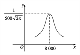

# Mathematics - 题目 3817

**ID**: f2986cdbd11847e6b2b5045f69306aff
**年级**: Grade 11
**难度**: Medium
**题型**: Calculation

## 题目
已知某地农民工年均收入X服从正态分布，其概率密度函数图象如图所示．(1)写出此地农民工年均收入的概率密度函数的表达式；​​​​​​​‌(2)求此地农民工年均收入在8 000～8 500元之间的人数所占的百分比．

## 解答

1. 设农民工年均收入X～N(μ，σ^{2})，结合题图可知，μ＝8 000，σ＝500.
2. (1)此地农民工年均收入的正态分布的概率密度函数表达式为
3. φ_{μ}_{，}_{σ}(x)＝e＝e，x∈(－∞，＋∞)．
4. (2)因为P(7 500<X<8 500)＝P(8 000－500<X<8 000＋500)≈0.683.
5. 所以P(8 000<X⩽8 500)＝P(7 500<X⩽8 500)≈0.341 5＝34.15%.
6. 即农民工年均收入在8 000～8 500元之间的人数所占的百分比约为34.15%.

## 知识点

**中文**:
  - 正态分布
  - 正态曲线及其特点

**English**:
  - Normal Distribution
  - Normal Curve and Characteristics

---
